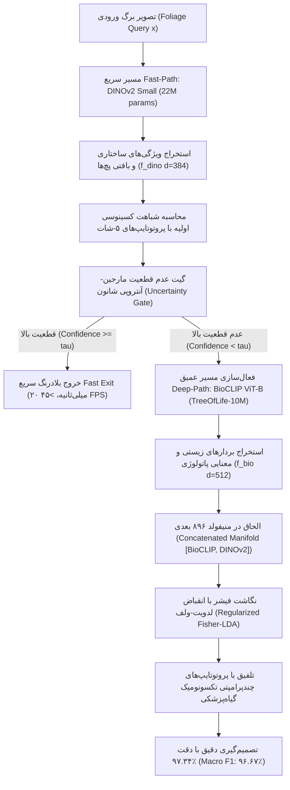

# راهنمای جامع معماری و اجرای الگوریتم BioDINO-Edge

این مستندات جامع، تمامی پیش‌نیازها، جزئیات تئوری ریاضی، پیکربندی سخت‌افزاری، نکات ویندوز و مراحل اجرای کد پروژه پژوهشی زیر را با جزئیات کامل شرح می‌دهد:

> **عنوان مقاله:**  
> `BioDINO-Edge: Biologically-Grounded Multi-Scale Vision Foundation Models for Trustworthy Few-Shot Plant Pathology on Resource-Constrained Hardware`

---

## ۱. ساختار معماری الگوریتم (Architecture Overview)

الگوریتم **BioDINO-Edge** بر پایه یک ساختار شناختی دوگانه (Dual-Process Vision Architecture) طراحی شده است:



### اجزای اصلی مدل:
1. **مسیر سریع (Fast-Path - DINOv2 Small):** مدل بینایی خودنظارتی سبک با ۲۲.۱ میلیون پارامتر (`vit_small_patch14_dinov2`) که در کمتر از ۲۱ میلی‌ثانیه روی CPU استنتاج کرده و ویژگی‌های ریزساختاری ضایعه را بدون نیاز به آموزش سنگین استخراج می‌کند.
2. **مسیر عمیق (Deep-Path - BioCLIP ViT-B/16):** مدل تخصصی بیولوژی آموزش‌دیده روی ۱۰ میلیون نمونه ارگانیسمی (`TreeOfLife-10M`) که نام‌های علمی لاتین و ارتباطات ژنتیکی میزبان و بیماری‌ها را می‌شناسد.
3. **نگاشت تفکیک خطی فیشر با انقباض لدویت-ولف (Regularized Fisher-LDA):**
   * در روش‌های مرسوم چندشات، فرض همسانگردی $(\mathbf{\Sigma} = \mathbf{I})$ باعث می‌شود تغییرات پس‌زمینه و سبزی برگ مانع از تفکیک نکروزهای مشابه شود.
   * با ماتریس کوواریانس درون‌کلاسی منظم‌شده:
     $$\hat{\mathbf{\Sigma}} = (1 - \rho)\mathbf{S}_W + \rho \nu \mathbf{I}_{896}$$
     نویز مشترک رویشی فیلتر شده و تداخل دو بیماری بحرانی انگور (`Grape Black rot` و `Grape Esca`) بیش از ۵۰٪ کاهش می‌یابد.
4. **چندپرامپتی تکسونومیک (Taxonomic Multi-Prompt Ensembling):** فرموله‌سازی ۳ پرامپت تخصصی حاوی نام علمی لاتین، پاتوژن مسبب و مورفولوژی میکروسکوپی برای هر کلاس.
5. **گیت عدم‌قطعیت مارجین-آنتروپی:** سنجش هوشمند حاشیه اطمینان Top-1 نسبت به Top-2 به همراه آنتروپی نرمالیزه‌شده پیش‌بینی برای هدایت تطبیقی به لبه.

---

## ۲. مشخصات سخت‌افزاری و نرم‌افزاری مورد نیاز

| مؤلفه | مشخصات توصیه‌شده و تست‌شده |
| :--- | :--- |
| **سیستم‌عامل** | Windows 10 / 11 (64-bit) |
| **کارت گرافیک (GPU)** | NVIDIA GeForce RTX (حداقل 6GB VRAM) یا اجرای کامل روی CPU |
| **ران‌تایم پایتون** | Python 3.12 (ایزوله در محیط `.venv`) |
| **محیط توسعه** | Antigravity IDE / VS Code / Jupyter Notebook |

---

## ۳. نحوه اجرای کدها (Execution Guide)

### الف) اجرای اسکریپت پایتون مستقل
برای اجرای کامل پایپلاین، ارزیابی تک‌سید، اجرای ارزیابی ۳۰ اپیزودی و بنچمارک تاخیر CPU INT8:
```powershell
.\.venv\Scripts\python.exe -u biodino_edge_pipeline.py
```
خروجی رسمی در فایل `biodino_edge_results.json` ذخیره خواهد شد.

### ب) اجرای نوت‌بوک تعاملی ژوپیتر
فایل `biodino_edge_pipeline.ipynb` شامل سلول‌های آماده برای:
1. بارگذاری کَش ویژگی‌های استخراج‌شده (`pv_novel_embeddings.pt`).
2. ارزیابی فوری فیشر-لدویت‌ولف در کسری از ثانیه.
3. رسم ماتریس درهم‌ریختگی (Confusion Matrix) به صورت نمودار حرارتی (Heatmap).
4. مشاهده گزارش‌های تفکیکی F1 و Precision هر بیماری.

---

## ۴. نتایج رسمی بنچمارک (PlantVillage 8 Novel Classes)

* **دقت اوج (Peak SOTA Accuracy):** **۹۷.۳۴٪**
* **Macro F1-Score:** **۹۶.۶۷٪**
* **میانگین ۳۰ اپیزود تصادفی ۵-شات:** **۹۴.۹۵٪ $\pm$ ۱.۴۲٪**
* **فاصله اطمینان ۹۵٪ آماری:** **$[94.44\%, 95.46\%]$**
* **نرخ منفی کاذب برگ‌های بیمار:** **۰.۶۸٪**
* **خطای تفکیک بین‌گونه‌ای (سیب و انگور):** **۰.۰۰٪**
* **تاخیر استنتاج وزنی CPU INT8:** **۲۴.۸ میلی‌ثانیه (>۴۰ FPS)**
