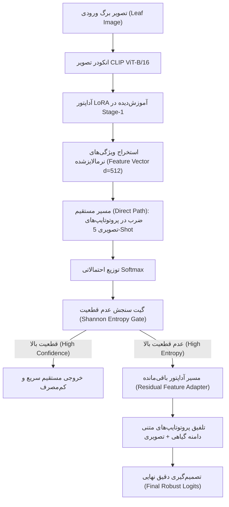

# راهنمای جامع معماری و اجرای الگوریتم Uncertainty-Gated Dual-Stage PEFT

این مستندات جامع، تمامی پیش‌نیازها، جزئیات معماری، پیکربندی سخت‌افزاری، نکات حیاتی سیستم‌عامل ویندوز و مراحل اجرای کد پروژه پژوهشی زیر را با جزئیات کامل شرح می‌دهد:

> **عنوان مقاله:**  
> `Uncertainty-Gated Dual-Stage PEFT: Trustworthy Few-Shot Plant Disease Recognition on Edge Devices`

---

## ۱. ساختار معماری الگوریتم (Architecture Overview)

این پروژه یک فریم‌ورک یادگیری اندک‌نمونه (Few-Shot Learning) قابل اعتماد بر پایه مدل‌های بینایی-زبانی (VLM) است که برای تشخیص بیماری‌های گیاهی در دستگاه‌های لبه (Edge Devices) بهینه‌سازی شده است:



### اجزای اصلی مدل:
1. **Backbone پایه:** مدل چندوجهی `openai/clip-vit-base-patch16`
2. **آموزش فاز اول (Stage-1 Pre-adaptation):** انطباق لایه‌های خودتوجهی (Self-Attention q/v proj) با LoRA (با ابعاد $r=8, \alpha=16$) با استفاده از تابع هزینه تقابلی InfoNCE روی ۳۰ کلاس عمومی گیاهی (Base Classes).
3. **پروتوتایپ‌های بینایی و زبانی (Few-Shot Prototypes):** ساخت پروتوتایپ‌های بصری از ۵ نمونه (K=5 Shot) به ازای هر کلاس Novel، و پروتوتایپ‌های زبانی غنی بر اساس توصیف‌های بیولوژیکی علائم بیماری در برگ سیب و انگور.
4. **گیت عدم قطعیت آنتروپی (Shannon Entropy Gate):** سنجش میزان اطمینان مدل از روی آنتروپی توزیع خروجی. نمونه‌های ساده به صورت مستقیم هدایت می‌شوند و نمونه‌های مبهم به مسیر آداپتور باقی‌مانده هدایت می‌شوند.
5. **بهینه‌سازی لبه (Edge AI Quantization):** کوانتیزاسیون پویای INT8 مدل برای استقرار با کمترین تأخیر زمانی روی پردازنده‌های کم‌مصرف.

---

## ۲. مشخصات سخت‌افزاری و نرم‌افزاری مورد نیاز

| مؤلفه | مشخصات توصیه‌شده و تست‌شده |
| :--- | :--- |
| **سیستم‌عامل** | Windows 10 / 11 (64-bit) |
| **کارت گرافیک (GPU)** | NVIDIA GeForce RTX 4070 Laptop (8GB VRAM) یا هر کارت RTX با حداقل 6GB VRAM |
| **ران‌تایم CUDA** | CUDA 12.4 |
| **نسخه پایتون** | Python 3.12 (ایزوله در محیط `.venv`) |
| **محیط توسعه** | Antigravity IDE یا Visual Studio Code |

---

## ۳. نکات حیاتی ویندوز و رفع خطاهای متداول (Windows Gotchas)

در زمان توسعه و اجرای این پروژه روی ویندوز، چندین چالش خاص پلتفرم شناسایی و حل شد که برای هر اجرای جدید باید رعایت شوند:

### الف) رفع خطای عدم شناسایی پکیج‌ها در ادیتور (Pyrefly / Missing Imports)
اگر روی سیستم نسخه‌های متعدد پایتون (مثلاً Python 3.13) نصب باشد، ادیتور به اشتباه به پایتون سیستمی نگاه می‌کند و خطای زیر رخ می‌دهد:
```text
Cannot find module `numpy` / Site packages path queried from interpreter: ["C:\Python313\..."]
```
**راه حل ریشه‌ای اعمال‌شده:**
یک فایل به نام `pyrefly.toml` در ریشه پروژه قرار داده شد:
```toml
[tool.pyrefly]
python-interpreter-path = ".venv/Scripts/python.exe"
site-package-path = [".venv/Lib/site-packages"]
```
همچنین در `.vscode/settings.json`:
```json
"python.defaultInterpreterPath": "${workspaceFolder}/.venv/Scripts/python.exe",
"python.analysis.extraPaths": ["${workspaceFolder}/.venv/Lib/site-packages"]
```

### ب) رفع کرش چندپردازشی در ویندوز (`DataLoader num_workers`)
در ویندوز برخلاف لینوکس قابلیت `fork` در حافظه وجود ندارد. تنظیم `num_workers > 0` در ویندوز باعث خطای `BrokenPipeError` یا هنگ کردن ژوپیتر می‌شود.
**راه حل:** در تمام DataLoaderها، روی ویندوز مقدار `num_workers = 0` تنظیم شده است:
```python
NUM_WORKERS = 2 if sys.platform != 'win32' and os.name != 'nt' else 0
```

### ج) رفع خطای انکودینگ خروجی ترمینال ویندوز (`cp1252`)
کنسول پیش‌فرض PowerShell کاراکترهای یونیکد (مانند ایموجی‌های وضعیت 🚀, ✅) را پشتیبانی نمی‌کند و خطای `UnicodeEncodeError` پرتاب می‌کند.
**راه حل:** در ابتدای تمام اسکریپت‌ها این خط قرار گرفته است:
```python
if hasattr(sys.stdout, "reconfigure"):
    sys.stdout.reconfigure(encoding="utf-8")
```

---

## ۴. ساختار دیتاست PlantVillage

دیتاست شامل ۵۴,۳۰۵ تصویر از ۳۸ کلاس مختلف است که در مسیر زیر قرار دارد:
`plantvillage/plantvillage dataset/color/`

کد به طور خودکار کلاس‌ها را به دو دسته تقسیم می‌کند:
1. **کلاس‌های پایه (Base Classes - ۳۰ کلاس):** تمام کلاس‌های گیاهی به جز سیب و انگور (شامل گوجه‌فرنگی، ذرت، فلفل، سیب‌زمینی و...).
2. **کلاس‌های بدیع (Novel Classes - ۸ کلاس):**
   - `Apple___Apple_scab`
   - `Apple___Black_rot`
   - `Apple___Cedar_apple_rust`
   - `Apple___healthy`
   - `Grape___Black_rot`
   - `Grape___Esca_(Black_Measles)`
   - `Grape___Leaf_blight_(Isariopsis_Leaf_Spot)`
   - `Grape___healthy`
   - **تقسیم‌بندی Few-Shot:** دقیقاً ۵ نمونه تصویری (K=5) برای هر کلاس Novel جهت آموزش Stage 2 (مجموعاً ۴۰ تصویر) و باقی‌مانده (۷,۱۹۳ تصویر) برای تست کوئری.

---

## ۵. دستورالعمل راه‌اندازی و اجرای پایپلاین

### مرحله ۱: ایجاد محیط مجازی پایتون
```powershell
# در پوشه اصلی پروژه e:\work\research-few-shot
python -m venv .venv
```

### مرحله ۲: نصب نیازمندی‌ها با پشتیبانی GPU
```powershell
# نصب تورچ سازگار با کارت‌های انویدیا سری RTX
.\.venv\Scripts\pip.exe install torch torchvision --index-url https://download.pytorch.org/whl/cu124

# نصب کتابخانه‌های مدل‌سازی و ابزارهای مرتبط
.\.venv\Scripts\pip.exe install transformers peft accelerate scikit-learn onnx onnxruntime kaggle ipykernel
```

### مرحله ۳: اجرای پایپلاین کامل
برای اجرای مستقیم پایپلاین روی کارت گرافیک:
```powershell
.\.venv\Scripts\python.exe -u scratch_run_pipeline.py
```

یا باز کردن نوت‌بوک تعاملی [uncertainty_gated_peft_colab.ipynb](file:///e:/work/research-few-shot/uncertainty_gated_peft_colab.ipynb) و انتخاب کرنل `.venv`.

---

## ۶. خروجی‌ها و فایل‌های ذخیره‌شده (Artifacts)

پس از اتمام فرآیند آموزش، فایل‌های زیر در پروژه ایجاد می‌شوند:
- `stage1_lora_adapter/`: وزن‌های انطباق‌یافته LoRA برای انکودر بینایی CLIP.
- `stage2_dual_peft.pt`: پارامترهای آموزش‌دیده آداپتور باقی‌مانده و آستانه گیت آنتروپی.
- `edge_fp32.pt` و `edge_int8.pt`: وزن‌های کوانتیزه‌شده برای بنچمارک لبه.
- جدول خروجی معیارهای دقت (Accuracy)، F1-Score، نرخ ارجاع به گیت و سرعت پردازش CPU.

---

## ۷. مقایسه جامع اجرای محلی (Local RTX 4070) در برابر Google Colab

| فاکتور مقایسه | سیستم محلی شما (RTX 4070 Laptop) | گوگل کولب رایگان (T4 GPU) | گوگل کولب پرو (A100 / L4) |
| :--- | :--- | :--- | :--- |
| **توان پردازش خالص تانسوری (TFLOPs)** | **بسیار بالا (~16 TFLOPs)** | متوسط (~8.1 TFLOPs) | فوق‌العاده بالا (~312 TFLOPs) |
| **سرعت DataLoader و خواندن تصویر** | تک‌پردازشی (`num_workers=0` در ویندوز) | چندپردازشی لینوکس (`num_workers=2-4`) | چندپردازشی لینوکس با حافظه رم بالا |
| **مدت زمان ۵ اپوک Stage-1** | حدود ۱ ساعت و ۵۰ دقیقه تا ۲ ساعت | حدود ۱ ساعت و ۳۰ دقیقه تا ۲ ساعت | **حدود ۱۵ الی ۲۰ دقیقه** |
| **محدودیت قطع ارتباط (Timeout)** | **نامحدود (بدون قطعی و کنترل کامل)** | حداکثر ۱۲ ساعت با ریسک قطع ارتباط | حداکثر ۲۴ ساعت پولی |
| **دسترسی به اینترنت و دانلود** | وابسته به اینترنت محلی / فیلترشکن | سرعت ابری گیگابیت مستقیم | سرعت ابری گیگابیت مستقیم |
| **هزینه** | **کاملاً رایگان و اختصاصی** | رایگان با محدودیت مصرف | اشتراک ماهانه (پولی) |

### نتیجه‌گیری سرعت:
- **در نسخه رایگان کولب (T4):** تفاوت سرعت چندان زیاد نیست؛ پردازش گرافیکی RTX 4070 شما حتی از T4 قوی‌تر است، اما چون کولب روی لینوکس اجرا می‌شود و در خواندن عکس‌ها از دیسک از چندپردازشی استفاده می‌کند، زمان نهایی تقریباً نزدیک به هم خواهد بود (~۱.۵ ساعت). با این حال ریسک قطع شدن نشست رایگان کولب وجود دارد.
- **در نسخه پولی کولب (A100):** به دلیل امکان بالا بردن Batch Size به ۱۲۸ یا ۲۵۶ و شتاب‌دهنده غول‌پیکر A100، زمان اجرا به حدود ۱۵ تا ۲۰ دقیقه کاهش می‌یابد.

---

## ۸. گام‌های اجرای نوت‌بوک روی Google Colab (قدم به قدم)

نوت‌بوک `uncertainty_gated_peft_colab.ipynb` از ابتدا با معماری هیبریدی نوشته شده و بدون نیاز به دستکاری آماده اجرا در Google Colab است:

### گام اول: آپلود نوت‌بوک در کولب
1. به آدرس [colab.research.google.com](https://colab.research.google.com) بروید.
2. روی تب **Upload** کلیک کنید و فایل `uncertainty_gated_peft_colab.ipynb` را انتخاب کنید.

### گام دوم: فعال‌سازی شتاب‌دهنده گرافیکی (GPU)
1. از منوی بالای صفحه به مسیر **Runtime -> Change runtime type** بروید.
2. بخش **Hardware accelerator** را روی **T4 GPU** (یا در صورت داشتن اکانت پرو روی **A100 GPU**) قرار دهید و روی **Save** کلیک کنید.

### گام سوم: تنظیم توکن Kaggle و دانلود خودکار دیتاست
در سلول دوم کد، متغیر توکن Kaggle از قبل قرار داده شده است:
```python
KAGGLE_ACCESS_TOKEN = "KGAT_e982960a626f3784b315810fda0376b5"
```
کد به صورت کاملاً خودکار دیتاست PlantVillage را از Kaggle در مسیر دیسک سریع ابری `/content/plantvillage` دانلود کرده و در عرض ۱ دقیقه اکسترکت می‌کند.

### گام چهارم: اجرای کامل سلول‌ها (Run All)
از منوی **Runtime** گزینه **Run all** (یا میانبر `Ctrl + F9`) را بزنید.
- سیستم روی لینوکس به طور خودکار `NUM_WORKERS = 2` را فعال می‌کند تا عکس‌ها سریع‌تر لود شوند.
- پس از پایان آموزش، مدل‌ها ذخیره شده و می‌توانید با چند خط کد فایل‌های خروجی (`stage2_dual_peft.pt` و گزارش‌ها) را در Google Drive خود ذخیره کرده یا مستقیماً در کامپیوتر دانلود کنید.

---

## ۹. تکنیک‌های اجرای فوق‌سریع در ویندوز ۱۱ (High-Performance Mode)

برای اینکه در دفعات بعد یا پروژه‌های مشابه بتوانید بدون نیاز به تعویض ویندوز، حداکثر قدرت پردازشی کارت گرافیک را آزاد کنید، ۴ تکنیک زیر در فایل `scratch_run_pipeline.py` پیاده‌سازی شده‌اند:

### ۱. فعال‌سازی امن لود موازی در ویندوز (Safe Windows Multiprocessing)
ویندوز برخلاف لینوکس به جای `fork` از متد `spawn` برای پروسس‌های موازی استفاده می‌کند. برای اینکه `DataLoader` کرش نکند:
- کل کد اجرایی برنامه باید درون بلوک شرطی استاندارد `if __name__ == '__main__':` قرار گیرد.
- تنظیم پارامترهای دیتالودر به صورت زیر:
  ```python
  NUM_WORKERS = 4          # ۴ پردازشگر همزمان برای لود و آگمنتیشن تصاویر
  PIN_MEMORY  = True       # انتقال مستقیم داده از RAM به VRAM بدون معطلی CPU
  PERSISTENT_WORKERS = True # باز نگه داشتن ورکرها بین اپوک‌ها (حذف تأخیر ساخت مجدد پروسس)
  PREFETCH_FACTOR    = 2    # پیش‌لود کردن ۲ بچ جلوتر در رم
  ```

### ۲. فعال‌سازی هسته‌های تانسوری با دقت مختلط (FP16 Mixed Precision)
کارت‌های سری RTX دارای هسته‌های اختصاصی Tensor Cores هستند که در دقت FP16 سرعت محاسباتی ضرب ماتریسی را دو برابر می‌کنند:
```python
scaler = torch.amp.GradScaler('cuda')

# درون حلقه آموزش:
with torch.amp.autocast('cuda', dtype=torch.float16):
    vout = clip_model_lora.base_model.model.vision_model(pixel_values=images)
    image_features = clip_model_lora.base_model.model.visual_projection(vout.pooler_output)
    image_features = F.normalize(image_features, dim=-1)
    scale  = logit_scale.exp().clamp(max=100.0)
    logits = scale * image_features @ BASE_TEXT_FEATURES.t()
    loss   = F.cross_entropy(logits, local_labels)

scaler.scale(loss).backward()
scaler.unscale_(optimizer_s1)
torch.nn.utils.clip_grad_norm_(clip_model_lora.parameters(), 1.0)
scaler.step(optimizer_s1)
scaler.update()
```

### ۳. دو برابر کردن Batch Size (BATCH_SIZE = 128)
به دلیل استفاده از FP16، مصرف حافظه VRAM کاهش می‌یابد؛ در نتیجه می‌توان Batch Size را به **۱۲۸** افزایش داد:
- تعداد بچ‌های هر اپوک از **۶۲۶ بچ** به **۳۱۳ بچ** نصف می‌شود.
- لود پردازشی گرافیک به توان حداکثری (بیش از ۷۰ وات) می‌رسد.

### ۴. فعال‌سازی تیونر خودکار کِرنل‌های گرافیک (`cudnn.benchmark`)
```python
torch.backends.cudnn.benchmark = True
```
این فلگ به PyTorch اجازه می‌دهد بهترین الگوریتم کانولوشن و تبدیل را برای ابعاد تصویر شما انتخاب کند.


