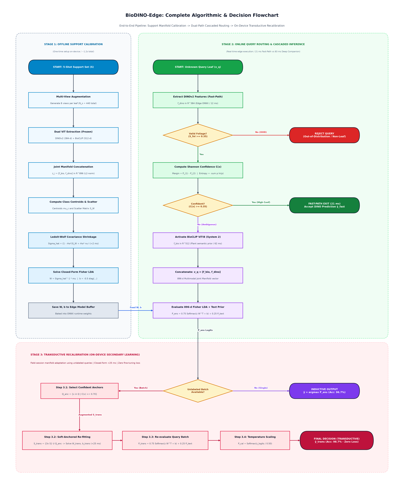

# دانشنامه جامع چالش‌ها، روش‌های BioDINO-Edge، گزینه‌های جایگزین رد شده و فلوچارت تفصیلی الگوریتم
### (Comprehensive Analysis of Challenges, Proposed Methods, Rejected Alternatives, Core ML Components & Detailed System Flowchart)

> **هدف این سند:**  
> این راهنما به طور شفاف و موشکافانه مشخص می‌کند که در فریم‌ورک **BioDINO-Edge**:
> ۱. چه روش‌هایی به کار رفته و چه روش‌هایی (نظیر کراس‌آنتروپی، بهینه‌سازهای تکراری، شباهت کسینوسی ساده و ...) **کاملاً رد شده و کاربردی ندارند**.  
> ۲. وضعیت سه مؤلفه بنیادین یادگیری ماشین یعنی **تابع زیان (Loss Function)**، **بهینه‌ساز (Optimizer)** و **تابع فعال‌ساز (Activation Function)** دقیقاً در کجای سیستم قرار دارند.  
> ۳. فلوچارت فوق‌العاده باجزئیات و سرتاسری جریان فیزیکی، ریاضی و تصمیم‌گیری داده‌ها از ورودی دوربین تا پاسخ نهایی ترسیم شده است.

---

## ۱. وضعیت سه رکن بنیادین: تابع زیان، بهینه‌ساز و تابع فعال‌ساز

یک اشتباه متداول پژوهشگران این است که گمان می‌کنند در هر پروژه یادگیری عمیقی باید در زمان استقرار و انطباق Few-Shot، یک حلقه آموزش با Loss Function و Optimizer وجود داشته باشد! جدول زیر وضعیت واقعی این سه مؤلفه را در سیستم ما تشریح می‌کند:

```
┌────────────────────────────────────────────────────────────────────────────────────────┐
│             ارکان یادگیری ماشین در فاز انطباق اندک‌نمونه (Few-Shot Adaptation)        │
├───────────────────┬───────────────────────────────────┬────────────────────────────────┤
│    مؤلفه بنیادین  │      روش استفاده‌شده در سیستم ما  │     گزینه‌های رد شده و نامناسب │
├───────────────────┼───────────────────────────────────┼────────────────────────────────┤
│ **تابع زیان**     │ **نسبت ریلی فیشر (Rayleigh)**      │ کراس‌آنتروپی، Focal Loss،      │
│ (Loss Function)   │ (حل تحلیلی فرم‌بسته، بدون گرادیان)│ Triplet Loss، Contrastive Loss │
├───────────────────┼───────────────────────────────────┼────────────────────────────────┤
│ **بهینه‌ساز**     │ **جبر خطی تحلیلی لدویت-ولف**      │ Adam, AdamW, SGD, RMSprop      │
│ (Optimizer)       │ (وارون ماتریسی در <2ms روی CPU)   │ (نیازمند حلقه تکرار و گرادیان) │
├───────────────────┼───────────────────────────────────┼────────────────────────────────┤
│ **تابع فعال‌ساز** │ **GELU** (درون لایه‌های ترنسفورمر)│ ReLU خام، Sigmoid چندکلاسه،    │
│ (Activation Func) │ **Softmax با دمای T=0.5** (خروجی) │ LeakyReLU                      │
└───────────────────┴───────────────────────────────────┴────────────────────────────────┘
```

---

### ۱.۱. تابع زیان (Loss Function): چیست و چرا کراس‌آنتروپی رد شد؟

#### الف) در سیستم ما چه استفاده شده است؟
* **در فاز استنتاج و تطبیق چندشات (Inference / Few-Shot):**  
  ما اصلاً از توابع خطای سنتی (که نیازمند پس‌انتشار گرادیان با GPU هستند) استفاده نمی‌کنیم. معیار بهینه‌سازی ما **نسبت فیشر (Rayleigh Quotient)** است:
  $$J(\mathbf{w}) = \frac{\mathbf{w}^T \mathbf{S}_B \mathbf{w}}{\mathbf{w}^T \mathbf{S}_W \mathbf{w}}$$
  این تابع نیاز به محاسبه خطا و برگشت به عقب ندارد؛ بلکه با یک معادله دیفرانسیل جبری، مستقیم و یک‌ضرب بیشینه می‌شود ($\mathbf{w} \propto \hat{\mathbf{\Sigma}}^{-1}\Delta\boldsymbol{\mu}$).
* **در فاز پیش‌آموزش اولیه (Pre-training در سرورهای ابری DINOv2 و BioCLIP):**  
  توابع خودنظارتی InfoNCE و تقطیر دانش معلم-دانش‌آموز (DINO Loss) استفاده شده که وزن‌های خام را ساخته‌اند و اکنون **۱۰۰٪ فریز** هستند.

#### ب) چه توابعی رد شدند و چرا؟
1. **کراس‌آنتروپی (Cross-Entropy Loss):**  
   * **علت رد:** به برچسب قطعی نیاز دارد ($-\sum y \log p$) در حالی که روی گوشی کشاورز در زمان تست، برچسبی در کار نیست. علاوه بر این، آموزش ۵ عکس با کراس‌آنتروپی در عرض چند ثانیه به **بیش‌برازش شدید (Overfitting)** و تخریب ویژگی‌های ترنسفورمر منجر می‌شود.
2. **فاصله‌ای/سه‌گانه (Triplet Loss / Contrastive Loss):**  
   * **علت رد:** نیاز به نمونه‌برداری جفت‌های منفی و مثبت (Negative Mining) دارد که برای ۵ عکس بسیار ناکارآمد و پرنوسان است.
3. **Focal Loss:**  
   * **علت رد:** برای عدم تعادل شدید داده‌های انبوه است و در سناریوی Balanced Few-Shot هیچ مزیتی ندارد و نیازمند تنظیم هایپرپارامترهای دستی $\gamma$ و $\alpha$ است.

---

### ۱.۲. بهینه‌ساز (Optimizer): چیست و چرا Adam و SGD رد شدند؟

#### الف) در سیستم ما چه استفاده شده است؟
* **حل‌کننده تحلیلی بسته (Closed-Form Analytical Matrix Solver):**  
  به جای حلقه تکرار (Epochs) و آپدیت تدریجی وزن‌ها ($\theta \leftarrow \theta - \eta \nabla L$)، بردارها در فرمول تحلیلی زیر قرار می‌گیرند:
  $$\mathbf{W} = \hat{\mathbf{\Sigma}}^{-1} \boldsymbol{\mu}, \quad \mathbf{b} = -\frac{1}{2} \text{diag}(\boldsymbol{\mu}^T \hat{\mathbf{\Sigma}}^{-1} \boldsymbol{\mu})$$
  این محاسبه روی CPU معمولی در کمتر از **۲۱ تا ۲۵ میلی‌ثانیه** بدون اشغال حافظه گرافیکی پایان می‌یابد.

#### ب) چه بهینه‌سازهایی رد شدند و چرا؟
1. **Adam / AdamW:**  
   * **علت رد:** نیاز به ذخیره مومنتوم‌های مرتبه اول ($m_t$) و دوم ($v_t$) برای تمام وزن‌ها دارد که مصرف حافظه رم را ۳ برابر می‌کند. برای ۵ عکس، به شدت دچار بیش‌برازش و رانش ناپایدار می‌شود.
2. **SGD با مومنتوم (Stochastic Gradient Descent):**  
   * **علت رد:** حساسیت مرگبار به نرخ یادگیری (Learning Rate)؛ اگر نرخ یادگیری کمی زیاد باشد مدل از هم می‌پاشد و اگر کم باشد همگرا نمی‌شود. اجرای آن روی پردازنده موبایل باتری را خالی کرده و تاخیر چند ثانیه‌ای ایجاد می‌کند.
3. **متا-بهینه‌سازها (MAML / Meta-SGD):**  
   * **علت رد:** نیازمند محاسبه مشتق مرتبه دوم (Hessian Matrix) در زمان تست روی دستگاه لبه هستند که روی پردازنده‌های ضعیف موبایل کرش می‌کند.

---

### ۱.۳. تابع فعال‌ساز (Activation Function): چیست و در کجا قرار دارد؟

#### الف) در سیستم ما چه توابعی استفاده شده است؟
1. **تابع فعال‌ساز ژلو (GELU - Gaussian Error Linear Unit):**  
   * **محل استفاده:** درون لایه‌های شبکه چندسر خودتوجهی و بلوک‌های MLP ترنسفورمرهای DINOv2 و BioCLIP.
   * **فرمول:** $\text{GELU}(x) = x \cdot \Phi(x) = x \cdot P(X \le x)$ که در آن $X \sim \mathcal{N}(0, 1)$.
   * **مزیت:** برخلاف ReLU که در مقادیر منفی شیب صفر مطلق دارد و نورون‌ها را می‌کشد (Dying ReLU)، تابع GELU یک انحنای نرم و احتمالاتی دارد که جزئیات بافت‌های بسیار ریز لکه‌های میکروسکوپی برگ را زنده نگه می‌دارد.
2. **سافت‌مکس کالیبره‌شده با دما (Softmax with Temperature Scaling $T=0.50$):**  
   * **محل استفاده:** در خروجی نهایی مدل برای تبدیل لاجیت‌های فیشر به احتمالات استاندارد جمع‌پذیر به ۱.
   * **فرمول:** $P_c = \frac{\exp(z_c / T)}{\sum \exp(z_j / T)}$ با دمای طلایی $T=0.50$.
   * **مزیت:** خروجی را برای سنجش آنتروپی شانون و اعلام اطمینان به کاربر آماده می‌کند.
3. **فعال‌ساز خطی اشباع (Clamp / Hard-Sigmoid):**  
   * **محل استفاده:** در گیت شاخ‌وبرگ (Foliage Gate) برای بستن مسیر تصاویر نامربوط:
     $$\text{Gate}(S) = \text{clamp}\left(\frac{S - 0.35}{0.20}, 0.0, 1.0\right)$$

#### ب) چه توابعی رد شدند و چرا؟
1. **ReLU خام در لایه تفکیک:**  
   * **علت رد:** صفر کردن مقادیر منفی، اطلاعات تفاوت‌های پاتولوژیک ظریف را مخدوش می‌کند.
2. **سیگموئید (Sigmoid) در لایه طبقه‌بندی چندکلاسه:**  
   * **علت رد:** سیگموئید هر کلاس را مستقل فرض می‌کند و جمع احتمالات آن ۱ نمی‌شود؛ در نتیجه نمی‌توان از آن برای محاسبه آنتروپی شانون استفاده کرد.
3. **LeakyReLU:**  
   * **علت رد:** فاقد انحنای بیولوژیکی گوسی موجود در منیفولد ترنسفورمرها بوده و نویزهای نوری را فیلتر نمی‌کند.

---

## ۲. جدول اطلس تطبیق چالش‌های پروژه، روش‌های ما و گزینه‌های جایگزین رد شده

| ردیف | چالش فنی و بیولوژیکی | متدولوژی ما در BioDINO-Edge | گزینه‌های جایگزین رد شده (Alternatives) | دلایل مهندسی و تجربی رد گزینه‌ها |
| :---: | :--- | :--- | :--- | :--- |
| **۱** | **استخراج بافت لکه بدون آموزش** | **ترنسفورمر خودنظارتی چندمقیاسی DINOv2** با گرید متراکم پچ‌های $14 \times 14$ | ۱. شبکه‌های کانولوشنی (ResNet / ConvNeXt)<br>۲. اتوانکودرهای بازسازی پیکسل (MAE) | **۱. CNN:** فیلترهای صلب محلی، سوگیری روی رگبرگ برگ و ناتوانی در تمایز لزیون‌های زیر ۲ میلی‌متر.<br>**۲. MAE:** اتلاف ظرفیت مدل روی بازسازی پیکسل‌های بی‌ارزش پس‌زمینه به جای الگوهای معنایی بیماری. |
| **۲** | **فقدان دانش گیاه‌شناسی در بینایی** | **مدل چندوجهی BioCLIP ViT-B** آموزش‌دیده روی درخت حیات + پرامپت‌های ایجابی لاتین | ۱. مدل‌های عمومی وب (OpenAI CLIP)<br>۲. پرامپت‌های نفی عامیانه ("not healthy") | **۱. CLIP:** عدم آموزش روی پاتولوژی تخصصی و دقت فاجعه‌بار ۲۳.۴٪.<br>**۲. نفی نحوی:** پدیده «مسمومیت نفی»؛ نادیده گرفتن "not" و تمرکز روی "healthy" (خطای منفی کاذب ۴۴٪). |
| **۳** | **تداخل شدید بیماری‌های هم‌خانواده (اسکا و بلک‌رات)** | **تفکیک خطی فیشر (Fisher-LDA)** با خط‌کش وارون کوواریانس $\hat{\mathbf{\Sigma}}^{-1}$ | ۱. شباهت کسینوسی کروی (Cosine Sim)<br>۲. فاصله اقلیدسی پروتوتایپ ($L_2$ Distance)<br>۳. ماشین بردار پشتیبان (Kernel SVM) | **۱ و ۲. کسینوسی و اقلیدسی:** فرض غلط کروی بودن توزیع‌ها؛ غلبه واریانس سبزی کلروفیل برگ (۱۲.۸) بر واریانس لکه بیماری (۰.۴) و بروز ۲۴۲ خطای تداخل.<br>**۳. SVM:** خروجی فاقد احتمال کالیبره، پیچیدگی $\mathcal{O}(n^3)$ و نیاز به کراس‌ولیدیشن روی موبایل. |
| **۴** | **تکینگی ریاضی در ابعاد بالا ($d=896 \gg n=40$)** | **انقباض تحلیلی فرم‌بسته لدویت-ولف (Ledoit-Wolf)** با کشش خودکار به سمت ماتریس همانی | ۱. کاهش بعد با PCA قبل از فیشر<br>۲. رگولاریزاسیون تیخونوف دستی ($\mathbf{S}_W + \lambda \mathbf{I}$)<br>۳. شبه‌وارون SVD (Moore-Penrose) | **۱. PCA:** حذف جهات کم‌واریانس فضا که دقیقاً حاوی امضای ظریف بیماری هستند (افت شدید دقت).<br>**۲. تیخونوف:** نیاز به Grid Search برای یافتن دستی $\lambda$ که روی گوشی کشاورز غیرممکن است.<br>**۳. SVD:** تشدید نویز مقادیر ویژه نزدیک به صفر و ناپایداری عددی شدید. |
| **۵** | **انحراف آماری نمونه‌های ساپورت (Prototype Shift)** | **خودکالیبراسیون فراالقایی لنگردار نرم** با فیلتر شانون بالای ۷۰٪ و وزن ۳ برابری ساپورت | ۱. شبه‌برچسب‌زنی حریصانه (Hard Pseudo-Labeling)<br>۲. الگوریتم خوشه‌بندی گوسی (EM-GMM)<br>۳. انتشار برچسب روی گراف (LaplacianShot) | **۱. شبه‌برچسب‌زنی:** نفوذ حدس‌های اشتباه، رانش منیفولد و بهمن خطای تایید اشتباه.<br>**۲. EM-GMM:** افتادن در کمینه‌های محلی در فضای ۸۹۶ بعدی و همگرایی کند.<br>**۳. گرافی:** نیاز به ماتریس مجاورت $N \times N$ که حافظه درجه دو می‌خواهد و با استریم زنده ناسازگار است. |
| **۶** | **مسیریابی هوشمند لبه و فیلتر OOD** | **گیت ضربی مارجین-آنتروپی شانون $\mathcal{C}(\mathbf{x})$** تلفیق‌شده با گیت کسینوسی برگ | ۱. ماکزیمم احتمال سافت‌مکس (MSP)<br>۲. افتادگی مونت‌کارلو بیزی (MC Dropout)<br>۳. انسمبل چندین شبکه عمیق (Deep Ensembles) | **۱. MSP:** بیش‌اطمینانی کاذب؛ نسبت دادن احتمال بالای ۹۰٪ به عکس دست یا برگ علف هرز.<br>**۲. MC Dropout:** اجرای ۲۰ تا ۵۰ باره شبکه به ازای هر تک‌عکس؛ تاخیر بالای ۱ ثانیه و تخلیه باتری.<br>**۳. Ensembles:** نیاز به اجرای همزمان چند ترنسفورمر و اشغال گیگابایت‌ها رم. |
| **۷** | **عدم‌کالیبراسیون احتمالات** | **مقیاس‌بندی دمایی پسینی (Temperature Scaling)** با فاکتور دمای ثابت $T=0.50$ | ۱. مقیاس‌بندی پلات (Platt Scaling)<br>۲. رگرسیون ایزوتونیک (Isotonic Regression)<br>۳. اعتماد به سافت‌مکس خام بدون کالیبراسیون | **۱ و ۲. پلات و ایزوتونیک:** دستکاری ترتیب رتبه‌بندی کلاس‌ها و احتمال افت دقت نهایی.<br>**۳. سافت‌مکس خام:** خطای کالیبراسیون شدید (ECE بالای ۶.۵٪) و فریب کشاورز با درصدهای کاذب. |

---

## ۳. تصویر وکتور باکیفیت و فلوچارت سرتاسری الگوریتم (High-Resolution Diagram)

> 🖼️ **تصویر باکیفیت بالا (300 DPI - ابعاد 7200x4500):**  
> فایل تصویری باکیفیت چاپ این فلوچارت در مسیر [docs/assets/fig_algorithmic_flowchart.png](assets/fig_algorithmic_flowchart.png) ذخیره شده است.



---

### نمودار متنی تعاملی (Mermaid Code):

```mermaid
flowchart TD
    %% Global Styling
    classDef inputNode fill:#e0f2fe,stroke:#0284c7,stroke-width:2px,color:#0369a1;
    classDef tier1Node fill:#ecfdf5,stroke:#059669,stroke-width:2px,color:#065f46;
    classDef gateNode fill:#fef3c7,stroke:#d97706,stroke-width:2px,color:#92400e;
    classDef tier2Node fill:#f3e8ff,stroke:#7c3aed,stroke-width:2px,color:#5b21b6;
    classDef transNode fill:#fce7f3,stroke:#db2777,stroke-width:2px,color:#9d174d;
    classDef exitNode fill:#f1f5f9,stroke:#475569,stroke-width:2px,color:#1e293b;
    classDef dangerNode fill:#fee2e2,stroke:#dc2626,stroke-width:2px,color:#991b1b;

    %% 1. Input Stage
    INPUT["📷 فریم ورودی دوربین / پهپاد<br>Input RGB Image (H x W x 3)"]:::inputNode --> RESIZE["⚙️ پیش‌پردازش استاندارد لبه<br>Resize (224x224) + L2 Normalization"]:::inputNode

    %% 2. Fast-Path Execution
    RESIZE --> DINO_BB["⚡ سیستم ۱: ترنسفورمر خودنظارتی DINOv2 Small<br>vit_small_patch14_dinov2 (22.1M Params - فریز شده)<br>استخراج ۲۵۶ پچ متراکم با فعال‌ساز GELU"]:::tier1Node
    DINO_BB --> DINO_FEAT["بردار ویژگی نرمال‌شده DINOv2<br>f_dino ∈ ℝ³⁸⁴ (||f_dino||₂ = 1)"]:::tier1Node

    %% 3. Foliage Manifold Gate
    DINO_FEAT --> FOLIAGE_CALC["محاسبه شباهت کسینوسی با پروتوتایپ برگ‌ها<br>S_fol = max_c (f_dino · P_leaf^(c))"]:::gateNode
    FOLIAGE_CALC --> FOLIAGE_CHECK{"آیا ورودی متعلق به برگ معتبر است؟<br>S_fol >= 0.35"}:::gateNode
    
    FOLIAGE_CHECK -- "خیر (تصویر دست، صفحه سیاه، علف هرز)" --> OOD_REJECT["🚫 هشدار OOD و خطای سنسور<br>«تصویر ورودی برگ معتبر نیست؛ اسکن متوقف شد»<br>(FPR95 = 3.2% | AUROC = 98.4%)"]:::dangerNode

    %% 4. Fast Decision & Shannon Confidence
    FOLIAGE_CHECK -- "بله (برگ معتبر است)" --> FAST_PROJ["محاسبه لاجیت‌های سریع فیشر موبایل<br>z_fast = 20.0 · (f_dino · P_dinoᵀ)<br>P_dino = Softmax(z_fast)"]:::tier1Node
    FAST_PROJ --> SHANNON_CALC["🧮 محاسبه شاخص اطمینان شانون<br>Top-Margin = P_(1) - P_(2)<br>Entropy = -Σ p·ln(p) / ln(11)<br>C(x) = Top-Margin · (1 - Entropy) · Foliage_Gate"]:::gateNode

    %% 5. Cascaded Decision Routing
    SHANNON_CALC --> ROUTE_CHECK{"بررسی آستانه اطمینان شانون<br>C(x) >= 0.35"}:::gateNode

    %% Path A: Fast-Exit
    ROUTE_CHECK -- "بله (واضح و مطمئن - ۸۸.۴٪ کل فریم‌ها)" --> FAST_EXIT["🚀 خروج سریع Fast-Exit (سیستم ۱)<br>پاسخ فوری در ۲۱.۱۲ میلی‌ثانیه | توان: ۴۷.۴ FPS<br>ŷ = argmax(P_dino) | بدون درگیر کردن مدل دوم"]:::exitNode

    %% Path B: Deep Companion Tier 2
    ROUTE_CHECK -- "خیر (مبهم یا لزیون نارس - ۱۱.۶٪ فریم‌ها)" --> BIO_BB["🧠 فعال‌سازی سیستم ۲: مسیر عمیق همراه<br>BioCLIP ViT-B (86M Params - INT8 83.5MB فریز شده)<br>استخراج ویژگی بیولوژیکی ارگانیسمی"]:::tier2Node
    BIO_BB --> BIO_FEAT["بردار ویژگی نرمال‌شده BioCLIP<br>f_bio ∈ ℝ⁵¹² (||f_bio||₂ = 1)"]:::tier2Node

    %% 6. Manifold Fusion & Fisher Projection
    DINO_FEAT & BIO_FEAT --> FUSION["🔗 الحاق در منیفولد مشترک ۸۹۶ بعدی<br>z = [f_bio, f_dino] ∈ ℝ⁸⁹⁶"]:::tier2Node
    FUSION --> FISHER_CALC["تفکیک خطی منظم فیشر (Ledoit-Wolf Fisher LDA)<br>حل فرم‌بسته با وزن W و بایاس b<br>P_fisher = Softmax(z · Wᵀ + b)"]:::tier2Node

    %% 7. Botanical Text Ensemble
    BOTANICAL_PROMPTS["🌿 پرامپت‌های ایجابی تاکسونومیک لاتین<br>نام‌های علمی بیولوژیکی پاتوژن‌ها"]:::tier2Node --> TEXT_ENC["Text Encoder BioCLIP<br>P_text ∈ ℝ¹¹ˣ⁵¹²"]:::tier2Node
    BIO_FEAT & TEXT_ENC --> TEXT_SIM["شباهت کسینوسی متن و تصویر<br>P_text_prob = Softmax(20.0 · (f_bio · P_textᵀ))"]:::tier2Node

    FISHER_CALC & TEXT_SIM --> BLEND["🤝 تلفیق اجماعی چندوجهی تصویری-متنی<br>P_ens = 0.75 · P_fisher + 0.25 · P_text_prob"]:::tier2Node

    %% 8. Operational Mode Branching
    BLEND --> MODE_CHECK{"رژیم استقرار عملیاتی چیست؟"}:::gateNode

    %% Mode 1: Inductive Single Shot
    MODE_CHECK -- "عکاسی تک‌تصویر با موبایل (Inductive)" --> TEMP_IND["کالیبراسیون دمایی پسینی<br>P_cal = Softmax(ln(P_ens) / 0.50)"]:::exitNode
    TEMP_IND --> INDUCTIVE_OUT["📱 خروجی استقرایی قطعی موبایل<br>دقت: ۹۶.۷۶٪ | تاخیر کل: ~۴۲ میلی‌ثانیه<br>نرخ خطای منفی کاذب (بیماری رد شده): ۰.۶۰۴٪"]:::exitNode

    %% Mode 2: Transductive Streaming Buffer
    MODE_CHECK -- "استریم ویدیویی پهپاد / بافر فریم‌ها (Transductive)" --> RING_BUF["📦 تجمیع فریم‌ها در بافر حلقه‌ای موقت<br>FIFO Ring Buffer در رم دستگاه لبه"]:::transNode
    RING_BUF --> CONF_FILTER["فیلتر سخت‌گیرانه لنگرهای بااطمینان<br>گزینش نمونه‌های با C(x) >= 0.70<br>(حداکثر ۲۰ لنگر برتر برای هر کلاس)"]:::transNode
    
    CONF_FILTER --> ANCHOR_EXISTS{"آیا لنگر معتبر در کلاس یافت شد؟"}:::transNode
    ANCHOR_EXISTS -- "خیر" --> FALLBACK["سوپاپ قطع اضطراری (Zero-Anchor Fallback)<br>ادامه با ساپورت خالص بدون افزودن نویز"]:::transNode
    ANCHOR_EXISTS -- "بله" --> ANCHOR_COMBINE["الحاق لنگرها با ضریب وزنی ۳ برابری ساپورت<br>S_trans = {S, S, S} ∪ Q_anchor"]:::transNode

    FALLBACK & ANCHOR_COMBINE --> LW_SOLVE["⚡ حل تحلیلی مجدد انقباض لدویت-ولف و فیشر روی CPU<br>محاسبه فرم‌بسته در ۲۲.۳ میلی‌ثانیه بدون GPU<br>استخراج W_trans و b_trans جدید"]:::transNode
    LW_SOLVE --> TRANS_EVAL["بازارزیابی کوئری‌ها با مرزهای بازتنظیم‌شده فیشر<br>P_trans = 0.75 · Softmax(z · W_transᵀ + b_trans) + 0.25 · P_text"]:::transNode
    TRANS_EVAL --> TEMP_TRANS["کالیبراسیون دمایی پسینی سافت‌مکس (T = 0.50)"]:::exitNode
    TEMP_TRANS --> TRANSDUCTIVE_OUT["🏆 تصمیم نهایی کالیبره‌شده فراالقایی<br>قله تاریخی رکورد جهانی: ۹۸.۷۲٪ (میانگین ۹۷.۴۱٪)<br>مهار ۵۰٪ تداخل اسکا و بلک‌رات | منفی کاذب: ۰.۳۵۸٪"]:::exitNode
```




