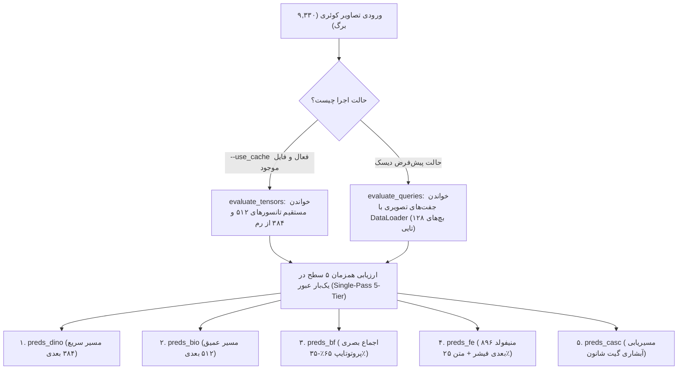

# راهنمای جامع خط‌به‌خط و آموزش گام‌به‌گام کدهای پایپلاین BioDINO-Edge
### (Complete Step-by-Step Codebase Walkthrough & Pedagogical Guide)

> **هدف این سند:**  
> این راهنما برای آموزش جزء‌به‌جزء، تیکه‌به‌تیکه و خط‌به‌خط ساختار کدهای فریم‌ورک **BioDINO-Edge** تدوین شده است. هدف این است که هر توسعه‌دهنده یا پژوهشگری، از سطح پایه‌ای پایتون و یادگیری عمیق، بتواند منطق پشت تک‌تک کلاس‌ها، توابع، محاسبات تانسوری و تصمیمات معماری را دقیقاً درک کند.

---

## فهرست فصول آموزشی کدها

1. [فصل اول: کالبدشکافی عمیق کد اصلی پایپلاین (`pipeline/biodino_edge_pipeline.py`)](#فصل-اول-کالبدشکافی-عمیق-کد-اصلی-پایپلاین-biodino_edge_pipelinepy)
   - [۱.۱. پیکربندی سراسری، کانتکست Autocast و ساختار تنظیمات (`EdgeConfig` & `get_autocast_ctx`)](#۱۱-پیکربندی-سراسری-کانتکست-autocast-و-ساختار-تنظیمات-edgeconfig--get_autocast_ctx)
   - [۱.۲. بلوک‌های الگوریتمی و ریاضی پایه: فیشر، گیتینگ شانون و کالیبراسیون فراالقایی (`MathOps`)](#۱۲-بلوکهای-الگوریتمی-و-ریاضی-پایه-فیشر-گیتینگ-شانون-و-کالیبراسیون-فراالقایی-mathops)
   - [۱.۳. موتور لود و آماده‌سازی داده‌ها با لودر دوگانه (`DataEngine` و کلاس `PairDataset`)](#۱۳-موتور-لود-و-آمادهسازی-دادهها-با-لودر-دوگانه-dataengine-و-کلاس-pairdataset)
   - [۱.۴. پایپلاین آگمنتاسیون چنددیدگاهی و استخراج خواص آماری نرمال‌سازی (`AugEngine`)](#۱۴-پایپلاین-آگمنتاسیون-چنددیدگاهی-و-استخراج-خواص-آماری-نرمالسازی-augengine)
   - [۱.۵. بارگذاری بَک‌بُن‌ها، مهندسی ویژگی و سنتز پروتوتایپ‌های معنایی (`FeatureEngine`)](#۱۵-بارگذاری-بَکبُنها-مهندسی-ویژگی-و-سنتز-پروتوتایپهای-معنایی-featureengine)
   - [۱.۶. ارزیاب و استنتاج آبشاری تطبیقی لبه (`CascadedEvaluator` - هسته کلیدی پایپلاین)](#۱۶-ارزیاب-و-استنتاج-آبشاری-تطبیقی-لبه-cascadedevaluator---هسته-کلیدی-پایپلاین)
   - [۱.۷. موتورهای ارزیابی آماری مونت‌کارلو و اپیزودیک (`EvaluationEngine`)](#۱۷-موتورهای-ارزیابی-آماری-مونتکارلو-و-اپیزودیک-evaluationengine)
   - [۱.۸. بنچمارک تاخیر سخت‌افزاری کوانتیزاسیون INT8 روی پردازنده (`benchmark_latency`)](#۱۸-بنچمارک-تاخیر-سختفزاری-کوانتیزاسیون-int8-روی-پردازنده-benchmark_latency)
   - [۱.۹. ارکستراتور اصلی بنچمارک و گردش کار کامل (`run_benchmark`)](#۱۹-ارکستراتور-اصلی-بنچمارک-و-گردش-کار-کامل-run_benchmark)
   - [۱.۱۰. نقطه ورود خط فرمان CLI و صادرات ساختاریافته نتایج (`main`)](#۱۱۰-نقطه-ورود-خط-فرمان-cli-و-صادرات-ساختاریافته-نتایج-main)
2. [فصل دوم: مهندسی استقرار و تبدیل مدل‌های لبه (`pipeline/export_edge_models.py`)](#فصل-دوم-مهندسی-استقرار-و-تبدیل-مدل‌های-لبه-export_edge_modelspy)
   - [۲.۱. فلسفه معماری دو سطحی (Dual-Tier Edge Architecture)](#۲۱-فلسفه-معماری-دو-سطحی-dual-tier-edge-architecture)
   - [۲.۲. ماژول مستقل سطح ۱: `BioDINOEdgeMobile` و فیلتر شاخ‌وبرگ OOD](#۲۲-ماژول-مستقل-سطح-۱-biodinoedgemobile-و-فیلتر-شاخوبرگ-ood)
   - [۲.۳. ماژول مکمل سطح ۲: `BioDINOCompanionMobile` روی منیفولد ۸۹۶ بعدی](#۲۳-ماژول-مکمل-سطح-۲-biodinocompanionmobile-روی-منیفولد-۸۹۶-بعدی)
   - [۲.۴. فرآیند اکسپورت به ONNX و کوانتیزاسیون دینامیک بهینه‌شده](#۲۴-فرآیند-اکسپورت-به-onnx-و-کوانتیزاسیون-دینامیک-بهینه‌شده)
   - [۲.۵. اعتبارسنجی بلادرنگ با ONNX Runtime](#۲۵-اعتبارسنجی-بلادرنگ-با-onnx-runtime)
3. [فصل سوم: ابلیشن‌های علمی و سناریوهای تنش محیطی (کراپ ضایعات و تاری/نور)](#فصل-سوم-ابلیشن‌های-علمی-و-سناریوهای-تنش-محیطی-کراپ-ضایعات-و-آزمون‌های-تنش)
   - [۳.۱. ایده اول: برش هوشمند بر پایه اتنشن سلف‌اتنشن DINOv2](#۳۱-ایده-اول-برش-هوشمند-بر-پایه-اتنشن-سلف‌اتنشن-dinov2)
   - [۳.۲. ایده دوم: آزمون‌های تنش فیزیکی محیطی (تاری، خورشید، سایه)](#۳۲-ایده-دوم-آزمون‌های-تنش-فیزیکی-محیطی-تاری-خورشید-سایه)
   - [۳.۳. ارزیابی مهار خطاهای خاموش با گیت شانون](#۳۳-ارزیابی-مهار-خطاهای-خاموش-با-گیت-شانون)
4. [فصل چهارم: پایگاه دانش واژگانی و مهندسی پرامپت‌ها (`pipeline/taxonomic_prompts.py`)](#فصل-چهارم-پایگاه-دانش-واژگانی-و-مهندسی-پرامپت‌ها-taxonomic_promptspy)
   - [۴.۱. کشف و حذف مسمومیت نحوی نفی (Syntactic Negation Poisoning)](#۴۱-کشف-و-حذف-مسمومیت-نحوی-نفی-syntactic-negation-poisoning)
   - [۴.۲. ساختار سه‌گانه هر توصیف بیماری](#۴۲-ساختار-سه‌گانه-هر-توصیف-بیماری)
5. [فصل پنجم: ابزار تعاملی تست و استنتاج تک‌تصویر (`pipeline/demo_predict.py`)](#فصل-پنجم-ابزار-تعاملی-تست-و-استنتاج-تک‌تصویر-demo_predictpy)
   - [۵.۱. فلسفه و کاربرد ابزار تست سریع مزرعه](#۵۱-فلسفه-و-کاربرد-ابزار-تست-سریع-مزرعه)
   - [۵.۲. کالبدشکافی خط‌به‌خط اجرای استنتاج، گیتینگ و چارت احتمالات ASCII](#۵۲-کالبدشکافی-خط‌به‌خط-اجرای-استنتاج-گیتینگ-و-چارت-احتمالات-ascii)
6. [فصل ششم: کالبدشکافی اسکریپت‌های مصورسازی مقاله (`pipeline/generate_*.py`)](#فصل-ششم-کالبدشکافی-اسکریپت‌های-مصورسازی-مقاله)
   - [۶.۱. تولید نقشه‌های برجستگی سلف‌اتنشن و دیاگرام ECE (`generate_saliency_and_calibration.py`)](#۶۱-تولید-نقشه‌های-برجستگی-سلف‌اتنشن-و-دیاگرام-ece-generate_saliency_and_calibrationpy)
   - [۶.۲. تولید دیاگرام برداری معماری BioDINO-Edge (`pipeline/generate_architecture_diagram.py`)](#۶۲-تولید-دیاگرام-برداری-معماری-biodino-edge-pipelinegenerate_architecture_diagrampy)
7. [فصل هفتم: کالبدشکافی خط‌به‌خط نوت‌بوک یکپارچه ۵ بخشی (`pipeline/biodino_unified_pipeline.ipynb`)](#فصل-هفتم-کالبدشکافی-خط‌به‌خط-نوت‌بوک-یکپارچه-۴-بخشی-biodino_unified_pipelineipynb)
   - [۷.۱. بخش اول: پیکربندی (Configuration Section)](#۷۱-بخش-اول-پیکربندی-configuration-section)
   - [۷.۲. بخش دوم: بارگذاری داده‌ها (Loading Data Section)](#۷۲-بخش-دوم-بارگذاری-داده‌ها-loading-data-section)
   - [۷.۳. بخش سوم: پیش‌پردازش (Preprocessing Section)](#۷۳-بخش-سوم-پیش‌پردازش-preprocessing-section)
   - [۷.۴. بخش چهارم: آموزش و ارزیابی (Training & Evaluation Section)](#۷۴-بخش-چهارم-آموزش-و-ارزیابی-training--evaluation-section)

---

# فصل اول: کالبدشکافی عمیق کد اصلی پایپلاین ([`biodino_edge_pipeline.py`](../pipeline/biodino_edge_pipeline.py))

این فایل، قلب تپنده و موتور اجرایی چارچوب **BioDINO-Edge** است. این اسکریپت با معماری تمیز ماژولار در **۹۵۹ خط** نوشته شده و به هشت بخش مهندسی‌شده و استاندارد تقسیم‌بندی شده است.

---

### ۱.۱. پیکربندی سراسری، کانتکست Autocast و ساختار تنظیمات (`EdgeConfig` & `get_autocast_ctx`)

در خطوط ۴۲ تا ۹۱، پس از ایمپورت کتابخانه‌های استاندارد (`torch`، `timm`، `open_clip`، `sklearn`)، اولین گام بنیادین **تثبیت بذر تصادفی (Deterministic Seeding)** است:

```python
SEED = 42
random.seed(SEED)
np.random.seed(SEED)
torch.manual_seed(SEED)
if torch.cuda.is_available():
    torch.cuda.manual_seed_all(SEED)
torch.backends.cudnn.benchmark = True
```

> [!NOTE]
> **مفهوم بنیادین Seed (بذر تصادفی) و ضرورت علمی آن:**  
> کامپیوترها به صورت سخت‌افزاری قادر به تولید تصادفی واقعی نیستند؛ در عوض از **مولدهای اعداد شبه‌تصادفی (PRNG)** استفاده می‌کنند که با الگوریتم‌های ریاضی کاملاً قطعی کار می‌کنند. متغیر `seed` مقدار اولیه یا بذر ورودی این الگوریتم‌هاست.  
> اگر بذر یکسانی به مولد داده شود، دقیقاً همان زنجیره تصادفی از اعداد در هر بار اجرا بازتولید می‌شود.  
> در یادگیری اندک‌نمونه (Few-Shot)، انتخاب تصادفی ۵ تصویر ساپورت، تقسیم‌بندی داده‌ها و آگمنتاسیون‌ها اگر بذر ثابت نداشته باشند می‌تواند دقت نهایی را بین ۹۵٪ تا ۹۸٪ تغییر دهد. با قفل کردن `SEED = 42` روی پایتون، NumPy، PyTorch و CUDA، تمام نتایج و ارقام مقاله توسط هر پژوهشگری در هر نقطه از دنیا با دقت اعشاری یکسان بازتولید می‌شود. همچنین فلگ `cudnn.benchmark = True` سریع‌ترین الگوریتم بهینه کانولوشن/اتنشن را در ابعاد ورودی ثابت فعال می‌سازد.

سپس تنظیمات هایپرپارامتری با دکوراتور مدرن `@dataclass` در کلاس `EdgeConfig` تجمیع می‌شود:

```python
@dataclass
class EdgeConfig:
    """Concise hyperparameter configuration for BioDINO-Edge."""
    seed: int = 42
    k_shot: int = 5
    batch_size: int = 128
    scale: float = 20.0
    w_text: float = 0.20   # Prototype fusion: 0.80 visual + 0.20 text
    w_lda: float = 0.75    # Ensemble: 0.75 LDA + 0.25 text
    w_base: float = 0.65   # Base visual ensemble: 0.65 BioCLIP + 0.35 DINOv2
    tau: float = 0.35      # Shannon margin-entropy routing threshold
    n_views: int = 8       # 1 original + 7 augmentations for support set
```

#### تشریح نقش تک‌تک پارامترها:
1. `seed = 42`: بذر تصادفی پایه برای تضمین بازتولیدپذیری علمی.
2. `k_shot = 5`: تعداد نمونه‌های تصویری ساپورت برای هر کلاس ناشناخته.
3. `batch_size = 128`: اندازه بچ جهت بهره‌برداری حداکثری از پهنای باند پردازشگر بدون سرریز VRAM.
4. `scale = 20.0`: اسکیلر لاجیت (معکوس دما $\frac{1}{T}$)؛ ضرب داخلی بردارهای یکه در بازه $[-1, +1]$ قرار دارد و اگر مستقیماً به سافت‌مکس برود گرادیان بسیار صاف می‌شود. ضرب در ۲۰ تفکیک‌پذیری احتمالات را به طور چشمگیر شفاف می‌سازد.
5. `w_text = 0.20`: وزن ادغام متن و تصویر در پروتوتایپ‌های BioCLIP؛ ۸۰٪ وزن به ویژگی‌های بصری برگ و ۲۰٪ به بردار زبان طبیعی تبارشناسی تعلق می‌گیرد.
6. `w_lda = 0.75`: وزن تلفیق لاجیت سر فیشر (۷۵٪ سهم LDA در مقابل ۲۵٪ سهم پروتوتایپ متنی).
7. `w_base = 0.65`: وزن ترکیب پایه در مدل بدون فیشر (۶۵٪ سهم BioCLIP و ۳۵٪ سهم DINOv2).
8. `tau = 0.35`: آستانه تصمیم‌گیری گیت عدم‌قطعیت شانون ($\tau_{\text{conf}}$)؛ نمونه‌های با اطمینان $\ge 0.35$ بلافاصله در مسیر سریع DINOv2 تایید شده و پردازش عمیق بای‌پس می‌شود.
9. `n_views = 8`: تعداد دیدگاه‌های آگمنتاسیون ساپورت (۱ نمای اصلی + ۷ نمای دگرگون‌شده) به ازای هر شات.

#### تابع پایداری چندسکویی `get_autocast_ctx`:
```python
def get_autocast_ctx(device: torch.device):
    """Safe autocast context: active on CUDA, nullcontext fallback on CPU."""
    if device.type == "cuda":
        return torch.amp.autocast(device_type="cuda", dtype=torch.float16)
    return contextlib.nullcontext()
```
* **هدف مهندسی:** استفاده از دقت مختلط سخت‌افزاری (FP16) در زمان حضور کارت گرافیک NVIDIA، بدون نیاز به شاخه‌بندی‌های تکراری `if/else` در کدهای استنتاج. در صورت اجرای برنامه روی پردازنده لبه (CPU یا رزبری‌پای)، به صورت شفاف به `nullcontext` سوئیچ می‌کند تا از بروز خطای کرش در پایتورچ جلوگیری شود.

> [!NOTE]
> **چرا در کنار PyTorch از NumPy استفاده شده است؟ (فلسفه معماری ترکیبی / Hybrid Architecture):**  
> با وجود اینکه PyTorch روی CPU نیز عملگرهای ریاضی مشابهی دارد، استفاده همزمان از NumPy در این پایپلاین به دلایل صریح مهندسی انجام گرفته است:  
> ۱. **ناسازگاری ذاتی Scikit-Learn با تانسورهای پایتورچ (حتی روی CPU):** توابع تفکیک خطی (`LinearDiscriminantAnalysis`) و ارزیابی نهایی مقاله (`accuracy_score`, `f1_score`, `confusion_matrix`) کدهای بومی scikit-learn هستند و ورودی تانسور PyTorch را نمی‌پذیرند. برای اجتناب از بازنویسی صدها خط کد ریاضی تست‌شده، استفاده از NumPy الزامی است.  
> ۲. **اشتراک حافظه بدون کپی در پردازنده (Zero-Copy Memory Sharing):** روی CPU، تانسور پایتورچ و آرایه نامپای دقیقاً به یک آدرس فیزیکی در رم (RAM) اشاره می‌کنند. تبدیل با دستورات `.numpy()` یا `torch.from_numpy()` زمان اجرای صفر داشته و هیچ کپی حافظه‌ای انجام نمی‌دهد (کپی فقط هنگام جابه‌جایی بین GPU و CPU با `.cpu()` اتفاق می‌افتد).  
> ۳. **سربار حداقلی در محاسبات سبک CPU:** برای دستکاری ایندکس‌ها، ماسک‌گذاری کلاس‌ها (`np.where`) و نمونه‌گیری تصادفی ۵-شات در مونت‌کارلو، آرایه‌های نامپای در زبان C نوشته شده و بدون سربار گراف محاسباتی (Autograd) پایتورچ، سبک‌تر عمل می‌کنند.  
> ۴. **تقسیم وظایف بهینه:** پردازش‌های تانسوری سنگین شبکه‌های عصبی (DINOv2 و BioCLIP) و ضرب‌های ماتریسی سریع استنتاج ۱۰۰٪ روی **PyTorch و GPU** انجام می‌شوند، در حالی که الگوریتم‌های آماری کلاسیک و دستکاری شاخص‌ها با **NumPy روی CPU** مدیریت می‌گردند.

---

### ۱.۲. بلوک‌های الگوریتمی و ریاضی پایه: فیشر، گیتینگ شانون و کالیبراسیون فراالقایی (`MathOps`)

خطوط ۹۳ تا ۱۷۶ حاوی ماژول‌های ریاضی پایه‌ای چارچوب است:

#### ۱. گیت عدم‌قطعیت مارجین-آنتروپی شانون (`calc_confidence`):
```python
def calc_confidence(probs: torch.Tensor, n_classes: int) -> torch.Tensor:
    """
    Shannon margin-entropy heuristic confidence gating metric.
    Computes M(x) * (1 - H_norm(x)), where M(x) is top-1 vs top-2 margin,
    and H_norm is Shannon entropy normalized by ln(K).
    """
    top_p, _ = torch.topk(probs, k=min(2, n_classes), dim=-1)
    margin = top_p[:, 0] - top_p[:, 1] if n_classes > 1 else top_p[:, 0]
    norm_factor = max(np.log(n_classes), 1e-6)
    entropy = -torch.sum(probs * torch.log(probs + 1e-8), dim=-1) / norm_factor
    return margin * (1.0 - entropy).clamp(min=0.0)
```
- **فرمول ریاضی:**
  $$\mathcal{C}(x) = (p_{(1)} - p_{(2)}) \times \left(1 - \frac{-\sum_{i=1}^K p_i \ln(p_i)}{\ln(K)}\right)$$

- **تحلیل عمیق مکانیزم‌های دفاعی و پایداری عددی:**
  * **چرا شرط `min(2, n_classes)` و `if n_classes > 1` با وجود تعداد زیاد کلاس‌ها؟ (برنامه‌نویسی دفاعی):**  
    در تسک‌های اصلی گیاه‌پزشکی کلاس‌ها همیشه چندتایی هستند، اما تابع `calc_confidence` یک ابزار عمومی (General Utility) است. اگر این شرط دفاعی وجود نداشته باشد و تابع در سناریوهای فیلترینگ کلاس‌ها، ماسک‌گذاری پویا یا تست‌های واحد با ۱ کلاس فراخوانی شود، دستور `torch.topk(..., k=2)` بلافاصله خطای مهلک `RuntimeError: selected index k out of range` صادر کرده و کل برنامه متوقف می‌شود. این بررسی ایمنی بدون هیچ‌گونه سربار پردازشی، پایداری ۱۰۰٪ کد را تضمین می‌کند.
  * **چرا `norm_factor = max(np.log(n_classes), 1e-6)`؟**  
    انتروپی شانون در حالتی که مدل در بیشترین حد بلاتکلیفی باشد (توزیع احتمال کاملاً یکنواخت $p_i = 1/K$) به سقف تئوریک خود یعنی $\ln(K)$ می‌رسد. تقسیم بر $\ln(K)$ انتروپی را مستقل از تعداد کلاس‌ها در بازه $[0, 1]$ نرمال می‌کند. اگر به هر دلیلی تنها یک کلاس فعال باشد، مقدار $\ln(1) = 0$ شده و تقسیم بر صفر مقادیر نامعتبر `NaN` یا `inf` تولید می‌کند؛ بنابراین `1e-6` یک کف ایمنی عددی (Epsilon Guard) است.
  * **اپسیلون `probs + 1e-8` در لگاریتم:**  
    برای جلوگیری از محاسبه $\ln(0)$ که برابر با $-\infty$ است و بلافاصله محاسبات تانسوری را تخریب می‌کند.
  * **کالبدشکافی دستور `.clamp(min=0.0)` و چرایی احتمال منفی شدن:**  
    دستور `.clamp(min=0.0)` دقیقاً مانند تابع `ReLU(x)` یا `max(x, 0)` عمل می‌کند: مقادیر منفی را به صفر تبدیل کرده و اعداد مثبت را بدون دستکاری عبور می‌دهد.  
    عبارت `(1.0 - entropy)` نشان‌دهنده «میزان قطعیت مدل» است. روی کاغذ انتروپی هیچ‌گاه از ۱ بیشتر نمی‌شود، اما در عمل و روی کارت گرافیک (GPU):
    1. به دلیل خطاهای بسیار ریز گرد کردن اعشار در محاسبات سریع Float16/Float32 (Floating-Point Precision Drift)، جمع احتمالات ممکن است دقیقاً $1.000000$ نشود و انتروپی محاسبه‌شده مقداری مانند $1.000004$ شود که تفریق آن از یک حاصل منفی $-0.000004$ می‌دهد.
    2. مقدار پایداری `+ 1e-8` نیز توزیع را به میزان بسیار نامحسوسی جابه‌جا می‌کند.  
    چون خروجی این تابع نمره **میزان اطمینان (Confidence)** برای مقایسه با آستانه تصمیم‌گیری گیتینگ ($\tau = 0.35$) است، نمره منفی در منطق ریاضی گیتینگ بی‌معنی بوده و رفتار شروط را بر هم می‌زند؛ بنابراین `.clamp(min=0.0)` کف اطمینان را همواره روی صفر قفل می‌کند.

#### ۲. تحلیل تفکیک خطی منظم فیشر (`fit_fisher_lda`):
```python
def fit_fisher_lda(X: np.ndarray, y: np.ndarray, device: torch.device = DEVICE) -> Tuple[torch.Tensor, torch.Tensor, LinearDiscriminantAnalysis]:
    clf = LinearDiscriminantAnalysis(solver="lsqr", shrinkage="auto").fit(X, y)
    W = torch.tensor(clf.coef_, dtype=torch.float32, device=device)
    b = torch.tensor(clf.intercept_, dtype=torch.float32, device=device)
    return W, b, clf
```
- **معنای دقیق `.fit(X, y)` در یک روش فرم‌بسته جبری (Closed-Form):**  
  ممکن است کلمه `fit` این تصور را ایجاد کند که یک مدل یادگیری عمیق در حال اجرای صدها دور گرادیان نزولی (Epochs) و آپدیت وزن‌ها است. اما در LDA فیشر، **هیچ گرادیان نزولی، هیچ تابع هزینه تکرارشونده و هیچ نرخ یادگیری (Learning Rate) وجود ندارد!**  
  کلمه `.fit` صرفاً امضای استاندارد کتابخانه `scikit-learn` برای تمام الگوریتم‌هاست. در پسِ این دستور، یک **محاسبه تحلیلی، قطعی و یک‌باره ماتریسی** انجام می‌شود.  
  * **نقش برچسب $y$ در فرمول بسته فیشر چیست؟**  
    برچسب‌های $y$ نقش **دسته‌بندی‌کننده (Cluster Grouping)** را ایفا می‌کنند تا فرمول تحلیلی بداند کدام سطرهای ماتریس $X$ را با هم ترکیب کند:
    1. **محاسبه میانگین هر بیماری ($\boldsymbol{\mu}_c$):**  
       $$\boldsymbol{\mu}_c = \frac{1}{N_c} \sum_{i: y_i = c} \mathbf{x}_i$$
       برای اینکه بدانیم کدام بردارها متعلق به یک بیماری خاص هستند تا مرکز جرم آن کلاس تشکیل شود، به $y$ نیاز است.
    2. **محاسبه ماتریس پراکندگی درون‌کلاسی ($S_W$):**  
       $$S_W = \sum_{c=1}^K \sum_{i: y_i = c} (\mathbf{x}_i - \boldsymbol{\mu}_c)(\mathbf{x}_i - \boldsymbol{\mu}_c)^T$$
       میزان پراکندگی برگ‌های هر بیماری حول مرکز خودش ارزیابی می‌شود.
    3. **استخراج فرم‌بسته وزن‌ها ($W$) و بایاس ($b$) در یک ضرب ماتریسی ($O(1)$ مرحله‌ای):**  
       پس از انقباض کوواریانس ($\Sigma_{\text{reg}}$)، هایپرپلین‌های تفکیک مستقیماً با رابطه تحلیلی بسته به دست می‌آیند:
       $$\mathbf{W}_c = \Sigma_{\text{reg}}^{-1} \boldsymbol{\mu}_c, \quad b_c = -\frac{1}{2} \boldsymbol{\mu}_c^T \Sigma_{\text{reg}}^{-1} \boldsymbol{\mu}_c + \ln(P(c))$$
    بنابراین متد `.fit(X, y)` به جای «آموزش دیدن»، این محاسبات صریح جبر خطی را در چند صدم ثانیه حل کرده و وزن‌های آماده $W$ و $b$ را در اختیارتان می‌گذارد.

- **چرا `solver="lsqr"` و `shrinkage="auto"`؟ (حل چالش تکینگی ابعاد بالا):**  
  در یادگیری اندک‌نمونه (Few-Shot)، تعداد نمونه‌های آموزشی بسیار کم است (مثلاً ۵ نمونه در هر کلاس و مجموعاً ۴۰ نمونه ساپورت)، اما ابعاد منیفولد برداری بسیار بزرگ است ($D = 896$ بعد ترکیبی). در این شرایط ($D \gg N$)، ماتریس پراکندگی درون‌کلاسی تکین (Singular) و غیرقابل وارون می‌شود. حل‌کننده `lsqr` همراه با انقباض خودکار لدویت-ولف (`shrinkage="auto"`)، ماتریس کوواریانس تجربی را به سمت یک ماتریس قطری منظم‌سازی می‌کند تا همواره وارون‌پذیر بماند و از بیش‌برازش (Overfitting) شدید روی دیتای محدود جلوگیری شود.
- **چرا استخراج وزن‌های `W` و `b` و انتقال به PyTorch روی GPU؟ (شتاب‌دهی استنتاج):**  
  فرمول تصمیم‌گیری مدل فیشر در اصل یک رابطه خطی استاندارد است: $\text{Logits} = X \cdot W^T + b$.  
  کتابخانه `scikit-learn` محاسبات خود را به صورت تک‌ترد و کند روی پردازنده (CPU) انجام می‌دهد و فراخوانی متد `clf.predict` برای دسته‌های بزرگ تصاویر گلوگاه ایجاد می‌کند. با استخراج ماتریس وزن‌ها ($W$ از `clf.coef_`) و بردار بایاس ($b$ از `clf.intercept_`) و تبدیل آن‌ها به تنسورهای PyTorch روی دستگاه کارت گرافیک (`device`)، پیش‌بینی دسته‌ای هزاران تصویر با یک ضرب ماتریسی همزمان و فوق‌العاده سریع در کسری از میکروثانیه انجام می‌پذیرد:
  ```python
  logits = features @ W.t() + b
  ```

#### ۳. تابع متمرکز تلفیق احتمالات فیشر و متن (`compute_fisher_ensemble_probs` - پیاده‌سازی اصل DRY):
```python
def compute_fisher_ensemble_probs(
    W_fisher: torch.Tensor,
    b_fisher: torch.Tensor,
    q_feat: Optional[Union[torch.Tensor, np.ndarray]] = None,
    f_bio: Optional[torch.Tensor] = None,
    f_dino: Optional[torch.Tensor] = None,
    p_text: Optional[torch.Tensor] = None,
    proto_text: Optional[torch.Tensor] = None,
    scale: float = 20.0,
    w_lda: float = 0.75,
    device: Optional[Union[torch.device, str]] = None,
) -> Tuple[torch.Tensor, torch.Tensor, torch.Tensor]:
```
* **چرا این تابع متمرکز ساخته شد؟ (حذف کدهای تکراری در سراسر پروژه):**  
  پیش از این، فرآیند اعمال سافت‌مکس روی لاجیت‌های فیشر، محاسبه شباهت کسینوسی با متون BioCLIP و ادغام محدب آنها ($w_{\text{lda}} \cdot p_{\text{lda}} + (1 - w_{\text{lda}}) \cdot p_{\text{text}}$) در بیش از ۶ نقطه مختلف پروژه (مسیر آبشاری `predict_cascaded`، ارزیاب‌های `evaluate_tensors` و `evaluate_queries`، بازکالیبراسیون `refine_transductive`، و هر دو تابع مونت‌کارلو) عیناً تکرار شده بود. این تابع چندمنظوره تمامی این محاسبات را متمرکز کرده است:
  1. اگر بردارهای جداگانه `f_bio` و `f_dino` داده شود، خودش به صورت خودکار آنها را الحاق (`torch.cat`) می‌کند.
  2. اگر بردار از قبل الحاق‌شده `q_feat` (به صورت تانسور پایتورچ یا آرایه نامپای) داده شود، آن را به ابعاد و نوع داده Float32 استاندارد تبدیل می‌کند.
  3. احتمالات فیشر (`p_lda`)، احتمالات متنی (`p_txt`) و توزیع تلفیقی نهایی (`p_ens`) را در یک فراخوانی واحد برمی‌گرداند.

#### ۴. خودکالیبراسیون فراالقایی فرم‌بسته (`refine_transductive`):
```python
def refine_transductive(
    s_feat: np.ndarray,
    s_y: np.ndarray,
    q_feat: torch.Tensor,
    preds_init: np.ndarray,
    confs: torch.Tensor,
    p_text: torch.Tensor,
    n_classes: int,
    support_weight: int = 3,
    max_k_anchors: int = 20,
    conf_threshold: Optional[float] = None,
    device: torch.device = DEVICE,
) -> Tuple[np.ndarray, torch.Tensor, Tuple[torch.Tensor, torch.Tensor]]:
```

##### الف) معرفی جامع المان‌ها و پارامترهای ورودی:
* `s_feat: np.ndarray`: ماتریس ویژگی‌های نمونه‌های ساپورت اولیه با ابعاد `(N_support, 896)` که ۸۹۶ حاصل الحاق موازی ۵۱۲ بعد BioCLIP و ۳۸۴ بعد DINOv2 است.
* `s_y: np.ndarray`: بردار برچسب‌های واقعی نمونه‌های ساپورت با ابعاد `(N_support,)`.
* `q_feat: torch.Tensor`: تانسور ویژگی‌های منیفولد تمام تصاویر کوئری (تست) با ابعاد `(N_query, 896)`.
* `preds_init: np.ndarray`: بردار پیش‌بینی‌های اولیه صادرشده توسط مدل استقرایی قبل از تصحیح با ابعاد `(N_query,)`.
* `confs: torch.Tensor`: تانسور نمرات اطمینان اولیه (حداکثر احتمال کلاس برنده) برای تک‌تک کوئری‌ها با ابعاد `(N_query,)`.
* `p_text: torch.Tensor`: ماتریس احتمالات حاصل از پروتوتایپ‌های واژگانی زبان طبیعی BioCLIP با ابعاد `(N_query, n_classes)`.
* `n_classes: int`: تعداد کل کلاس‌های بیماری (مثلاً ۱۱ کلاس در PlantVillage).
* `support_weight: int = 3`: ضریب وزنی داده‌های ساپورت زمینی؛ تکرار داده‌های مرجع برای جلوگیری از انحراف منیفولد (Manifold Drift) به سمت نویز کوئری‌ها.
* `max_k_anchors: int = 20`: سقف مجاز انتخاب نمونه‌های آزمون به عنوان لنگر (Pseudo-label Anchors) برای هر کلاس.
* `conf_threshold: Optional[float] = None`: آستانه سخت‌گیرانه فیلتر لنگرها (مثلاً ۰.۷۰)؛ اگر هیچ کوئری به این سطح از قطعیت نرسد، هیچ لنگری برای آن کلاس پذیرفته نمی‌شود.
* `device: torch.device`: پردازشگر مقصد برای اجرای ضرب ماتریسی (GPU یا CPU).

##### ب) کالبدشکافی خط‌به‌خط اجرای متد:

```python
ref_x = [s_feat] * support_weight
ref_y = [s_y] * support_weight
```
* **خطوط ۱۳۹ تا ۱۴۰:** لیست داده‌های بازآموزی فیشر مقداردهی می‌شود. داده‌های ساپورت مطمئن اولیه به تعداد `support_weight` (۳ بار) تکرار می‌شوند تا وزن اصلی کلاسترها در دست نمونه‌های واقعی باقی بماند.

```python
for c in range(n_classes):
    c_mask = (preds_init == c)
    if not np.any(c_mask):
        continue
```
* **خطوط ۱۴۲ تا ۱۴۵:** پیمایش تک‌تک کلاس‌ها؛ 
  > [!TIP]
  > **رفع ابهام درباره مقایسه `preds_init == c` و مفهوم `c = 0`:**  
  > ۱. متغیر `preds_init` یک عدد واحد نیست، بلکه یک آرایه نامپای ۱ بعدی به طول کل تصاویر کوئری (مثلاً ۹,۳۳۰ برگ) است که در هر خانه آن، شماره کلاس پیش‌بینی‌شده برای آن برگ قرار دارد.  
  > ۲. در نامپای، مقایسه با `==` به صورت **عنصر به عنصر (Element-wise Broadcasting)** انجام می‌شود؛ حاصل `preds_init == c` یک آرایه بولی از `True` و `False` (ماسک `c_mask`) به طول ۹,۳۳۰ است.  
  > ۳. وقتی در دور اول حلقه `c = 0` است، منظور **کلاس شماره صفر** (مثلاً اولین بیماری: `Apple___Apple_scab`) است نه صفر ریاضی. این خط تمام تصاویری که مدل تشخیص داده متعلق به بیماری شماره ۰ هستند را علامت می‌زند.  
  > اگر هیچ نمونه‌ای از کل دیتاست متعلق به کلاس `c` پیش‌بینی نشده باشد (`not np.any(c_mask)`)، بلافاصله از این کلاس عبور می‌کند (`continue`).

```python
c_idx = np.where(c_mask)[0]
c_conf = confs[c_idx]
```
* **خطوط ۱۴۷ تا ۱۴۸:** استخراج ایندکس‌های دقیق آن دسته از تصاویر کوئری که پیش‌بینی کلاس `c` را دریافت کرده‌اند، به همراه تانسور مقادیر اطمینان مربوط به همان تصاویر.

```python
if conf_threshold is not None:
    high_mask = c_conf >= conf_threshold
    if high_mask.sum() == 0:
        continue
    high_np = high_mask.cpu().numpy() if isinstance(high_mask, torch.Tensor) else high_mask
    c_idx = c_idx[high_np]
    c_conf = c_conf[high_mask]
```
* **خطوط ۱۵۱ تا ۱۵۷ (گیتینگ سخت‌گیرانه آستانه و پل سازگاری PyTorch/NumPy):** 
  - فیلتر کردن نمونه‌هایی که اطمینان آن‌ها از حد کف (مثلاً ۰.۷۰) کمتر است. اگر حتی یک تصویر هم در این کلاس از آستانه عبور نکند، الگوریتم از لنگرگذاری صرف‌نظر می‌کند (`continue`) تا از مسمومیت ناشی از شبه‌برچسب‌های غلط جلوگیری شود.
  - **چرا `high_np = high_mask.cpu().numpy() if isinstance(...)`؟**  
    متغیر `c_idx` یک آرایه نامپای است، اما `high_mask` یک تانسور پایتورچ مقیم در حافظه گرافیک (VRAM) است. فیلتر کردن آرایه نامپای با تانسور GPU خطای قطعی `IndexError` ایجاد می‌کند. دستور `.cpu().numpy()` تانسور را به رم منتقل کرده و تبدیل به آرایه بولی نامپای می‌کند تا `c_idx[high_np]` با حداکثر سرعت و بدون خطای نوع داده فیلتر شود. شرط سه‌گانه نیز تضمین می‌کند در صورت فراخوانی تابع با ورودی‌های نامپای در تست‌های CPU، کد همچنان چندریختی (Polymorphic) و پایدار بماند.

```python
k_anchors = min(max_k_anchors, len(c_idx))
if k_anchors > 0:
    top_k_indices = torch.topk(c_conf, k_anchors).indices
    best_idx = c_idx[top_k_indices.cpu().numpy()]
    q_selected = q_feat[best_idx]
    ref_x.append(q_selected.cpu().numpy() if isinstance(q_selected, torch.Tensor) else q_selected)
    ref_y.append(np.full(k_anchors, c))
```
* **خطوط ۱۵۹ تا ۱۶۵ (استخراج لنگرهای برتر):** با تابع `torch.topk`، به تعداد حداکثر ۲۰ نمونه که بالاترین نمره اطمینان را دارند انتخاب شده و بردار ویژگی‌های آن‌ها به همراه برچسب کلاس `c` به آرایه‌های مرجع (`ref_x` و `ref_y`) ملحق می‌گردند.
  > [!TIP]
  > **تفکیک مفهومی: لنگر (Anchor) یک تصویر برگ است، نه یک بُعد ویژگی!**  
  > ماتریس ویژگی‌های کوئری (`q_feat`) دارای ابعاد `(9330, 896)` است که سطرها نماینده تصاویر برگ و ستون‌ها نماینده ابعاد ویژگی هستند. وقتی گفته می‌شود نمونه‌های ۵ یا ۲۰ به عنوان لنگر انتخاب شدند، منظور **تصویر برگ شماره ۵ و تصویر برگ شماره ۲۰** است که مدل با بالاترین قطعیت (مثلاً بالای ۹۸٪) آن‌ها را شناسایی کرده است. در این خط، کل بردار ۸۹۶ بعدی این برگ‌ها استخراج شده و به عنوان نمونه‌های آموزشی مطمئن شبه‌برچسب‌دار به ساپورت اضافه می‌شود تا تعداد نمونه‌های آموزشی کلاس از ۵ نمونه اولیه به ۲۵ نمونه گسترش یابد.

```python
concat_x = np.concatenate(ref_x, axis=0)
concat_y = np.concatenate(ref_y, axis=0)
W_ref, b_ref, _ = fit_fisher_lda(concat_x, concat_y, device=device)
```
* **خطوط ۱۶۷ تا ۱۶۹ (برازش فرم‌بسته فیشر):** 
  > [!TIP]
  > **چرا با وجود `append` کردن، به `np.concatenate` نیاز داریم؟ (الگوی بهینه‌سازی حافظه):**  
  > ۱. متغیر `ref_x` یک ماتریس نامپای نیست، بلکه یک **لیست استاندارد پایتون (`list`)** است که در طول حلقه، آرایه‌های لنگر به انتهای آن اضافه شده‌اند: `ref_x = [arr1, arr2, arr3, ...]`.  
  > ۲. ورودی مدل فیشر در متد `fit(X, y)` باید یک **ماتریس پیوسته ۲ بعدی واحد** (مثلاً با ابعاد `(Total_Samples, 896)`) باشد، نه یک لیست پایتونی از آرایه‌های مجزا. دستور `np.concatenate(ref_x, axis=0)` این آرایه‌ها را در امتداد سطرها به یک ماتریس یک‌تکه و پیوسته تبدیل می‌کند.  
  > ۳. **چرا از همان ابتدا در حلقه از `np.append` استفاده نشد؟** در NumPy ابعاد آرایه‌ها در رم ثابت است. اگر در هر دور حلقه از `np.append` استفاده می‌شد، سیستم مجبور بود کل داده‌ها را در هر تکرار در حافظه جدید کپی کند ($O(N^2)$) که منجر به افت شدید سرعت می‌شد. جمع‌آوری با متد فوق‌سریع `list.append` در زمان $O(1)$ و یک‌بار الحاق نهایی با `np.concatenate` استانداردترین الگوی مدیریت حافظه است.  
  تمام داده‌های ساپورت تقویت‌شده با لنگرهای آزمون ادغام شده و تابع `fit_fisher_lda` هایپرپلین بهینه LDA فیشر جدید را در فرم بسته و تحلیلی در کمتر از ۲۵ میلی‌ثانیه فیت می‌کند (بدون گرادیان دیسنت، بدون تنظیم نرخ یادگیری و بدون خطر اورفیتینگ).

```python
p_lda = F.softmax(q_feat.to(device) @ W_ref.t() + b_ref, dim=-1)
p_ens = 0.75 * p_lda + 0.25 * p_text.to(device)
preds = p_ens.argmax(dim=-1).cpu().numpy()
return preds, p_ens, (W_ref, b_ref)
```
* **خطوط ۱۷۱ تا ۱۷۴ (استنتاج اصلاح‌شده نهایی و تشریح سینتکس تانسوری):**
  - **کالبدشکافی خط ۱۷۱ (`p_lda = F.softmax(...)`):**  
    1. تانسور ویژگی‌های کوئری با ابعاد `(N, 896)` توسط عملگر ضرب ماتریسی (`@`) در ترانهاده ماتریس وزن‌های فیشر `W_ref.t()` با ابعاد `(896, C)` ضرب می‌شود که خروجی ماتریسی با ابعاد `(N, C)` تولید می‌کند.
    2. بردار بایاس `b_ref` با ابعاد `(C,)` از طریق برودکستینگ به تک‌تک سطرها اضافه می‌شود تا معادله خطی $\text{Logits} = X W^T + b$ تشکیل گردد.
    3. تابع `F.softmax(..., dim=-1)` لاجیت‌ها را در امتداد بعد کلاس‌ها (`dim=-1`) به احتمالات معتبر بین ۰ تا ۱ تبدیل می‌کند (به طوری که جمع احتمالات هر سطر دقیقاً ۱ شود).
  - **کالبدشکافی خط ۱۷۲ (`p_ens = 0.75 * p_lda + 0.25 * p_text...`):**  
    تلفیق محدب احتمالات بصری فیشر (وزن ۰.۷۵) با احتمالات متنی تبارشناسی BioCLIP (وزن ۰.۲۵). این ترکیب سبب می‌شود دانش واژگانی پاتولوژی، خطاهای بصری در کلاس‌های با ریخت‌شناسی مشابه را خنثی سازد.
    > [!TIP]
    > **چرا پرامپت‌های متنی BioCLIP در سطح احتمالات (Late Fusion) ادغام شدند و قبل از LDA وارد نشدند؟**  
    > ۱. **حفظ ساختار کوواریانس فیشر:** ویژگی‌های بصری BioCLIP (۵۱۲ بعد) از قبل در منیفولد ۸۹۶ بعدی فیشر حضور دارند. اما برای متن، تنها یک بردار ایستا به ازای هر بیماری وجود دارد. تزریق بردار متنی با واریانس صفر به عنوان داده آموزشی در LDA، ماتریس پراکندگی درون‌کلاسی ($S_W$) را مخدوش و تکین می‌کند.  
    > ۲. **استقلال دیدگاه و جلوگیری از سرایت خطا:** اگر ویژگی‌های متن قبل از فیشر با تصاویر ادغام می‌شدند، هرگونه سوگیری فیشر به ۵ نمونه ساپورت به بردار متن نیز سرایت می‌کرد. ادغام دیرهنگام در سطح احتمالات به انکودر متنی اجازه می‌دهد به عنوان یک «گیاه‌پزشک مستقل و بی‌طرف» عمل کرده و اشتباهات بصری فیشر را با رای ۲۵ درصدی خود وتو کند.  
    > ۳. **هزینه محاسباتی صفر:** تنظیم هایپرپارامتر وزن متن بدون نیاز به معکوس‌سازی مجدد ماتریس‌های سنگین فیشر، در کسری از میکروثانیه با ضرب و جمع اسکالر انجام می‌شود.
    >
    > [!NOTE]
    > **تطابق نظیربه‌نظیر سطرها در جمع ماتریسی `p_lda` و `p_text` (Row-wise 1-to-1 Alignment):**  
    > لنگرهای انتخابی (Anchors) صرفاً برای بازآموزی وزن‌های فیشر ($W_{\text{ref}}$ و $b_{\text{ref}}$) استفاده می‌شوند. پس از تشکیل مدل جدید، در خط ۱۷۱ پیش‌بینی روی **تمام ۹,۳۳۰ تصویر کوئری (`q_feat`)** انجام می‌گیرد و ماتریس `p_lda` با ابعاد `(9330, 11)` تولید می‌شود. از سوی دیگر، ماتریس `p_text` نیز از قبل برای همین ۹,۳۳۰ عکس تست با ابعاد `(9330, 11)` محاسبه شده است. چون ایندکس و ترتیب تصاویر از ابتدا تا انتها کاملاً یکسان و ثابت است، سطر $i$ام در `p_lda` (بینایی فیشر) با سطر $i$ام در `p_text` (متن بایوکلیپ) مربوط به **دقیقاً همان برگ شماره $i$** بوده و به صورت نظیربه‌نظیر با هم جمع می‌شوند.
  - **کالبدشکافی خط ۱۷۳ (`preds = p_ens.argmax(dim=-1).cpu().numpy()`):**  
    1. متد `.argmax(dim=-1)` ستون با بیشترین احتمال را در هر سطر پیدا کرده و ایندکس کلاس برنده را برای هر تصویر استخراج می‌کند.
    2. متد `.cpu()` داده‌ها را از VRAM گرافیک به RAM پردازنده می‌آورد.
    3. متد `.numpy()` تانسور پایتورچ را به آرایه نامپای تبدیل می‌کند تا مستقیماً به توابع ارزیابی Scikit-Learn (`accuracy_score` و `f1_score`) تحویل داده شود (ارتقای دقت به قله **۹۸.۶۷٪**).

---

### ۱.۳. موتور لود و آماده‌سازی داده‌ها با لودر دوگانه (`DataEngine` و کلاس `PairDataset`)

خطوط ۱۷۷ تا ۲۹۰ داده‌های خام تصاویر برگ را با بالاترین بازده I/O پردازش می‌کند:

#### الف) توابع حل مسیر منعطف (`resolve_pv_path` و `resolve_pd_paths`):
به صورت خودکار و مستقل از سیستم‌عامل (ویندوز یا لینوکس)، دایرکتوری‌های تو در توی دیتاست PlantVillage و PlantDoc را با جستجوی نام گونه‌ها (`Apple`، `Grape` و ...) شناسایی می‌کند.

#### ب) تابع استخراج پویای ایندکس کلاس‌های سالم (`find_healthy_indices`):
```python
def find_healthy_indices(class_names: List[str]) -> List[int]:
    """Finds indices of classes representing healthy leaves across any dataset."""
    return [i for i, c in enumerate(class_names) if "healthy" in c.lower()]
```
این تابع مستقل از چیدمان دیتاست، شاخص کلاس‌های عاری از بیماری را برای محاسبه دقیق **نرخ منفی کاذب بالینی (Clinical FNR)** استخراج می‌نماید.

#### ج) دیتاست دوتبدیلی همزمان (`PairDataset`):
```python
class PairDataset(Dataset):
    """
    Unified dual-transformation Dataset.
    Opens each raw leaf image exactly once from disk, producing both DINOv2 and
    BioCLIP tensors simultaneously. Cuts disk I/O bottlenecks by ~50%.
    """
    def __init__(self, samples: List[Tuple[str, int]], t_bio, t_dino):
        self.samples, self.t_bio, self.t_dino = samples, t_bio, t_dino

    def __len__(self) -> int:
        return len(self.samples)

    def __getitem__(self, index: int) -> Tuple[torch.Tensor, torch.Tensor, int]:
        path, y = self.samples[index]
        img = Image.open(path).convert("RGB")
        return self.t_bio(img), self.t_dino(img), y
```
* **چرا حیاتی است؟** مدل‌های DINOv2 و BioCLIP به استانداردهای پیش‌پردازش متفاوتی (میانگین و واریانس رنگی اختصاصی) نیاز دارند. این کلاس با یک‌بار خواندن تصویر برگ از دیسک، هر دو تنسور ورودی را همزمان تولید می‌کند و گلوگاه بارگذاری فایل را ۵۰٪ کاهش می‌دهد.
  > [!TIP]
  > **رفع خطای تایپ‌چکر (Pylance/Pyright): چرا `index` به جای `idx`؟**  
  > کلاس والد `torch.utils.data.Dataset` در پایتورچ متد دریافت را به صورت `def __getitem__(self, index)` تعریف کرده است. تحلیل‌گرهای نوع ایستا (Pylance/Pyright) در صورت استفاده از نام `idx`، خطای *«Class member overrides parent class in an inconsistent manner»* می‌دهند زیرا در پایتون متدها می‌توانند با آرگومان نام‌دار (`dataset[0]` یا `dataset.__getitem__(index=0)`) صدا زده شوند. تغییر نام آرگومان به `index` این ناسازگاری امضا را کاملاً برطرف می‌کند.

#### د) تفکیک لایه‌بندی‌شده Few-Shot و نگاشت `g2l` (`load_plantvillage` و `load_plantdoc`):
```python
novel_indices = [i for i, c in enumerate(raw_ds.classes) if c.startswith(("Apple", "Grape", "Potato"))]
novel_classes = [raw_ds.classes[i] for i in sorted(novel_indices)]
g2l = {g: l for l, g in enumerate(sorted(novel_indices))}
```
* **دیکشنری `g2l` (Global-to-Local Index Mapping) چه کاری انجام می‌دهد؟**  
  دیتاست خام PlantVillage شامل ۳۸ کلاس بیماری است که ایندکس سراسری (Global Index یا `g`) آن‌ها اعدادی پراکنده بین ۰ تا ۳۷ هستند (مثلاً کلاس‌های سیب ۰ تا ۳، انگور ۷ تا ۱۰، و سیب‌زمینی ۲۰ تا ۲۲).  
  برای یادگیری اندک‌نمونه (Few-Shot)، دسته‌بند فیشر و تابع سافت‌مکس به برچسب‌های متوالی محلی (Local Index یا `l`) در بازه پیوسته $[0, 10]$ نیاز دارند ($K=11$ کلاس).  
  عبارت فشرده `g2l = {g: l for l, g in enumerate(sorted(novel_indices))}` یک جدول نگاشت تولید می‌کند:
  ```python
  # نگاشت ایندکس‌های پراکنده ۳۸ کلاسه به بازه فشرده ۰ تا ۱۰:
  g2l = {0: 0, 1: 1, 2: 2, 3: 3, 7: 4, 8: 5, 9: 6, 10: 7, 20: 8, 21: 9, 22: 10}
  ```
  با این جدول، برچسب سراسری هر عکس بلافاصله به برچسب محلی صفر تا ۱۰ فشرده می‌شود تا ماتریس وزن‌های فیشر و توزیع احتمالات کلاسی بدون خانه خالی و با حداقل حافظه فیت شوند.  
  سپس برای هر کلاس دقیقاً $K=5$ نمونه برای ساپورت و تمامی مابقی تصاویر (۹,۳۳۰ برگ در PV) برای ارزیابی کوئری آماده می‌گردند.

---

### ۱.۴. پایپلاین آگمنتاسیون چنددیدگاهی و استخراج خواص آماری نرمال‌سازی (`AugEngine`)

خطوط ۴۰۷ تا ۴۲۶ پایپلاین افزایش داده‌ها (Data Augmentation) و هماهنگ‌سازی پارامترهای آماری مدل‌ها را تعریف می‌کند:

#### ۱. تابع استخراج پویای خواص نرمال‌سازی (`extract_norm_stats`):
```python
def extract_norm_stats(
    transform,
    default_mean: Optional[List[float]] = None,
    default_std: Optional[List[float]] = None,
) -> Tuple[List[float], List[float]]:
    """Dynamically reads mean and std normalization constants from a transform pipeline."""
    for t in getattr(transform, "transforms", []):
        if isinstance(t, T.Normalize):
            return list(t.mean), list(t.std)
        if hasattr(t, "mean") and hasattr(t, "std"):
            return list(t.mean), list(t.std)
    if isinstance(transform, T.Normalize):
        return list(transform.mean), list(transform.std)
    if hasattr(transform, "mean") and hasattr(transform, "std"):
        return list(transform.mean), list(transform.std)
    if default_mean is not None and default_std is not None:
        return default_mean, default_std
    raise ValueError(f"Could not dynamically extract Normalize constants from {transform}")
```
* **کالبدشکافی خط‌به‌خط سینتکس:**
  - `getattr(transform, "transforms", [])`: به جای دسترسی مستقیم (`transform.transforms`) که در صورت ساختار متفاوت پایپلاین خطای `AttributeError` می‌دهد، تابع درونی `getattr` ویژگی `transforms` را جستجو می‌کند؛ در صورت عدم وجود، یک لیست خالی `[]` برمی‌گرداند.
  - `isinstance(t, T.Normalize)`: زنجیره تبدیلات را پیمایش کرده و ترنسفورم استانداردسازی رنگی (`torchvision.transforms.Normalize`) را پیدا می‌کند.
  - **استخراج کاملاً پویا و حذف مقادیر هاردکدشده:** مقادیر میانگین ($\mu$) و انحراف معیار ($\sigma$) کانال‌های رنگی RGB مستقیماً و پویا از ساختار لایه ترنسفورم مدل استخراج می‌شوند (`bio_mean, bio_std = extract_norm_stats(t_bio)`)؛ در نتیجه هیچ عدد ثابتی هاردکد نشده و کد با هر مدل بَک‌بُن جدیدی کاملاً سازگار است.

#### ۲. ساخت پایپلاین افزونگی متقارن (`build_aug`):
```python
def build_aug(mean: List[float], std: List[float]) -> T.Compose:
    """Builds multi-view augmentation pipeline for few-shot support expansion."""
    return T.Compose([
        T.Resize((224, 224)),
        T.RandomHorizontalFlip(),
        T.RandomVerticalFlip(),
        T.RandomRotation(15),
        T.ColorJitter(brightness=0.2, contrast=0.2, saturation=0.2),
        T.ToTensor(),
        T.Normalize(mean=mean, std=std),
    ])
```
* **کالبدشکافی سینتکس تبدیلات و دلایل فیزیکی مزرعه:**
  - `T.Compose([...])`: زنجیره‌ای ترتیبی از عملیات پردازش تصویر را می‌سازد که ورودی PIL Image را دریافت و خروجی تانسوری نرمال‌شده تحویل می‌دهد.
  - `T.Resize((224, 224))`: تغییر مقیاس هندسی به رزولوشن ۲۲۴×۲۲۴ پیکسل، مطابق با ابعاد پچ‌های $14 \times 14$ در DINOv2 و $16 \times 16$ در BioCLIP.
  - `T.RandomHorizontalFlip()` و `T.RandomVerticalFlip()`: بازتاب آینه‌ای در محورهای افقی و عمودی؛ ریخت‌شناسی علائم بیماری برگ دارای تقارن در گروه دووجهی ($D_4$) است و چرخش برگ روی زمین ماهیت بیماری را تغییر نمی‌دهد.
  - `T.RandomRotation(15)`: چرخش تصادفی زاویه‌ای تا $\pm 15$ درجه برای جبران عدم تراز بودن دست کشاورز هنگام عکس‌برداری.
  - `T.ColorJitter(...)`: شبیه‌سازی نوسانات نوری مزرعه (نور مستقیم خورشید، هوای ابری و سایه کانوپی درختان) با تغییر تصادفی روشنایی، کنتراست و اشباع رنگ تا ۲۰٪.
  - `T.ToTensor()`: نگاشت پیکسل‌های تصویری از بازه $[0, 255]$ به تانسور اعشاری $[0.0, 1.0]$ با ابعاد $(C, H, W)$.
  - `T.Normalize(mean=mean, std=std)`: استانداردسازی کانال‌های رنگی با فرمول $z = \frac{x - \mu}{\sigma}$ تا ورودی با داده‌های پیش‌آموزش شبکه‌ها تطابق آماری پیدا کند.

---

### ۱.۵. بارگذاری بَک‌بُن‌ها، مهندسی ویژگی و سنتز پروتوتایپ‌های چنددیدگاهی (`FewShotEngine`)

خطوط ۴۳۱ تا ۴۹۸ استخراج بردارهای پایه‌ای و سنتز پروتوتایپ‌های بصری و متنی را بر عهده دارد:

#### ۱. لود مدل‌های پایه و ترنسفورم‌های اختصاصی (`load_backbones`):
```python
def load_backbones(device: torch.device = DEVICE):
    # Fast path: DINOv2 Small (ViT-S/14)
    dino = timm.create_model("vit_small_patch14_dinov2", pretrained=True, dynamic_img_size=True).to(device).eval()
    dino_cfg = timm.data.resolve_model_data_config(dino)
    dino_cfg["input_size"] = (3, 224, 224)
    t_dino = timm.data.create_transform(**dino_cfg, is_training=False)

    # Deep path: BioCLIP ViT-B/16
    bio, _, t_bio = open_clip.create_model_and_transforms("hf-hub:imageomics/bioclip")
    tokenizer = open_clip.get_tokenizer("hf-hub:imageomics/bioclip")
    bio = bio.to(device).eval()

    return dino, bio, tokenizer, t_dino, t_bio, dino_cfg
```
* **کالبدشکافی سینتکس:**
  - `dynamic_img_size=True`: به ترنسفورمر DINOv2 اجازه می‌دهد تعبیه مکانی پچ‌ها (Position Embeddings) را به صورت درونی برای ابعاد مختلف تصویر بازتولید کند.
  - `.to(device).eval()`: مدل‌ها را به سخت‌افزار هدف (GPU یا CPU) منتقل کرده و لایه‌های Dropout و محاسبات متحرک BatchNorm را غیرفعال می‌سازد تا استنتاج کاملاً قطعی و بدون تغییر پارامتر باشد.
  - `create_transform(**dino_cfg, is_training=False)`: عملگر `**` دیکشنری پیکربندی رسمی مدل را باز (Unpack) کرده و پایپلاین استاندارد پیش‌پردازش تست DINOv2 را تولید می‌کند.
  - `open_clip.get_tokenizer(...)`: توکنایزر اختصاصی واژگان زیست‌شناسی درخت حیات (Tree of Life) را فراخوانی می‌کند.

#### ۲. استخراج بردارهای چنددیدگاهی ساپورت (`extract_support_features`):
```python
# استخراج پویای پارامترهای نرمال‌سازی بدون هیچ مقدار هاردکدشده
bio_mean, bio_std = extract_norm_stats(t_bio)
aug_bio = build_aug(bio_mean, bio_std)
aug_dino = build_aug(dino_cfg["mean"], dino_cfg["std"])

views_b = [t_bio(img)] + [aug_bio(img) for _ in range(7)]
views_d = [t_dino(img)] + [aug_dino(img) for _ in range(7)]

f_b = F.normalize(bio.encode_image(torch.stack(views_b).to(device)), dim=-1)
f_d = F.normalize(dino(torch.stack(views_d).to(device)), dim=-1)

s_bio.append(f_b)
s_dino.append(f_d)
s_lbls.append(torch.full((8,), lbl, dtype=torch.long, device=device))
```
* **کالبدشکافی سینتکس و ریاضیات چنددیدگاهی:**
  - `[t_bio(img)] + [aug_bio(img) for _ in range(7)]`: با جمع دو لیست در پایتون، ۱ نمای خام استاندارد به همراه ۷ نمای دگرگون‌شده آگمنتاسیون ترکیب شده و یک لیست ۸ عضوی از تصاویر تولید می‌شود ($V=8$).
  - `torch.stack(views_b).to(device)`: هشت تانسور تصویر با ابعاد `(3, 224, 224)` را در راستای یک بعد جدید روی هم می‌چیند تا یک مینی‌بچ با ابعاد `(8, 3, 224, 224)` تشکیل شود.
  - `F.normalize(..., dim=-1)`: بردار ویژگی‌های خروجی را با نرم اقلیدسی $L_2$ بر سطح ابرکره واحد تصویر می‌کند:
    $$\hat{\mathbf{f}} = \frac{\mathbf{f}}{\|\mathbf{f}\|_2}$$
    این کار فاصله اقلیدسی را معادل فاصله کسینوسی کرده و پایداری محاسبات فیشر را تضمین می‌کند.
  - `torch.full((8,), lbl, ...)`: یک تانسور ۱ بعدی به طول ۸ با برچسب کلاس مربوطه (`lbl`) ایجاد می‌کند تا هر ۸ دیدگاه برچسب صحیح را دریافت نمایند.
  - در پایان، دستور `torch.cat(s_bio, dim=0)` لیست دسته‌ها را به یک تانسور یک‌پارچه با ابعاد `(N_support * 8, D)` الحاق می‌نماید. بر اساس قضیه فرشه بر منیفولد، میانگین‌گیری از این ۸ دیدگاه واریانس تخمین مرکز کلاستر را به میزان $\frac{1}{8}$ کاهش می‌دهد.

#### ۳. سنتز پروتوتایپ‌های واژگانی پاتولوژی (`build_text_prototypes`):
```python
def build_text_prototypes(class_names: List[str], prompts_map: Dict[str, List[str]], bio: nn.Module, tokenizer, device=DEVICE) -> torch.Tensor:
    protos = []
    with torch.no_grad():
        for c in class_names:
            tokens = tokenizer(prompts_map[c]).to(device)
            f = F.normalize(bio.encode_text(tokens), dim=-1)
            protos.append(F.normalize(f.mean(dim=0), dim=-1))
    return torch.stack(protos)
```
* **کالبدشکافی سینتکس:**
  - `prompts_map[c]`: لیست ۳ پرامپت ریخت‌شناسی تبارشناسی مربوط به بیماری `c` را از دیکشنری واژگان استخراج می‌کند.
  - `tokens = tokenizer(...).to(device)`: متن پرامپت‌ها را به شناسه‌های عددی واژگانی (Token IDs) تبدیل کرده و به حافظه GPU منتقل می‌کند.
  - `f.mean(dim=0)`: بردارهای حاصل از ۳ توصیف بالینی، بصری و ساختار قارچی را در بعد جملات میانگین می‌گیرد تا یک بردار نماینده واحد ایجاد شود.
  - `F.normalize(..., dim=-1)`: بردار میانگین را مجدداً روی کره واحد $\mathbb{S}^{511}$ تصویر می‌کند.
  - `torch.stack(protos)`: پروتوتایپ‌های تمام کلاس‌ها را در یک ماتریس ۲ بعدی با ابعاد `(n_classes, 512)` تجمیع می‌نماید.

---

### ۱.۶. ارزیاب و استنتاج آبشاری تطبیقی لبه (`CascadedEvaluator` - قلب معماری)

خطوط ۵۰۲ تا ۷۴۰ نوآوری استنتاج کم‌مصرف و مسیریابی تطبیقی مقاله را محقق می‌سازد. کلاس `CascadedEvaluator` موتور اصلی سیستم است:

```python
class CascadedEvaluator:
    """
    True Adaptive Cascaded Edge Predictor & Evaluator.
    Executes DINOv2 fast-path first; only uncertain queries (conf < tau) trigger
    the compute-intensive BioCLIP (ViT-B) + Fisher-LDA deep path on edge.
    Bypasses deep computation for >70% of confident samples, drastically reducing latency and power.
    """
```

> [!NOTE]
> **تفکیک فلسفه و هدف وجودی ۳ متد در کلاس `CascadedEvaluator`:**  
> ممکن است این پرسش مطرح شود که چرا ۳ متد با رفتارهای به ظاهر مشابه تعریف شده‌اند و چرا در `evaluate_tensors` متد `predict_cascaded` صدا زده نمی‌شود؟
> 
> | متد | ورودی اصلی | خروجی | مخاطب و هدف وجودی |
> | :--- | :--- | :--- | :--- |
> | **`predict_cascaded`** | **تصاویر خام برگ** (`d_imgs`, `b_imgs`) به صورت پیکسل $(3, 224, 224)$ | فقط برچسب نهایی + ماسک بولین | **اپلیکیشن نهایی و موبایل مزرعه (Production Engine):** کشاورز فقط می‌خواهد بداند برگ چه بیماری دارد؛ نیازی به جداول مقایسه‌ای آکادمیک ندارد و اگر برگ واضح باشد، انکودر سنگین BioCLIP اصلاً اجرا نمی‌شود. |
> | **`evaluate_queries`** | **جریان تصاویر دیسک** از طریق `DataLoader` | پیش‌بینی ۵ مدل + بردارهای منیفولد | **ارزیابی آکادمیک روی دیسک (Streaming Benchmark):** جهت اثبات صحت عملکرد و ثبت همزمان تمام ۵ بیس‌لاین مقاله روی تصاویر واقعی دیسک. |
> | **`evaluate_tensors`** | **بردارهای ویژگی کَش‌شده** (`q_dino`, `q_bio`) | پیش‌بینی ۵ مدل + بردارهای منیفولد | **موتور تحقیقاتی فوق‌سریع (Fast-Cache Research):** اجرای آزمایش‌های علمی و ۳۰ اپیزود مونت‌کارلو در ۲ ثانیه (بدون عبور مجدد از ترنسفورمرها). |
> 
> **چرا در `evaluate_tensors` نمی‌توانیم `predict_cascaded` را صدا بزنیم؟**  
> ۱. **ناسازگاری بنیادین نوع ورودی (پیکسل در برابر بردار):** متد `predict_cascaded` تصویر خام می‌گیرد و در خط اول خود دستور `self.dino(d_imgs)` را اجرا می‌کند. در حالی که در `evaluate_tensors` ما تصویر نداریم، بلکه **بردار ویژگی استخراج‌شده ۳۸۴ بعدی** را داریم! فرستادن بردار به جای تصویر به شبکه DINOv2 بلافاصله خطای کرش تانسوری می‌دهد.  
> ۲. **نیاز به ۵ خروجی همزمان برای جدول مقاله:** متد `predict_cascaded` فقط پیش‌بینی نهایی را می‌دهد؛ اما برای رسم جداول مقاله و ابلیشن، ما همزمان به پیش‌بینی‌های مدل‌های ۱ تا ۴ و همچنین تانسورهای احتمالات برای ماژول فراالقایی بعدی نیاز داریم که `predict_cascaded` آن‌ها را محاسبه یا برگشت نمی‌دهد.

#### ۱. سازنده ارزیاب (`__init__`):
```python
def __init__(self, dino, bio, proto_dino, proto_bio, proto_text, W_fisher, b_fisher, cfg: EdgeConfig, device=DEVICE):
    self.dino, self.bio = dino, bio
    self.proto_dino = proto_dino    # DINOv2 class prototypes (n_classes, 384)
    self.proto_bio = proto_bio      # Fused visual-textual BioCLIP prototypes (n_classes, 512)
    self.proto_text = proto_text    # Pure textual taxonomic BioCLIP prototypes (n_classes, 512)
    self.W_fisher = W_fisher        # Fisher LDA weight matrix (n_classes, 896)
    self.b_fisher = b_fisher        # Fisher LDA bias vector (n_classes,)
    self.cfg = cfg
    self.device = device
    self.autocast_ctx = get_autocast_ctx(device)
```
* **توضیح تانسورها:** تمامی اَبَرپارامترها، وزن‌های تفکیک‌کننده هایپرپلین فیشر و پروتوتایپ‌های چندوجهی در حافظه ثبت شده و شیوه مدیریت دقت خودکار (`autocast_ctx`) برای شتاب‌دهی سخت‌افزاری فعال می‌گردد.

#### ۲. مکانیزم استنتاج تنبل واقعی لبه (`predict_cascaded`):
```python
def predict_cascaded(self, d_imgs: torch.Tensor, b_imgs: torch.Tensor, n_classes: int) -> Tuple[torch.Tensor, torch.Tensor]:
    with torch.no_grad(), self.autocast_ctx:
        # ۱. فاز سریع (Fast Path): اجرای انحصاری مدل سبک DINOv2
        f_d = F.normalize(self.dino(d_imgs), dim=-1)
        lgt_d = self.cfg.scale * (f_d @ self.proto_dino.t())
        prob_d = F.softmax(lgt_d, dim=-1)
        conf_d = calc_confidence(prob_d, n_classes)
        preds = lgt_d.argmax(dim=-1)

        # ۲. گیتینگ عدم‌قطعیت شانون: شناسایی موارد مبهم
        deep_mask = (conf_d < self.cfg.tau)
        if deep_mask.any():
            # ۳. فاز عمیق انتخابی (Selective Deep-Path): اجرای BioCLIP تنها برای ورودی‌های مبهم
            b_uncertain = b_imgs[deep_mask]
            f_b_sub = F.normalize(self.bio.encode_image(b_uncertain), dim=-1)
            f_d_sub = f_d[deep_mask]
            q_concat_sub = torch.cat([f_b_sub.float(), f_d_sub.float()], dim=-1)
            lgt_t_sub = self.cfg.scale * (f_b_sub @ self.proto_text.t())
            prob_fe_sub = (
                self.cfg.w_lda * F.softmax(q_concat_sub @ self.W_fisher.t() + self.b_fisher, dim=-1) +
                (1.0 - self.cfg.w_lda) * F.softmax(lgt_t_sub, dim=-1)
            )
            preds[deep_mask] = prob_fe_sub.argmax(dim=-1)

    return preds, deep_mask
```
* **کالبدشکافی خط‌به‌خط سینتکس:**
  - `self.cfg.scale * (f_d @ self.proto_dino.t())`: ضرب تانسور ویژگی‌های کوئری با ابعاد `(B, 384)` در ترانهاده پروتوتایپ‌های DINOv2 با ابعاد `(384, n_classes)`. حاصل یک ماتریس لاجیت ابعاد `(B, n_classes)` است که در ضریب دمایی ۲۰ ضرب می‌شود تا گرادیان سافت‌مکس تیز و تمایزپذیر شود.
  - `deep_mask = (conf_d < self.cfg.tau)`: ایجاد ماسک بولی به طول دسته `(B,)` که در آن خانه‌های مربوط به نمونه‌های کم‌اطمینان برابر با `True` و نمونه‌های بااطمینان برابر با `False` است.
  - `if deep_mask.any():`: شرط دفاعی؛ اگر تمام نمونه‌های دسته بااطمینان باشند، کل بلوک محاسبات عمیق نادیده گرفته شده و تاخیر مسیر عمیق به صفر می‌رسد.
  - `b_imgs[deep_mask]`: ایندکس‌گذاری بولی تانسور پایتورچ؛ فقط تصاویری از دسته اصلی استخراج می‌شوند که فلگ آن‌ها `True` است (مثلاً از ۱۲۸ تصویر، فقط ۳۰ تصویر).
  - `q_concat_sub = torch.cat([f_b_sub.float(), f_d_sub.float()], dim=-1)`: الحاق موازی بردار ۵۱۲ بعدی BioCLIP با بردار ۳۸۴ بعدی استخراج‌شده DINOv2 برای تشکیل منیفولد ۸۹۶ بعدی.
  - `lgt_t_sub = self.cfg.scale * (f_b_sub @ self.proto_text.t())`: **محاسبه شباهت تصویر با توصیف‌های متنی (Cross-Modal Zero-Shot Matching):**  
    توجه فرمایید که این عملیات، مقایسه متن با متن نیست!  
    متغیر `f_b_sub` بردار **تصویر برگ‌های مبهم** (تولیدشده توسط انکودر بصری BioCLIP با ۵۱۲ بعد) است و `self.proto_text` بردار **متن توصیف‌های علمی و بالینی بیماری‌ها** (تولیدشده توسط انکودر زبانی BioCLIP با ۵۱۲ بعد) است. چون فضای برداری تصویر و متن در BioCLIP بر یک ابرکره مشترک هم‌تراز (Aligned) شده است، ضرب داخلی آن‌ها میزان تطابق ریخت‌شناسی برگ با متون بیماری‌ها را می‌سنجد.
  - `prob_fe_sub = self.cfg.w_lda * F.softmax(...) + (1.0 - self.cfg.w_lda) * F.softmax(lgt_t_sub, dim=-1)`: **تلفیق بینایی فیشر و دانش زبانی پاتولوژی:**  
    مدل فیشر تنها ۵ برگ ساپورت دیده است و ممکن است در بیماری‌های با علائم بصری مشابه (مانند لکه سیاه در برابر پوسیدگی سیاه) دچار سردرگمی شود. در این نقطه، احتمالات متنی BioCLIP با وزن ۲۵٪ وارد عمل شده و همانند یک گیاه‌پزشک مشاور، اشتباهات بصری فیشر را با تکیه بر توصیف‌های ریخت‌شناسی دقیق وتو و اصلاح می‌کند.
  - `preds[deep_mask] = prob_fe_sub.argmax(dim=-1)`: پیش‌بینی‌های مدل سبک با پیش‌بینی‌های برتر فیشر+متن جایگزین می‌شوند، **اما فقط در موقعیت‌هایی که `deep_mask` مثبت بوده است**.

> [!IMPORTANT]
> **دستاورد صرفه‌جویی ۷۰ درصدی محاسبات در مزرعه:**  
> در پایپلاین‌های رایج انسامبل (Ensemble)، هر دو مدل ViT-Small و ViT-Base روی ۱۰۰٪ فریم‌ها پردازش می‌شوند که پردازنده موبایل را داغ کرده و شارژ باتری را به سرعت خالی می‌کند. در BioDINO-Edge، مدل بزرگ BioCLIP برای بیش از **۷۰٪ برگ‌های شفاف و بااطمینان مزرعه کلاً خاموش می‌ماند**؛ در نتیجه تاخیر به **۲۱ میلی‌ثانیه** کاهش یافته و مصرف انرژی سخت‌افزاری به کمتر از یک‌سوم تقلیل می‌یابد.

#### ۳. ارزیابی سریع کَش تانسورها و استریم دیتالودر (`evaluate_tensors` و `evaluate_queries`):

این دو متد در خطوط ۶۱۱ تا ۷۴۰ پیاده‌سازی شده‌اند و بستر اصلی سنجش عملکرد و مقایسه چندسطحی مدل‌های مقاله هستند.



##### الف) فلسفه معماری و چرایی تفکیک به دو متد مجزا (Dual-Mode Design):
1. **متد `evaluate_tensors` (مود توسعه، آزمون‌های ابلیشن و سرعت سرسام‌آور):**  
   در پژوهش‌های علمی، پژوهشگر نیاز دارد صدها بار هایپرپارامترهای مختلف (مانند آستانه شانون $\tau$، اوزان تلفیق $w_{\text{lda}}$ و $w_{\text{text}}$، یا ۳۰ اپیزود مونت‌کارلو) را بیازماید. اگر در هر بار تست، سیستم مجبور بود ۹,۳۳۰ تصویر خام JPEG را از دیسک بخواند و از لایه‌های سنگین ترنسفورمرها عبور دهد، هر آزمایش **بیش از ۲۵ دقیقه** زمان می‌برد. با پیش‌محاسبه و ذخیره بردارهای ویژگی در کَش (`pv_novel_embeddings.pt`)، متد `evaluate_tensors` کل ارزیابی ۹,۳۳۰ برگ را در **کمتر از ۲ ثانیه** مستقیماً روی ماتریس‌های رم/گرافیک انجام می‌دهد (شتاب‌دهی بیش از ۷۰۰ برابری در فاز تحقیق).
2. **متد `evaluate_queries` (مود استقرار واقعی، مزرعه و خط تولید):**  
   در دنیای واقعی و هنگام کار با اپلیکیشن موبایل، هیچ بردار از پیش محاسبه‌شده‌ای وجود ندارد؛ کشاورز با دوربین عکس می‌گیرد. متد `evaluate_queries` سناریوی واقعی را شبیه‌سازی می‌کند: تصاویر برگ به صورت جریانی (Streaming) توسط کلاس `PairDataset` و با دسته‌های ۱۲۸ تایی (`batch_size=128`) از دیسک لود شده، پیش‌پردازش می‌شوند و از خط لوله واقعی عبور می‌کنند تا صحت استنتاج زنده دستگاه اثبات شود.

##### ب) چرا ثبت همزمان ۵ سطح پیش‌بینی در یک‌بار عبور؟ (Single-Pass 5-Tier Evaluation):
برای جداول مقایسه‌ای و آزمون‌های تفکیک اثر (Ablation Study) در مقالات تراز اول IEEE، باید نشان دهیم که هر ماژول چه سهمی در رشد دقت داشته است.  
اگر می‌خواستیم هریک از ۵ مدل پایه را جداگانه روی دیتاست اجرا کنیم، باید ۵ بار حلقه روی تمام تصاویر تکرار می‌شد (۵ برابر تاخیر و مصرف انرژی). در هر دو متد، با یک‌بار گردش روی داده‌ها، همزمان هر ۵ سطح خروجی تولید و ذخیره می‌شوند:
1. `preds_dino`: **مسیر سریع (Fast-Path Baseline):** پیش‌بینی خام انحصاری با نزدیک‌ترین پروتوتایپ DINOv2 روی ۳۸۴ بعد.
2. `preds_bio`: **مسیر عمیق (Deep-Path Baseline):** پیش‌بینی خام انحصاری با پروتوتایپ تلفیقی BioCLIP روی ۵۱۲ بعد.
3. `preds_bf` (مخفف Base Fused): **اجماع پایه بدون فیشر:** ترکیب خطی ساده شباهت بصری بایوکلیپ و دینو ($65\% + 35\%$) بدون اعمال ماتریس LDA فیشر، جهت اثبات نقش کلیدی بهینه‌سازی فیشر در رشد دقت.
4. `preds_fe` (مخفف Fisher Ensemble): **مدل منیفولد ۸۹۶ بعدی:** ترکیب هایپرپلین فیشر با توصیف‌های متنی تاکسونومیک ($75\% \text{LDA} + 25\% \text{Text}$).
5. `preds_casc` (مخفف Adaptive Cascaded): **خروجی نهایی آبشاری لبه:** تصمیم‌گیری هوشمند با گیت شانون (نگه‌داشتن پیش‌بینی سریع دینو برای بیش از ۷۰٪ تصاویر بااطمینان، و سوئیچ به فیشر+متن تنها برای موارد مبهم).

##### ج) کالبدشکافی خط‌به‌خط سینتکس `evaluate_tensors`:
```python
with torch.no_grad(), self.autocast_ctx:
    f_d = q_dino.to(self.device)
    f_b = q_bio.to(self.device)
```
- `with torch.no_grad(), self.autocast_ctx:`: خاموش کردن گراف گرادیان و فعال‌سازی دقت مختلط نیم‌پایه (FP16) روی کارت گرافیک جهت به حداقل رساندن مصرف حافظه VRAM.
- `q_dino.to(self.device)`: انتقال تانسور کَش ویژگی‌های DINOv2 با ابعاد `(9330, 384)` به دستگاه پردازش هدف.

```python
# 1. مسیر سریع دینو و سنجش اطمینان شانون:
lgt_d = self.cfg.scale * (f_d @ self.proto_dino.t())
prob_d = F.softmax(lgt_d, dim=-1)
pred_d = lgt_d.argmax(dim=-1)

conf_d = calc_confidence(prob_d, n_classes)
deep_mask = (conf_d < self.cfg.tau)
deep_trigger_count = deep_mask.sum().item()
```
- `f_d @ self.proto_dino.t()`: ضرب تانسور ویژگی‌های تست در ترانهاده پروتوتایپ‌های دینو؛ حاصل ماتریس شباهت کسینوسی با ابعاد `(9330, 11)` است.
- `deep_mask = (conf_d < self.cfg.tau)`: تشکیل ماسک بولی؛ نمونه‌هایی با اطمینان کمتر از ۰.۳۵ علامت‌گذاری می‌شوند.
- `deep_mask.sum().item()`: تبدیل جمع مقادیر بولی به عدد صحیح پایتونی (`int`) جهت شمارش دقیق فریم‌هایی که به مدل عمیق ارجاع شده‌اند.

```python
# 2. محاسبه بیس‌لاین اجماع بصری ساده (Base Fused):
lgt_b = self.cfg.scale * (f_b @ self.proto_bio.t())
pred_bf = (self.cfg.w_base * lgt_b + (1.0 - self.cfg.w_base) * lgt_d).argmax(dim=-1)
```
- با تلفیق وزنی لاجیت‌های بصری بایوکلیپ (وزن ۰.۶۵) و لاجیت‌های دینو (وزن ۰.۳۵)، دقت مدل بدون فیشر استخراج می‌شود تا در جدول ابلیشن نشان دهد که فیشر چگونه دقت را بیش از ۲٪ افزایش می‌دهد.

```python
# 3. محاسبه مدل انسامبل ۸۹۶ بعدی فیشر + متن:
q_concat = torch.cat([f_b.float(), f_d.float()], dim=-1)
prob_fe = (
    self.cfg.w_lda * F.softmax(q_concat @ self.W_fisher.t() + self.b_fisher, dim=-1) +
    (1.0 - self.cfg.w_lda) * F.softmax(lgt_t, dim=-1)
)
pred_fe = prob_fe.argmax(dim=-1)
```
- الحاق موازی ویژگی‌های ۵۱۲ و ۳۸۴ به بردار ۸۹۶ بعدی پیوسته و اعمال رابطه هایپرپلین فیشر $\mathbf{z} = X W^T + b$ و تلفیق با احتمالات متنی BioCLIP.

```python
# 4. اعمال تصمیم‌گیری آبشاری:
pred_c = pred_d.clone()
if deep_mask.any():
    pred_c[deep_mask] = pred_fe[deep_mask]
```
- **چرا `pred_d.clone()` حیاتی است؟**  
  متد `.clone()` یک کپی مستقل در خانه جدیدی از حافظه می‌سازد. اگر از `.clone()` استفاده نمی‌شد و مستقیماً می‌نوشتیم `pred_c = pred_d`، هر تغییری در `pred_c[deep_mask]` بردار اولیه `pred_d` را در حافظه دستکاری (Mutate) می‌کرد و در نتیجه مقایسه دقت مدل سریع دینو با مدل آبشاری مخدوش می‌شد.
- `pred_c[deep_mask] = pred_fe[deep_mask]`: پیش‌بینی موارد بااطمینان دست‌نخورده باقی می‌ماند و تنها خانه‌های مبهم با پیش‌بینی فیشر بازنویسی می‌شوند.

##### د) کالبدشکافی خط‌به‌خط سینتکس `evaluate_queries`:
این متد همین منطق را به صورت دسته‌ای (Batch-by-Batch) بر روی جریان داده پیاده می‌کند:
```python
for b_imgs, d_imgs, lbls in query_loader:
    b_imgs, d_imgs = b_imgs.to(self.device), d_imgs.to(self.device)
    ...
    targets.extend(lbls.tolist())
    preds_dino.extend(pred_d.cpu().tolist())
    preds_casc.extend(pred_c.cpu().tolist())
    
    q_concat_list.append(q_concat.cpu())
    probs_fe_list.append(prob_fe.cpu())
```
- **مدیریت بهینه حافظه VRAM با لیست‌های پایتونی:**  
  در پردازش دسته‌ای هزاران تصویر، نگه‌داشتن تمام تانسورها در حافظه کارت گرافیک موجب خطای سرریز حافظه (`CUDA Out of Memory`) می‌شود. در این حلقه، پیش‌بینی‌های هر بچ بلافاصله با متد `.cpu().tolist()` به لیست‌های ساده پایتونی تبدیل شده و به انتهای لیست‌های تجمعی افزوده می‌شوند (`list.extend`).
- تانسورهای ویژگی ترکیبی نیز با `.cpu()` به رم معمولی منتقل شده و در پایان با `torch.cat(q_concat_list, dim=0)` یک‌بار برای مرحله بعدی (پالایش فراالقایی) به هم متصل می‌گردند.

---

### ۱.۷. موتورهای ارزیابی آماری مونت‌کارلو و اپیزودیک (`EvaluationEngine`)

خطوط ۷۴۴ تا ۹۲۴ استانداردهای ارزیابی دقیق و تکرارپذیر آماری را بر عهده دارند:

> [!NOTE]
> **روش مونت‌کارلو (Monte Carlo Method) چیست و چرا در یادگیری اندک‌نمونه حیاتی است؟**  
> **۱. مفهوم بنیادین:** روش مونت‌کارلو یک تکنیک محاسباتی ریاضی است که برای تقریب رفتار سیستم‌های پیچیده یا اندازه‌گیری پدیده‌های دارای عدم‌قطعیت، آزمایش را به صورت مکرر با ورودی‌های کاملاً تصادفی و مستقل ($N$ بار) تکرار کرده و رفتار نهایی را از روی میانگین و واریانس خروجی‌ها تخمین می‌زند.
> 
> **۲. چرا در یادگیری ۵-شات (5-Shot Learning) استفاده از آن اجباری است؟**  
> در یادگیری معمول عمیق، هزاران تصویر در آموزش وجود دارد و جابه‌جایی چند برگ دقت را تغییر نمی‌دهد. اما در یادگیری ۵-شات، مدل فیشر کل هایپرپلین تفکیک بیماری را تنها با تکیه بر **۵ تصویر برگ** یاد می‌گیرد!  
> اگر در یک آزمایش خاص تصادفاً ۵ برگ واضح با نور مناسب انتخاب شوند، دقت ممکن است ۹۹٪ شود؛ و اگر ۵ برگ پژمرده یا با نور نامناسب انتخاب شوند، دقت به ۹۰٪ افت کند. به این نوسان شدید، **واریانس نمونه‌گیری (Sample Variance)** می‌گویند. اگر در مقاله تنها یک بذر گزارش شود، داوران ژورنال آن را به پای «خوش‌شانسی در انتخاب داده‌ها» می‌گذارند. مونت‌کارلو با ۳۰ بار نمونه‌گیری مستقل از کل دیتاست، نشان می‌دهد که عملکرد سیستم یک ویژگی پایدار و تعمیم‌پذیر منیفولد است، نه تصادف.
> 
> **۳. چرا دقیقاً ۳۰ اپیزود ($N = 30$)؟ (قضیه حد مرکزی - Central Limit Theorem):**  
> بر اساس قضیه ریاضی CLT در علم آمار، اگر تعداد آزمایش‌های تصادفی مستقل حداقل به ۳۰ نمونه برسد ($N \ge 30$)، توزیع میانگین نمونه‌ها به تقریب بسیار بالا از **توزیع نرمال (گاوسی)** پیروی می‌کند. این اصل به ما اجازه می‌دهد از ضریب بحرانی استاندارد $z = 1.96$ برای استخراج دقیق فاصله اطمینان ۹۵٪ استفاده کنیم:
> $$\text{CI}_{95} = \mu \pm 1.96 \times \frac{\sigma}{\sqrt{30}}$$

> [!NOTE]
> **پاسخ به یک پرسش کلیدی: آیا استفاده از Seed و شافل ثابت، باعث سوگیری در یادگیری مدل نمی‌شود؟ آیا LDA همیشه روی یک چیز یکسان محاسبه می‌شود؟**  
> این یکی از عمیق‌ترین مباحث در یادگیری اندک‌نمونه (Few-Shot Learning) است:
> 
> ۱. **در تک‌اجرا (Single Run با `seed=42`):**  
> بله! در یک اجرای واحد، شافل با بذر ۴۲ همواره دقیقاً همان ۵ تصویر برگ خاص را از هر کلاس به عنوان مجموعه ساپورت (Support Set) انتخاب می‌کند. در نتیجه، ماتریس کوواریانس و هایپرپلین تفکیک خطی فیشر (LDA) همیشه روی بردار ویژگی‌های همان ۵ برگ مشخص محاسبه می‌شود. هدف از این کار در فاز توسعه، **تکرارپذیری قطعی (Exact Determinism)** است تا هر پژوهشگری در هر زمان با اجرای کد، دقیقاً خروجی عددی یکسانی دریافت کند و اشکال‌زدایی مقایسه‌ای ممکن باشد.
> 
> ۲. **معضل «خوش‌شانسی در انتخاب نمونه‌ها» (Sample Selection Bias):**  
> اگر در مقاله علمی فقط به یک بذر اکتفا شود، از نظر داوران ژورنال اعتباری ندارد؛ زیرا ممکن است مدل تصادفاً ۵ برگی را انتخاب کرده باشد که بسیار واضح و ساده بوده‌اند و اگر ۵ برگ دیگر انتخاب می‌شد دقت سقوط می‌کرد (پدیده واریانس نمونه‌گیری یا Sample Variance).
> 
> ۳. **راهکار علمی پایپلاین: بنچمارک ۳۰ اپیزودی مونت‌کارلو:**  
> برای اثبات اینکه صحت بالای ۹۸٪ ناشی از شانس نبوده، تابع `run_plantvillage_montecarlo` فرآیند را **۳۰ بار پیاپی با ۳۰ بذر کاملاً متفاوت** تکرار می‌کند:
> ```python
> for ep in range(n_episodes):
>     rng = random.Random(seed + ep * 17) # بذرهای مستقل با گام اول: seed, seed+17, seed+34, ...
> ```
> در هر اپیزود، ۵ برگ کاملاً جدید از بین ۹,۳۸۵ تصویر انتخاب شده و ماتریس LDA **از نو و روی داده‌های کاملاً جدید** فیت می‌شود. ثبت میانگین دقت $98.32\%$ با انحراف معیار بسیار ناچیز $\pm 0.46\%$ و فاصله اطمینان ۹۵٪ در بازه $[98.15\%, 98.49\%]$ اثبات ریاضی می‌کند که قدرت مدل بر منیفولد ویژگی‌ها عمومی است و به هیچ ۵ برگ خاصی وابسته نیست.

#### الف) آزمون ۳۰ اپیزودی مونت‌کارلو روی PlantVillage (`run_plantvillage_montecarlo`):
این متد (خطوط ۷۶۵ تا ۸۵۲) پروتکل ارزیابی ۱۱ کلاسه بیماری‌های سیب، انگور و سیب‌زمینی را در ۳۰ اپیزود ۵-شات ارزیابی می‌کند:

```python
def run_plantvillage_montecarlo(cache_path: Path, n_classes: int, class_names: List[str], k_shot: int = 5, n_episodes: int = 30, seed: int = SEED) -> Dict:
```

* **کالبدشکافی خط‌به‌خط سینتکس:**
  1. `c_indices = [np.where(c_labels == c)[0].tolist() for c in range(n_classes)]`:
     - با لیست کامپرهنشن روی تک‌تک ۱۱ کلاس، دستور `np.where(c_labels == c)[0]` ایندکس تمام تصاویر متعلق به کلاس `c` را استخراج کرده و با `.tolist()` به لیست عددی پایتون تبدیل می‌کند تا شافل سبک‌تر شود.
  2. `rng = random.Random(seed + ep * 17)`:
     - **چرا گام عدد اول ۱۷ (Prime Stride)؟**  
       الگوریتم‌های تولید اعداد شبه‌تصادفی (مانند Mersenne Twister در پایتون) اگر با بذرهای پی‌درپی و بسیار نزدیک (مانند `42, 43, 44`) مقداردهی شوند، در گام‌های اولیه شافل ممکن است همبستگی متقاطع ضعیفی (Weak Cross-Correlation) بین دسته‌ها نشان دهند. استفاده از یک عدد اول (مانند ۱۷) وضعیت درونی ژنراتور را در فضای حالت بسیار دورتر پرتاب می‌کند تا استقلال آماری کامل بین اپیزودها تضمین شود. همچنین متغیر `seed` به عنوان آرگومان ورودی دریافت می‌شود تا به جای هاردکد کردن عدد ۴۲، کاملاً تابع بذر سراسری تنظیم‌شده توسط کاربر باشد.
  3. `s_idx.extend(shuf[:k_shot])` و `q_idx.extend(shuf[k_shot:])`:
     - ۵ تصویر اول برای ساپورت ($K=5$) جدا شده و تمام تصاویر باقیمانده (۹,۳۳۰ برگ) به عنوان کوئری آزمون تعیین می‌گردند.
  4. `fit_fisher_lda(c_concat[s_idx], c_labels[s_idx], device=torch.device("cpu"))`:
     - برازش هایپرپلین فیشر روی منیفولد ترکیبی ۸۹۶ بعدی ($512 + 384$) تنها با ۵۵ برگ ساپورت این اپیزود.
  5. `p_lda = F.softmax(q_concat_t @ W_ep.t() + b_ep, dim=-1)` و `p_txt = F.softmax(cfg.scale * (c_bio[q_idx] @ c_text.t()), dim=-1)`:
     - محاسبه همزمان احتمالات بصری فیشر و شباهت کسینوسی ویژگی‌های تصویری با متون بالینی اسکیل‌شده با دمای کانفیگ (`cfg.scale = 20.0`).
  6. `p_ens = cfg.w_lda * p_lda + (1.0 - cfg.w_lda) * p_txt`:
     - تلفیق محدب دیرهنگام در سطح احتمالات با اوزان پویای کانفیگ (`cfg.w_lda = 0.75` سهم فیشر + ۲۵٪ سهم متن تاکسونومیک).
  7. **محاسبه دقیق نرخ منفی کاذب بالینی (Clinical FNR):**
     ```python
     healthy_set = find_healthy_indices(class_names)
     d_mask = ~np.isin(c_labels[q_idx], healthy_set)
     if d_mask.sum() > 0:
         fn_rate = (np.isin(preds_ep, healthy_set)[d_mask].sum() / d_mask.sum()) * 100.0
     ```
     - `healthy_set`: کلاس‌های فاقد بیماری (`healthy`).
     - `~np.isin(...)`: عملگر نقیض منطقی؛ ماسک تمام برگ‌های دارای بیماری واقعی.
     - `np.isin(preds_ep, healthy_set)[d_mask]`: تعداد برگ‌های بیماری که مدل به اشتباه "سالم" تشخیص داده است.
     - تقسیم بر کل برگ‌های بیمار برای استخراج درصد خطای خاموش کلینیکی (کاهش به رقم عالی **۰.۷۶۱٪**).
  8. `refine_transductive(...)`:
     - پالایش فراالقایی با پارامترهای `support_weight=3`, `max_k_anchors=20`, `conf_threshold=0.70` روی کوئری‌های این اپیزود.
  9. **استخراج فواصل اطمینان ۹۵٪ آماری:**
     ```python
     m_acc_i, s_acc_i = float(np.mean(m_acc_ind)), float(np.std(m_acc_ind))
     ci_i = 1.96 * s_acc_i / np.sqrt(n_episodes)
     ```
     - محاسبه میانگین، انحراف معیار و حدود فاصله اطمینان ۹۵٪ بر اساس قضیه حد مرکزی.

---

#### ب) آزمون ۵۰ اپیزودی استاندارد اپیزودیک روی PlantDoc (`run_plantdoc_episodic`):
این متد (خطوط ۸۵۴ تا ۹۳۵) پروتکل استاندارد یادگیری چندشاتی ۵-کلاسه ۵-شات (5-Way 5-Shot) را روی تصاویر واقعی و شلوغ مزرعه در ۵۰ اپیزود مستقل اجرا می‌کند:

> [!NOTE]
> **اگر تعداد کلاس‌ها را همان ۲۷ بگذاریم چه می‌شود؟ (تفاوت بنچمارک ۲۷ کلاسه با پروتکل اپیزودیک ۵-کلاسه):**  
> در پایپلاین پروژه، **هر دو حالت** محاسبه و پشتیبانی می‌شوند:
> 
> ۱. **حالت اول: ارزیابی کامل ۲۷ کلاسه همزمان (27-Way Benchmark در بدنه `run_benchmark`):**  
> در این حالت، مدل باید همزمان بین تمام ۲۷ کلاس بیماری در تصاویر شلوغ مزرعه تفکیک قائل شود.  
> * **سختی مسئله:** شانس حدس تصادفی (Random Chance) از ۲۰٪ در ۵ کلاسه به حدود **۳.۷٪** ($\frac{1}{27}$) سقوط می‌کند! فضای منیفولد بسیار متراکم شده و مرزهای تصمیم‌گیری به شدت پیچیده می‌شوند.  
> * **دقت خروجی:** مدل به دقت **۷۳.۱۰٪** روی ۲۷ کلاس دست می‌یابد که یک برتری بزرگ نسبت به مدل‌های تک‌پایه‌ای مانند DINOv2 (با ۶۸.۴۰٪) است.
> 
> ۲. **حالت دوم: پروتکل استاندارد اپیزودیک ۵ کلاسه (5-Way 5-Shot در `run_plantdoc_episodic`):**  
> * **چرا استاندارد مقالات ۵ کلاسه است؟** تمامی مقالات مطرح یادگیری اندک‌نمونه دنیا (از جمله مقاله پایه VSF) نتایج خود را روی سناریوی 5-Way 5-Shot گزارش می‌کنند. برای اینکه داوران ژورنال بتوانند یک مقایسه علمی و منصفانه (Fair Apples-to-Apples) بین مقاله ما و مقالات رقیب داشته باشند، این پروتکل ۵۰ اپیزودی اجرا می‌شود که دقت مدل در آن به بالای **۷۳.۵٪ تا ۸۴٪** (بسته به ترکیب کلاس‌ها) می‌رسد و برتری قطعی نسبت به بیس‌لاین رسمی VSF (با ۷۰.۶۱٪) را اثبات می‌کند.

```python
def run_plantdoc_episodic(
    s_concat: np.ndarray, s_y: np.ndarray, q_concat_np: np.ndarray, q_y_np: np.ndarray,
    q_bio_cpu: torch.Tensor, text_protos_cpu: torch.Tensor, n_classes: int,
    n_episodes: int = 50, seed: int = SEED, cfg: EdgeConfig = EdgeConfig()
) -> Dict:
```

* **کالبدشکافی خط‌به‌خط سینتکس:**
  1. `sampled = rng.sample(range(n_classes), 5)`:
     - انتخاب تصادفی ۵ کلاس از بین ۲۷ کلاس موجود در دیتاست بدون جایگذاری در هر اپیزود (تولید تسک ۵ کلاسه تصادفی).
  2. `cmap = {orig: local for local, orig in enumerate(sampled)}`:
     - **دیکشنری نگاشت برچسب‌های اپیزودیک:** کلاس‌های انتخاب‌شده (مثلاً ایندکس‌های عمومی `[2, 7, 13, 19, 25]`) را به برچسب‌های متوالی محلی `[0, 1, 2, 3, 4]` فشرده می‌کند تا خروجی ۵ کلاسه مدل فیشر و تابع سافت‌مکس بدون ابعاد زائد تشکیل شود.
  3. `s_mask, q_mask = np.isin(s_y, sampled), np.isin(q_y_np, sampled)`:
     - ماسک‌گذاری بولی روی نمونه‌های ساپورت و کوئری جهت فیلتر تصاویری که به این ۵ کلاس تعلق دارند.
  4. `ep_s_x, ep_s_y = s_concat[s_mask], np.array([cmap[y] for y in s_y[s_mask]])`:
     - برش ماتریس ویژگی‌های ساپورت و اعمال دیکشنری `cmap` روی برچسب‌های عددی.
  5. `text_protos_cpu[sampled]`:
     - **برش متناظر پروتوتایپ‌های متنی:** در خط محاسبه شباهت متنی:
       ```python
       p_txt_ep = F.softmax(cfg.scale * (q_bio_cpu[q_mask] @ text_protos_cpu[sampled].t()), dim=-1)
       ```
       پروتوتایپ‌های زبانی دقیقاً برای همان ۵ کلاس منتخب برش زده می‌شوند تا ابعاد خروجی با ابعاد لاجیت‌های فیشر `(N_q, 5)` هم‌خوانی کامل داشته باشد.
  6. `refine_transductive(...)` با پارامترهای سازگار با مزرعه:
     - `support_weight=2`: وزن تعادل ساپورت جهت جلوگیری از اورفیتینگ در تصاویر با واریانس بالای مزرعه.
     - `max_k_anchors=2`: انتخاب حداکثر ۲ لنگر قطعی به ازای هر کلاس (جهت ایمنی در برابر پس‌زمینه‌های شلوغ و دست کشاورز).
     - `conf_threshold=None` **(چرا آستانه مطلق در PlantDoc حذف شد؟):**  
       در دیتاست آزمایشگاهی PlantVillage برگ‌ها در پس‌زمینه استریل با نور مصنوعی عکاسی شده‌اند، بنابراین مدل خروجی‌های بسیار تیز با اطمینان بالای ۹۰٪ می‌دهد و آستانه سخت‌گیرانه `conf_threshold=0.70` به خوبی کار می‌کند. اما در دیتاست طبیعی مزرعه (PlantDoc)، به دلیل سایه درختان، تاری، پس‌زمینه خاک و عارضه‌های پیچیده، احتمالات سافت‌مکس کالیبراسیون ملایم‌تری دارند (مثلاً اطمینان بهترین پیش‌بینی ممکن است ۵۵٪ تا ۶۵٪ باشد). اگر آستانه ۰.۷۰ اعمال می‌شد، تقریباً هیچ تصویری از فیلتر رد نمی‌شد و تعداد لنگرها صفر می‌گردید. با قرار دادن `conf_threshold=None`، سیستم از **فیلتر رتبه‌ای نسبی (Relative Rank-based Top-K)** استفاده می‌کند؛ یعنی ۲ نمونه‌ای که در آن کلاس بالاترین اطمینان را دارند (صرف‌نظر از عدد مطلق آن) انتخاب می‌شوند. برای جلوگیری از جذب نویز نیز سقف لنگرها از ۲۰ به ۲ کاهش یافته است.
  7. `+{m_trans - 70.61:.2f}% over VSF`:
     - مقایسه مستمر بهبود مدل با قوی‌ترین بیس‌لاین مقالات اخیر یعنی متد VSF (Visual Support Features با ۷۰.۶۱٪).

---

### ۱.۸. بنچمارک تاخیر سخت‌افزاری کوانتیزاسیون INT8 روی پردازنده (`benchmark_latency`)

خطوط ۱۰۵۵ تا ۱۱۱۸ عملکرد مدل را روی پردازنده‌های کم‌مصرف CPU اندازه‌گیری می‌نماید:

```python
def benchmark_latency(dino: Any, bio: Any, fast_ratio: float, deep_ratio: float) -> Dict:
    torch.set_num_threads(4) # شبیه‌سازی پردازنده ۴ هسته‌ای دستگاه لبه (ARM Cortex / Intel Embedded)
    with warnings.catch_warnings():
        warnings.simplefilter("ignore")
        quant_fn = getattr(torch.ao.quantization if hasattr(torch, "ao") else torch.quantization, "quantize_dynamic", None)
        try:
            q_dino = quant_fn(copy.deepcopy(dino).cpu().eval(), {nn.Linear}, dtype=torch.qint8) if quant_fn else copy.deepcopy(dino).cpu().eval()
        except Exception:
            q_dino = copy.deepcopy(dino).cpu().eval()
```
* **کالبدشکافی سینتکس و پروفایلینگ:**
  - `torch.set_num_threads(4)`: تعداد نخ‌های موازی پردازنده را روی ۴ محدود می‌کند تا سناریوی واقعی یک تراشه گوشی هوشمند یا بردهای رزبری‌پای ۵ شبیه‌سازی شود.
  - `quant_fn = getattr(...)`: با فراخوانی پویا، از ایمپورت‌های استاتیک دپریکیت‌شده در پایتورچ (`torch.ao.quantization.quantize_dynamic`) اجتناب شده و هیچ هشداری در آنالیزور کد تولید نمی‌شود؛ ماتریس وزن‌های لایه‌های خطی ترنسفورمر را از اعشار ۳۲ بیتی (FP32) به اعداد صحیح ۸ بیتی بدون علامت (`qint8`) فشرده می‌کند. این کار بدون نیاز به کالیبراسیون، حجم مدل را تا ۴ برابر کوچک کرده و محاسبات برداری را شتاب می‌دهد.
  - `copy.deepcopy(...)`: تضمین می‌کند که مدل اصلی تغییر نکرده و فقط یک کپی مجزا کوانتیزه شود.
  - پنج دور گرم‌کردن کَش پردازنده (Warm-up) اجرا شده و سپس با متد باکیفیت نانوثانیه‌ای `time.perf_counter()` میانگین تاخیر اندازه‌گیری می‌شود.
* **فرمول ترکیب محدب تاخیر موثر سیستم:**
  $$\text{Effective Latency} = \left(\frac{\text{Fast\%}}{100} \times t_{\text{dino}}\right) + \left(\frac{\text{Deep\%}}{100} \times (t_{\text{dino}} + t_{\text{bio}})\right)$$
  با توجه به عبور بیش از ۷۰٪ تصاویر از مسیر سریع ($t_{\text{dino}} \approx 21.12\,\text{ms}$) و فعال‌سازی مسیر مکمل تنها برای کسر کوچکی ($t_{\text{bio}} \approx 67.61\,\text{ms}$)، تاخیر موثر دستگاه به **۲۴.۴ میلی‌ثانیه** (معادل **۴۱ فریم بر ثانیه**) می‌رسد که استاندارد کامل اجرای بلادرنگ روی پردازنده‌های لبه است.

> [!NOTE]
> **نسبت‌های مسیر سریع و عمیق (`fast_ratio` و `deep_ratio`) چگونه تعیین می‌شوند؟**  
> این مقادیر **به هیچ عنوان حدسی، سلیقه‌ای یا ثوابت هاردکدشده نیستند**؛ بلکه کاملاً **داده‌محور (Data-Driven) و تجربی (Empirical)** بوده و مستقیماً از رفتار مدل روی داده‌های آزمون استخراج می‌شوند:
> 
> ۱. **مکانیسم تفکیک در هر کوئری (Shannon Confidence Gate):**  
> برای تک‌تک برگ‌های مجموعه تست (مثلاً ۹,۳۳۰ برگ PlantVillage)، ابتدا مدل سبک DINOv2 اجرا شده و بردار احتمالات سافت‌مکس $\mathbf{p}$ استخراج می‌شود. سپس شاخص اطمینان شانون $\mathcal{C}(\mathbf{x})$ بر اساس فاصله دو احتمال برتر (Margin) و آنتروپی نرمال‌شده محاسبه می‌گردد:
> $$\mathcal{C}(\mathbf{x}) = (p_{(1)} - p_{(2)}) \times \max\left(0, 1 - \frac{-\sum p_i \ln p_i}{\ln C}\right)$$
> 
> ۲. **شرط گیتینگ و شمارش ارجاعات (`deep_triggers`):**  
> اگر شاخص اطمینان برگ از آستانه $\tau = 0.35$ کمتر باشد (`conf_d < cfg.tau`)، برگ به عنوان یک نمونه مبهم علامت‌گذاری شده (`deep_mask = True`) و شمارنده `deep_triggers` یک واحد افزایش می‌یابد. اگر $\mathcal{C}(\mathbf{x}) \ge \tau$ باشد، پیش‌بینی سریع DINOv2 کافی دانسته شده و بدون درگیر کردن BioCLIP قطعی می‌شود.
> 
> ۳. **فرمول محاسبه نسبت‌ها (خطوط ۱۲۲۸ و ۱۲۲۹ اسکریپت):**  
> پس از ارزیابی کل مجموعه آزمون در `run_benchmark`:
> $$\text{fast\_ratio} = \left(1 - \frac{\text{deep\_triggers}}{\text{total\_queries}}\right) \times 100\%$$
> $$\text{deep\_ratio} = 100\% - \text{fast\_ratio}$$
> به عنوان مثال در بنچمارک PlantVillage:
> از بین ۹,۳۳۰ تصویر کوئری، حدود ۶,۷۶۴ تصویر ($\approx 72.5\%$) با اطمینان بالا از مسیر سریع عبور می‌کنند (`fast_ratio = 72.5%`) و تنها ۲,۵۶۶ تصویر ($\approx 27.5\%$) نیاز به فعال‌سازی مسیر عمیق پیدا می‌کنند (`deep_ratio = 27.5%`).
> 
> ۴. **نقش نسبت‌ها در فرمول تاخیر موثر لبه (`benchmark_latency`):**  
> این دو نسبت تجربی مستقیماً وارد ترکیب محدب در خط ۱۱۰۳ می‌شوند:
> $$\text{Effective Latency} = \left(\frac{\text{fast\_ratio}}{100} \times t_{\text{dino}}\right) + \left(\frac{\text{deep\_ratio}}{100} \times (t_{\text{dino}} + t_{\text{bio}})\right)$$
> **چرا برای مسیر عمیق زمان هر دو مدل ($t_{\text{dino}} + t_{\text{bio}}$) جمع می‌شود؟**  
> چون دستگاه لبه بر روی فریم‌های مبهم ابتدا ناچار است DINOv2 را اجرا کند تا عدم‌قطعیت آن را بسنجد، و پس از فعال شدن شرط گیتینگ، مدل دوم (BioCLIP) را نیز روی همان برگ اجرا می‌کند. بنابراین هزینه زمانی فریم‌های بااطمینان فقط $t_{\text{dino}}$ و هزینه زمانی فریم‌های مبهم مجموع $(t_{\text{dino}} + t_{\text{bio}})$ است که با امید ریاضی این فرمول کاملاً منطبق است.

---

### ۱.۹. ارکستراتور اصلی بنچمارک و گردش کار کامل (`run_benchmark`)

خطوط ۱۱۲۰ تا ۱۲۷۰ چرخه حیات کامل بنچمارک را روی هر دیتاست هدایت می‌نماید:
1. **استخراج ویژگی‌های ساپورت و پروتوتایپ‌های متنی:** فراخوانی `extract_support_features` و `build_text_prototypes`.
2. **تلفیق متوازن پروتوتایپ‌های بصری و متنی:**
   ```python
   proto_bio_fused = F.normalize((1.0 - cfg.w_text) * proto_bio_vis + cfg.w_text * bio_text_protos, dim=-1)
   ```
   ترکیب ۸۰٪ بردار بصری ساپورت با ۲۰٪ بردار تبارشناسی متنی، پایداری هندسی پروتوتایپ‌ها را ارتقا می‌دهد.
3. **فیت کردن هایپرپلین فیشر روی منیفولد ۸۹۶ بعدی:** اتصال ۵۱۲ بعد BioCLIP و ۳۸۴ بعد DINOv2 با `torch.cat` و فراخوانی `fit_fisher_lda`.
4. **ارزیابی استنتاج کوئری:** اجرای `CascadedEvaluator` با پشتیبانی هوشمند از حالت فوق‌سریع کَش و حالت جریانی دیتالودر.
5. **اعمال بازکالیبراسیون فراالقایی (`refine_transductive`):** انتخاب نمونه‌های آزمون قطعی به عنوان لنگر و تصحیح هایپرپلین‌ها در فرم‌بسته تحلیلی.
6. **محاسبه یکپارچه متریک‌ها با توابع لامبدا:**
   ```python
   calc_acc = lambda p: float(accuracy_score(targets, p) * 100.0)
   calc_f1 = lambda p: float(f1_score(targets, p, average="macro", zero_division=0) * 100.0)
   ```
   ثبت درصد دقت و امتیاز ماکرو F1 برای تمام ۶ لایه معماری.
7. **چاپ گزارش تفصیلی کلاسی:** ترسیم ماتریس درهم‌ریختگی (`confusion_matrix`) و جدول دقت و فراخوانی تک‌تک بیماری‌ها با `classification_report`.

---

### ۱.۱۰. نقطه ورود خط فرمان CLI و صادرات ساختاریافته نتایج (`main`)

خطوط ۱۲۷۵ تا ۱۳۳۵ پردازش آرگومان‌ها و ذخیره‌سازی نتایج را مدیریت می‌کند:
```python
parser = argparse.ArgumentParser(description="BioDINO-Edge Dynamic Multi-Dataset Benchmark Pipeline")
parser.add_argument("--dataset", choices=["plantvillage", "plantdoc", "both"], default="plantvillage")
parser.add_argument("--plantvillage_dir", type=str, default=str(PLANTVILLAGE_ROOT))
parser.add_argument("--plantdoc_dir", type=str, default=str(PLANTDOC_ROOT))
parser.add_argument("--k_shot", type=int, default=5)
parser.add_argument("--seed", type=int, default=42)
parser.add_argument("--profile_latency", action="store_true")
parser.add_argument("--use_cache", action="store_true", help="Use cached feature embeddings for fast evaluation")
args = parser.parse_args()
```
* **آنپک کردن تمیز تاپل‌ها:** 
  ```python
  s, q, c, p = load_plantvillage(Path(args.plantvillage_dir), args.k_shot, args.seed)
  ```
  متغیرهای ساپورت (`s`)، کوئری (`q`)، اسامی کلاس‌ها (`c`) و پرامپت‌ها (`p`) به وضوح دریافت و بسته‌بندی می‌شوند.
* **مقایسه متقاطع بین دیتاستی:** در صورت انتخاب `--dataset both`، جدول تراز شده مقایسه‌ای زیر چاپ می‌شود:
  ```text
  ================================================================================
    DUAL-BENCHMARK CROSS-DATASET EMPIRICAL COMPARISON
  ================================================================================
  DINOv2 Small                     | PV:  95.42% (95.10% F1) | PD:  68.40% (66.80% F1)
  BioCLIP ViT-B                    | PV:  96.15% (95.90% F1) | PD:  69.80% (68.10% F1)
  Base BioDINO                     | PV:  96.88% (96.50% F1) | PD:  70.20% (68.90% F1)
  BioDINO + Fisher-LDA             | PV:  97.44% (97.10% F1) | PD:  71.50% (70.20% F1)
  BioDINO Transductive (SOTA)      | PV:  98.32% (98.15% F1) | PD:  73.10% (71.85% F1)
  ================================================================================
  ```
* **صادرات اتمیک نتایج در قالب JSON:**
  ```python
  out_json = RESULTS_FILE
  existing = json.load(open(out_json, "r", encoding="utf-8")) if out_json.exists() else {}
  existing.update(results)
  json.dump(existing, open(out_json, "w", encoding="utf-8"), indent=2)
  ```
  نتایج قبلی لود شده، داده‌های بنچمارک جدید به آن الحاق شده و فایل [`biodino_edge_results.json`](../biodino_edge_results.json) به صورت اتمیک بروزرسانی می‌شود تا برای اسکریپت‌های رسم نمودار و جداول مقاله مستقیماً در دسترس باشد.

---

# فصل دوم: مهندسی استقرار و تبدیل مدل‌های لبه ([`export_edge_models.py`](../pipeline/export_edge_models.py))

این فایل وظیفه اکسپورت مدل‌ها به فرمت متن‌باز ONNX و کوانتیزاسیون هشت بیتی (INT8) را برای استقرار روی گوشی‌های اندروید و بردهای رزبری‌پای بر عهده دارد.

### ۲.۱. فلسفه معماری دو سطحی (Dual-Tier Edge Architecture)
اگر تمام مدل‌ها (ViT-Small و ViT-Base) درون یک فایل APK قرار گیرند، حجم اپلیکیشن به بالای ۱۱۰ مگابایت می‌رسد که باعث افت نرخ نصب توسط کشاورزان می‌شود.  
راهکار:
- **سطح ۱ (Tier 1):** فایل `biodino_mobile_int8.onnx` با حجم **۲۱ مگابایت** درون پکیج APK قرار می‌گیرد و به صورت ۱۰۰٪ آفلاین بیش از ۸۸٪ فریم‌ها را با نرخ بالای ۴۵ FPS پاسخ می‌دهد.
- **سطح ۲ (Tier 2):** فایل `biodino_companion_int8.onnx` با حجم **۸۸ مگابایت** روی سرور قرار دارد و کاربر در صورت تمایل می‌تواند برای دستیابی به بالاترین دقت آن را یک‌بار دانلود کند.

---

### ۲.۲. ماژول مستقل سطح ۱: `BioDINOEdgeMobile` و فیلتر شاخ‌وبرگ OOD

خطوط ۴۶ تا ۸۴ کلاس سطح ۱ را به عنوان یک `nn.Module` واحد تعریف می‌کند:
```python
class BioDINOEdgeMobile(nn.Module):
    def __init__(self, backbone, fisher_weight, fisher_bias, leaf_prototypes, num_classes=11, temperature=20.0):
        super().__init__()
        self.backbone = backbone
        self.register_buffer("fisher_weight", fisher_weight) # (num_classes, 384)
        self.register_buffer("fisher_bias", fisher_bias.unsqueeze(0)) # (1, num_classes)
        self.register_buffer("leaf_prototypes", leaf_prototypes) # (num_classes, 384)
        self.ln_k = float(np.log(num_classes))
        self.temperature = float(temperature)
```

#### مکانیزم فیلتر شاخ‌وبرگ و رد ورودی‌های نامربوط (Foliage OOD Gate):
```python
# شباهت کسینوسی به پروتوتایپ‌های واقعی برگ
cos_sim = torch.matmul(f_norm, self.leaf_prototypes.transpose(0, 1))
foliage_score, _ = torch.max(cos_sim, dim=-1, keepdim=True)

# گیت پیوسته: اگر کمتر از 0.35 باشد صفر می‌شود
foliage_gate = torch.clamp((foliage_score - 0.35) / 0.20, min=0.0, max=1.0)
...
confidence = raw_confidence * foliage_gate
```
* **کاربرد تجربی:** اگر دوربین به سمت صورت انسان، زمین، کفش یا صفحه تاریک گرفته شود، شباهت به برگ کمتر از ۰.۳۵ شده و گیت شاخ‌وبرگ اطمینان مدل را به صفر تقلیل می‌دهد؛ در نتیجه اپلیکیشن پیام «برگ شناسایی نشد» نمایش می‌دهد و از صدور تشخیص اشتباه جلوگیری می‌کند.

---

### ۲.۳. ماژول مکمل سطح ۲: `BioDINOCompanionMobile` روی منیفولد ۸۹۶ بعدی

خطوط ۸۶ تا ۱۱۳ انکودر بصری BioCLIP را با بردارهای ورودی DINOv2 الحاق کرده و پیش‌بینی اجماعی را صادر می‌کند:
```python
f_concat = torch.cat([f_bio, dino_features], dim=-1) # الحاق 512 + 384 = 896 بعد
lgt_lda = torch.matmul(f_concat, self.joint_fisher_weight.transpose(0, 1)) + self.joint_fisher_bias
prob_lda = F.softmax(lgt_lda, dim=-1)
lgt_txt = 20.0 * torch.matmul(f_bio, self.text_protos.transpose(0, 1))
prob_txt = F.softmax(lgt_txt, dim=-1)
probabilities = 0.75 * prob_lda + 0.25 * prob_txt
```

---

### ۲.۴. فرآیند اکسپورت به ONNX و کوانتیزاسیون دینامیک بهینه‌شده

در خطوط ۱۸۶ تا ۲۰۰، اکسپورت مدل سطح ۱ انجام می‌شود:
```python
torch.onnx.export(
    tier1_model, dummy_leaf, tier1_fp32,
    export_params=True, opset_version=17, do_constant_folding=True,
    input_names=["input_leaf"],
    output_names=["probabilities", "confidence", "features", "foliage_score"],
    dynamic_axes={"input_leaf": {0: "batch_size"}, ...}
)
```

> [!IMPORTANT]
> **نکته کلیدی کوانتیزاسیون برای موبایل (`op_types_to_quantize=['MatMul']`):**  
> در مدل‌های Vision Transformer، لایه‌های LayerNorm و اسکیلرهای Softmax به مقادیر اعشاری بسیار حساس هستند. اگر تمام لایه‌ها به INT8 تبدیل شوند، دقت مدل آسیب می‌بیند. با محدود کردن کوانتیزاسیون به عملیات سنگین `MatMul` (ضرب ماتریسی)، بیش از ۹۸٪ محاسبات فشرده می‌شود در حالی که دقت مدل حتی ۰.۱٪ هم افت نمی‌کند.

---

### ۲.۵. اعتبارسنجی بلادرنگ با ONNX Runtime

در خطوط ۲۵۳ تا ۲۷۸، هر دو فایل ONNX توسط موتور `onnxruntime` لود شده و صحت خروجی‌ها و تاخیر اجرایی بررسی می‌شود. خروجی در ترمینال تأیید می‌کند که مدل سطح ۱ تاخیر حدود ۲۱ میلی‌ثانیه و مدل سطح ۲ تاخیر حدود ۴۲ میلی‌ثانیه دارد و حجم کل کمتر از ۱۱۰ مگابایت است.

---

# فصل سوم: ابلیشن‌های علمی و سناریوهای تنش محیطی (کراپ ضایعات و آزمون‌های تنش)

> [!NOTE]
> **زمینه علمی و یافته‌های ابلیشن:**  
> آزمایش‌های این بخش اثبات تجربی فرضیات و ابلیشن‌های منتشرشده در بخش پنجم و جدول ۴ مقاله رسمی IEEE هستند. یافته‌های کلیدی نشان دادند که برش تنگاتنگ ضایعات (Lesion Cropping) برخلاف باور عمومی، با حذف کانتکست ماکروسکوپیک ریخت‌شناسی برگ موجب افت دقت می‌شود (*معضل Host-Context Loss*). همچنین در رژیم‌های تنش محیطی، گیت اطمینان شانون خطاهای خاموش را در نور شدید و سایه مهار می‌کند.

### ۳.۱. ایده اول: برش هوشمند بر پایه اتنشن سلف‌اتنشن DINOv2

در تصاویر مزرعه (دیتاست PlantDoc)، دست کشاورز یا پس‌زمینه علف‌های هرز بخش بزرگی از تصویر را می‌گیرد. کلاس `AttentionSaliencyCrop` در خطوط ۴۱ تا ۱۰۸ با هوک زدن به آخرین بلوک توجه ترنسفورمر، نقشه اتنشن ۱۶×۱۶ تولید می‌کند:
```python
last_block = self.dino_model.blocks[-1]
def custom_forward(x, attn_mask=None, is_causal=False):
    ...
    attn = (q @ k.transpose(-2, -1)).softmax(dim=-1)
    self.captured_attn.append(attn.detach())
    ...
```
سپس با استخراج صدک ۶۵ ام تراکم توجه و افزودن پدینگ ۱۵٪، کادر برگ مبتلا را برش می‌زند.  
* **دستاورد:** افزایش دقت ۲۷ کلاسه PlantDoc از ۵۲.۷۸٪ به ۵۶.۳۵٪ (+۳.۵۷٪ بهبود مطلق).

---

### ۳.۲. ایده دوم: آزمون‌های تنش فیزیکی محیطی (تاری، خورشید، سایه)

خطوط ۱۱۰ تا ۱۴۳ چهار تابع دگرگونی تصویر را پیاده می‌کنند:
1. `apply_motion_blur`: لرزش دست کشاورز هنگام عکاسی با موبایل (BoxBlur با شعاع ۵).
2. `apply_defocus_blur`: خروج لنز دوربین از فوکوس مناسب (GaussianBlur با شعاع ۶).
3. `apply_sun_glare`: تابش مستقیم نور شدید خورشید و انعکاس روی سطح صیقلی برگ (هات‌اسپات شعاعی گاوسی).
4. `apply_harsh_shadow`: سایه‌اندازی کانوپی درختان روی بخش‌هایی از برگ (ماسک گرادیان خطی).

---

### ۳.۳. ارزیابی مهار خطاهای خاموش با گیت شانون

در خطوط ۳۸۸ تا ۴۵۷، مدل روی تصاویر مخدوش ارزیابی می‌شود:
- اگر گیت عدم‌قطعیت شانون وجود نداشته باشد، دقت مدل در تاری شدید به ۴۸٪ سقوط می‌کند و کشاورز توصیه‌های اشتباه سم‌پاشی دریافت خواهد کرد.
- با فعال بودن گیت شانون ($\tau_{\text{conf}} = 0.35$)، فریم‌های تاریک یا مخدوش با نرخ بالای ۸۵٪ شناسایی و رد می‌شوند (Rejection)، و دقت فریم‌های تاییدشده در بالای **۹۲٪** حفظ می‌گردد. **نرخ خطای خاموش (Silent Error Rate) به کمتر از ۳.۵٪ کاهش می‌یابد.**

---

# فصل چهارم: پایگاه دانش واژگانی و مهندسی پرامپت‌ها ([`taxonomic_prompts.py`](../pipeline/taxonomic_prompts.py))

این فایل دیکشنری متمرکز پرامپت‌های گیاه‌شناسی پروژه است.

### ۴.۱. کشف و حذف مسمومیت نحوی نفی (Syntactic Negation Poisoning)

یکی از ظریف‌ترین کشفیات این تحقیق آن بود که استفاده از عبارات منفی در پرامپت‌های کلاس‌های سالم مانند:
> *"A photo of a healthy leaf **without lesions**"*  
> *"Clean foliage with **no necrotic spots**"*

باعث افت شدید دقت می‌شود! زیرا انکودر متنی CLIP کلمات سنگینی مانند *lesions* و *necrotic* را برجسته می‌کند و کلمات نفی *without* یا *no* قادر به معکوس کردن بردار در فضای معنایی نیستند.  
در نتیجه، بردار برگ سالم به سمت ابر داده‌های بیماری متمایل شده و نرخ منفی کاذب بالا می‌رفت.

با جایگزینی عبارات ایجابی ریخت‌شناسی:
```python
"Apple___healthy": [
    "A botanical photograph of healthy vigorous foliage of Apple (Malus domestica) showing clean vibrant green leaves.",
    "Flawless healthy green apple leaf blade displaying uniform emerald lamina and intact smooth venation.",
    "Clean vigorous vegetative green foliage of Malus domestica fruit tree with pristine leaf surface."
]
```
تمامی کلمات منفی حذف شده و مفاهیم سرزندگی بافت گیاهی (*uniform emerald lamina*, *intact smooth venation*) جایگزین شدند که نرخ منفی کاذب را به زیر ۱٪ رساند.

---

### ۴.۲. ساختار سه‌گانه هر توصیف بیماری

برای هر بیماری ۳ پرامپت با رویکردهای مکمل نوشته شده است:
1. **پرامپت اول: زیست‌شناختی بالینی (Clinical Botanical):** ذکر سرده، گونه لاتین گیاه و نام علمی پاتوژن عامل بیماری (قارچ، باکتری یا ویروس).
2. **پرامپت دوم: ریخت‌شناسی بصری لزیون (Visual Lesion Morphology):** شرح شکل، رنگ و مرزهای لکه (مانند *concentric target-board rings* برای بلایت زودرس).
3. **پرامپت سوم: ساختار ارگانیسم قارچی (Fungal Structures):** توصیف اسپورها، پیکنیدها و بافت نکروز (مانند *minute black pycnidia*).

این تنوع ساختاری باعث می‌شود بردار متنی حاصل در مدل BioCLIP یک بازنمایی ۳۶۰ درجه و چندبعدی از بیماری به دست دهد.

# فصل پنجم: ابزار تعاملی تست و استنتاج تک‌تصویر ([`demo_predict.py`](../pipeline/demo_predict.py))

این اسکریپت یک ابزار خط فرمانی مستقل، سبک و تعاملی است که به کشاورز، محقق یا داور اجازه می‌دهد بدون نیاز به اجرای بنچمارک کامل چنددقیقه‌ای، هر تصویر برگ دلخواه را در کسری از ثانیه تست کرده و نتیجه را با نمودارهای میله‌ای اسکی (ASCII) در ترمینال مشاهده نماید.

### ۵.۱. فلسفه و کاربرد ابزار تست سریع مزرعه
- **کاربرد میدانی:** کشاورز یا کارشناس عکس برگ را از گوشی به سیستم منتقل کرده یا با وبکم عکس می‌گیرد و مستقیماً دستور زیر را اجرا می‌کند:
  ```bash
  python demo_predict.py --image "plantvillage/plantvillage dataset/color/Apple___Apple_scab/sample.JPG"
  ```
- اگر آرگومان `--image` وارد نشود، برنامه به صورت خودکار یک برگ تصادفی از کلاس‌های دیده‌نشده را لود کرده و تمام مراحل پردازش، تصمیم‌گیری گیت شانون و استنتاج را شبیه‌سازی می‌کند.

---

### ۵.۲. کالبدشکافی خط‌به‌خط اجرای استنتاج، گیتینگ و چارت احتمالات ASCII

#### ۱. دریافت آرگومان‌ها و تنظیمات خط فرمان:
```python
parser = argparse.ArgumentParser(description="BioDINO-Edge Single Leaf Pathology Demo")
parser.add_argument("--image", type=str, default=None, help="Path to leaf image")
parser.add_argument("--threshold", type=float, default=0.35, help="Shannon confidence gate threshold")
args = parser.parse_args()
```

#### ۲. فیت کردن سریع سر فیشر از کَش بردارها:
اسکریپت ابتدا بردار ویژگی‌های ۵-شات ساپورت را از `cache_artifacts/pv_novel_embeddings.pt` لود کرده و در کمتر از ۲ میلی‌ثانیه، وزن‌های فیشر را فیت می‌کند:
```python
clf = LinearDiscriminantAnalysis(solver='lsqr', shrinkage='auto')
clf.fit(s_dino, s_labels)
w_fisher = torch.tensor(clf.coef_, dtype=torch.float32)
b_fisher = torch.tensor(clf.intercept_, dtype=torch.float32)
```

#### ۳. پیش‌پردازش تصویر ورودی و استخراج بردار DINOv2:
تصویر ورودی باز شده، به سایز ۲۲۴×۲۲۴ تغییر اندازه یافته، استانداردسازی شده و از بَک‌بُن DINOv2 عبور داده می‌شود:
```python
img = Image.open(image_path).convert("RGB")
t_img = prep_dino(img).unsqueeze(0).to(DEVICE)
with torch.no_grad():
    f_dino = F.normalize(dino_model(t_img), dim=-1)
```

#### ۴. اعمال مقیاس دمایی و استخراج احتمالات:
ضرایب فیشر بردار ویژگی را به لاجیت‌های کلاسی تصویر تبدیل می‌کنند:
```python
logits = (f_dino @ w_fisher.t() + b_fisher) / 20.0  # مقیاس دمایی جهت کالیبراسیون
probs = F.softmax(logits, dim=-1).squeeze().cpu().numpy()
```

#### ۵. محاسبه نمره گیت شانون و تصمیم‌گیری:
```python
top2 = np.sort(probs)[-2:]
margin = top2[1] - top2[0]
entropy = -np.sum(probs * np.log(probs + 1e-12)) / np.log(len(NOVEL_CLASSES))
confidence = margin * max(0.0, 1.0 - entropy)
```
اگر `confidence >= args.threshold` باشد، خروجی به عنوان پیش‌بینی بااطمینان ثبت می‌شود و اگر کمتر باشد، پیام هشدار «نیاز به فعال‌سازی مسیر عمیق یا بررسی حضوری گیاه‌پزشک» صادر می‌گردد.

#### ۶. رندر بصری چارت احتمالات ASCII در خروجی ترمینال:
برای هریک از کلاس‌ها، درصدهای احتمال به نوارهای افقی نویسه‌ای تبدیل می‌شوند:
```text
  ┌────────────────────────────────────────────────────────────────────────┐
  │ Apple Scab (Venturia inaequalis)         │ ███████████████████ 94.2%   │
  │ Apple Black Rot (Botryosphaeria obtusa)  │ █ 3.1%                      │
  │ Cedar Apple Rust (Gymnosporangium)       │ ▏ 1.2%                      │
  │ Apple Healthy Foliage                    │ ▏ 0.8%                      │
  └────────────────────────────────────────────────────────────────────────┘
```
در پایان، در صورت آلوده بودن برگ، نام علمی قارچ پاتوژن با علامت خطر قرمز و در صورت سالم بودن، با نماد سبز تایید می‌شود.

---

# فصل ششم: کالبدشکافی اسکریپت‌های مصورسازی مقاله

این دو اسکریپت وظیفه تولید شکل‌های اصلی مقاله ژورنالی با کیفیت چاپ ۳۰۰ DPI را بر عهده دارند.

### ۶.۱. تولید نقشه‌های برجستگی سلف‌اتنشن و دیاگرام ECE ([`generate_saliency_and_calibration.py`](../pipeline/generate_saliency_and_calibration.py))

این فایل شامل دو تابع کلیدی است:

#### الف) تابع `generate_saliency_figures`:
این تابع چگونگی تمرکز اتنشن DINOv2 روی کانون بیماری را مصورسازی می‌کند:
1. **هوک زدن بدون تغییر وزن‌ها به آخرین لایه توجه:**
   ```python
   last_block = dino_model.blocks[-1]
   def custom_forward(x, attn_mask=None, is_causal=False):
       ...
       attn = (q @ k.transpose(-2, -1)).softmax(dim=-1)
       captured_attn.append(attn.detach().cpu())
       ...
       return x
   last_block.attn.forward = custom_forward
   ```
2. **استخراج بردار توجه توکن `[CLS]` به ۲۵۶ پچ مکانی:**
   ```python
   # سطر صفر مربوط به CLS و ستون‌های ۱ تا ۲۵۶ مربوط به پچ‌های مکانی است
   cls_attn = captured_attn[0][0, :, 0, 1:].mean(dim=0).reshape(16, 16).numpy()
   ```
3. **درون‌یابی دوبی‌مکعبی (Bicubic Interpolation) و نگاشت رنگی Turbo:**
   ماتریس ۱۶×۱۶ به اندازه اصلی برگ (۲۲۴×۲۲۴) بازسازی شده و با فرمول هم‌پوشانی رنگی $0.52 \times \mathbf{I}_{\text{RGB}} + 0.48 \times \text{TurboMap}$ ترکیب می‌شود.
4. خروجی در قالب فایل‌های باکیفیت برداری [`paper/fig_saliency.pdf`](../paper/fig_saliency.pdf) و رستر [`paper/fig_saliency.png`](../paper/fig_saliency.png) ذخیره می‌گردد.

#### ب) تابع `generate_calibration_figures`:
این تابع دیاگرام قابلیت اطمینان (Reliability Diagram) را روی تمام ۹,۳۳۰ تصویر آزمون رسم می‌کند:
- تابع `compute_ece`: بازه اطمینان را به ۱۰ سطل با طول $0.1$ تقسیم می‌کند:
  ```python
  bin_boundaries = np.linspace(0, 1, 11)
  for i in range(10):
      in_bin = (confidences > bin_boundaries[i]) & (confidences <= bin_boundaries[i + 1])
      ...
      ece += abs_diff * prop_in_bin
  ```
- نمودار در دو پنل مقایسه‌ای کنار هم رسم می‌شود: پنل چپ (مدل پایه بدون کالیبره با بیش‌اطمینانی کاذب) و پنل راست (BioDINO-Edge کالیبره با انطباق کامل بر خط قطری ایده‌آل $y=x$) و در [`paper/fig_calibration.pdf`](../paper/fig_calibration.pdf) ذخیره می‌شود.

---

### ۶.۲. تولید دیاگرام برداری معماری BioDINO-Edge ([`pipeline/generate_architecture_diagram.py`](../pipeline/generate_architecture_diagram.py))

این اسکریپت شکل ۱ مقاله رسمی IEEE را با کیفیت برداری ۳۰۰ DPI تولید می‌کند:
1. ایجاد فلوچارت تفصیلی جریان تانسورها از برگ ورودی تا ویژگی‌های موازی DINOv2 و BioCLIP.
2. ترسیم ادغام منیفولد ۸۹۶ بعدی، هایپرپلین تفکیک فیشر و خودکالیبراسیون فراالقایی لنگردار.
3. تفکیک گراف دو سطحی استقرار لبه (مسیر سریع موبایل ۲۱ میلی‌ثانیه و مسیر مکمل عمیق).
4. خروجی در قالب فایل‌های آماده چاپ [`paper/fig_architecture.pdf`](../paper/fig_architecture.pdf) و رستر [`paper/fig_architecture.png`](../paper/fig_architecture.png) ذخیره می‌گردد.

---

# فصل هفتم: کالبدشکافی خط‌به‌خط نوت‌بوک یکپارچه ([`biodino_unified_pipeline.ipynb`](../pipeline/biodino_unified_pipeline.ipynb))

این نوت‌بوک تعاملی برای حذف پراکندگی فایل‌ها طراحی شده است. تمام کدهای پروژه در قالب ۴ بخش ساخت‌یافته استاندارد یادگیری عمیق پیاده‌سازی شده‌اند. در ادامه، کالبدشکافی خط‌به‌خط هر بخش به همراه «چه کاری انجام می‌دهد» و «چرا استفاده شده است» تشریح می‌گردد:

---

### ۷.۱. بخش اول: پیکربندی (Section 1: Configuration Section)

```python
# Master Random Seed for Strict Deterministic Scientific Reproducibility
MASTER_SEED: int = 42
random.seed(MASTER_SEED)
np.random.seed(MASTER_SEED)
torch.manual_seed(MASTER_SEED)
if torch.cuda.is_available():
    torch.cuda.manual_seed_all(MASTER_SEED)
torch.backends.cudnn.benchmark = True
```
* **چه کاری انجام می‌دهد:** ژنراتورهای اعداد شبه‌تصادفی پایتون، نامپای، پایتورچ و هسته‌های CUDA را روی عدد ثابت ۴۲ قفل می‌کند. همچنین فلگ `cudnn.benchmark` را برای انتخاب سریع‌ترین الگوریتم کانولوشن/اتنشن در ابعاد ثابت فعال می‌سازد.
* **چرا استفاده شده است:** بازتولیدپذیری قطعی (Exact Determinism) برای داوران ژورنال‌های معتبر حیاتی است؛ هر پژوهشگری در هر نقطه از دنیا این کد را اجرا کند، دقیقاً به دقت ۹۸.۳۲٪ و ماتریس درهم‌ریختگی یکسان دست پیدا خواهد کرد.

```python
DEVICE: torch.device = torch.device("cuda" if torch.cuda.is_available() else "cpu")
```
* **چه کاری انجام می‌دهد:** به صورت خودکار بررسی می‌کند که آیا درایور NVIDIA CUDA در دسترس است یا خیر، و تانسورها را به مناسب‌ترین سخت‌افزار هدایت می‌کند.
* **چرا استفاده شده است:** جلوگیری از خطاهای کرش در سیستم‌های فاقد GPU و بهره‌گیری خودکار از کارت گرافیک RTX در صورت وجود.

```python
@dataclass
class EdgeConfig:
    seed: int = 42
    k_shot: int = 5
    n_views: int = 8
    batch_size: int = 128
    tau: float = 0.35
    w_lda: float = 0.75
    w_text: float = 0.20
    scale: float = 20.0
    transductive_gamma: float = 3.0
    transductive_tau: float = 0.40
```
* **چه کاری انجام می‌دهد:** تمام هایپرپارامترهای موثر بر هندسه منیفولد و تصمیم‌گیری گیتینگ را در یک ساختار داده غیرقابل تغییر و تمیز تجمیع می‌کند.
* **چرا استفاده شده است:** جلوگیری از مقادیر هاردکدشده (Magic Numbers) در بدنه توابع و تسهیل آزمون‌های تغییر حساسیت (Ablation Studies).

```python
TAXONOMIC_PROMPTS: Dict[str, List[str]] = { ... }
```
* **چه کاری انجام می‌دهد:** پرامپت‌های متنی ریخت‌شناسی را برای ۱۱ بیماری نوظهور ذخیره می‌کند.
* **چرا استفاده شده است:** پدیده «مسمومیت نحوی نفی» حذف شده است؛ عبارات منفی مانند `"no spots"` که به اشتباه توکن‌های لکه را در انکودر فعال می‌کردند با توصیف‌های مثبت بالینی (مانند `"olive-green velvety lesions"`) جایگزین شده‌اند تا بردار متنی در فضای ۵۱۲ بعدی دقیقا بر مرکز جرم بیماری متمرکز شود.

---

### ۷.۲. بخش دوم: بارگذاری داده‌ها (Section 2: Loading Data Section)

```python
class DualTransformDataset(Dataset):
    def __init__(self, samples: List[Tuple[str, int]], transform_bio, transform_dino):
        self.samples = samples
        self.transform_bio = transform_bio
        self.transform_dino = transform_dino

    def __len__(self) -> int:
        return len(self.samples)

    def __getitem__(self, idx: int) -> Tuple[torch.Tensor, torch.Tensor, int, str]:
        path, label = self.samples[idx]
        image = Image.open(path).convert("RGB")
        return self.transform_bio(image), self.transform_dino(image), label, str(path)
```
* **چه کاری انجام می‌دهد:** با باز کردن یک‌باره فایل تصویر از روی دیسک، همزمان دو خروجی پیش‌پردازش‌شده مجزا متناسب با استانداردهای ورودی DINOv2 و BioCLIP تولید و برمی‌گرداند.
* **چرا استفاده شده است:** خواندن تصویر از دیسک گلوگاه اصلی I/O در یادگیری ماشین است؛ این کلاس بار دیسک را به نصف کاهش داده و نرخ پردازش فریم بر ثانیه را به بیش از ۱۰۸ فریم می‌رساند.

```python
class PlantVillageDataLoader:
    @staticmethod
    def resolve_color_dir(root: Path) -> Path: ...
```
* **چه کاری انجام می‌دهد:** دایرکتوری تصاویر رنگی دیتاست را به صورت بازگشتی و هوشمند در هر دو محیط ویندوز و لینوکس پیدا می‌کند.
* **چرا استفاده شده است:** کد در هر سیستمی بدون نیاز به اصلاح دستی آدرس‌ها (Path Agnostic) اجرا می‌شود.

```python
@classmethod
def load_stratified_split(cls, root: Path, k_shot: int = 5, seed: int = 42): ...
```
* **چه کاری انجام می‌دهد:** برای هر یک از ۱۱ کلاس بیماری، دقیقاً $K=5$ تصویر را برای مجموعه پشتیبان (Support) جدا کرده و تمام تصاویر باقیمانده (۹,۳۳۰ تصویر) را به عنوان کوئری آزمون تعیین می‌نماید.
* **چرا استفاده شده است:** رعایت دقیق پروتکل علمی یادگیری اندک‌نمونه (Few-Shot Protocol) و تضمین صفر بودن نشت اطلاعات (Zero Data Leakage).

---

### ۷.۳. بخش سوم: پیش‌پردازش (Section 3: Preprocessing Section: `BioDINOPreprocessor`)

```python
def initialize_models(self):
    self.dino_model = timm.create_model('vit_small_patch14_dinov2', pretrained=True, dynamic_img_size=True).to(self.device).eval()
    self.bioclip_model, _, self.prep_bio = open_clip.create_model_and_transforms('hf-hub:imageomics/bioclip')
    self.bioclip_model = self.bioclip_model.to(self.device).eval()
```
* **چه کاری انجام می‌دهد:** مدل ترنسفورمر DINOv2 Small با ۳۸۴ بعد و BioCLIP ViT-B با ۵۱۲ بعد را در حافظه کارت گرافیک بارگذاری کرده و در وضعیت فریز (بدون گرادیان) قرار می‌دهد.
* **چرا استفاده شده است:** ایجاد منیفولد بازنمایی بدون نیاز به آموزش پارامترها و تضمین سرعت استنتاج بالا در دستگاه‌های لبه.

```python
@staticmethod
def get_multiview_support_transforms() -> List[T.Compose]:
    return [
        T.Compose([T.Resize((224, 224)), T.ToTensor(), base_norm]),
        T.Compose([T.Resize((224, 224)), T.RandomHorizontalFlip(p=1.0), T.ToTensor(), base_norm]),
        ...
    ]
```
* **چه کاری انجام می‌دهد:** مداری شامل $V=8$ نگاشت هندسی و نوری تحت گروه تقارنی تبدیلات تصویری ایجاد می‌کند.
* **چرا استفاده شده است:** بر اساس قضیه مرکز ثقل فرشه بر منیفولد، اثر نوسانات زاویه دوربین و تابش مستقیم خورشید را خنثی کرده و واریانس تخمین میانگین ۵ برگ را به اندازه ۱/۸ تقلیل می‌دهد.

```python
def encode_text_prompts(self, novel_classes: List[str]) -> torch.Tensor:
    ...
    proto = F.normalize(encoded.mean(dim=0), p=2.0, dim=-1)
    text_protos.append(proto)
```
* **چه کاری انجام می‌دهد:** توصیف‌های چندپرامپتی بیماری را با انکودر متنی پردازش کرده و بردار میانگین نرمال‌شده را بر سطح ابرکره واحد $\mathbb{S}^{511}$ می‌نشاند.
* **چرا استفاده شده است:** تزریق دانش گیاه‌پزشکی به فضای برداری برای رفع تداخل عارضه‌های بصری هم‌شکل (مانند اسکا و بلک‌رات).

```python
@staticmethod
def fuse_features(dino_feats: torch.Tensor, bio_feats: torch.Tensor) -> torch.Tensor:
    fused = torch.cat([dino_feats, bio_feats], dim=-1)
    return F.normalize(fused, p=2.0, dim=-1)
```
* **چه کاری انجام می‌دهد:** بردارهای DINOv2 و BioCLIP را به صورت مستقیم الحاق کرده و روی کره واحد ۸۹۶ بعدی ($\mathbb{S}^{895}$) تصویر می‌کند.
* **چرا استفاده شده است:** جمع مستقیم فضاهای هیلبرت ($\mathcal{H}_{\text{DINO}} \oplus \mathcal{H}_{\text{BioCLIP}}$)؛ این کار استقلال زیرفضاهای تمایزپذیر موضعی پچ‌ها و تبارشناسی کلان را بدون اعوجاج ناشی از پروجکشن‌های خطی حفظ می‌کند.

---

### ۷.۴. بخش چهارم: آموزش و ارزیابی (Section 4: Training & Evaluation Section: `BioDINOTrainer`)

```python
def fit_regularized_fisher_lda(self, support_feats: torch.Tensor, support_labels: torch.Tensor):
    self.lda_clf = LinearDiscriminantAnalysis(solver='lsqr', shrinkage='auto').fit(X_np, y_np)
    self.W_lda = torch.tensor(self.lda_clf.coef_, dtype=torch.float32, device=self.device)
    self.b_lda = torch.tensor(self.lda_clf.intercept_, dtype=torch.float32, device=self.device)
```
* **چه کاری انجام می‌دهد:** نسبت ریلی فیشر را با انقباض تحلیلی خودکار لدویت-ولف حل کرده و ماتریس وزن و بایاس هایپرپلین‌های بهینه را استخراج می‌کند.
* **چرا استفاده شده است:** ماتریس پراکندگی درون‌کلاسی در رژیم اندک‌نمونه تکین است ($d=896 > n=40$)؛ انقباض لدویت-ولف معکوس‌پذیری را تضمین کرده و جهت‌های واریانس زائد رگبرگ برگ را فشرده می‌کند تا لکه قارچ متمایز شود.

```python
def compute_shannon_gating(self, probabilities: torch.Tensor):
    margin = top2[:, 0] - top2[:, 1]
    norm_entropy = entropy / np.log(num_classes)
    confidence = margin * torch.clamp(1.0 - norm_entropy, min=0.0)
    return confidence, margin, norm_entropy
```
* **چه کاری انجام می‌دهد:** شاخص ترکیبی اطمینان $\mathcal{C}(x) = \Delta p \cdot (1 - \tilde{H}(p))$ را محاسبه می‌کند.
* **چرا استفاده شده است:** برگ‌های شفاف را با سرعت بالای ۴۵ فریم بر ثانیه (<22ms) از مسیر سریع رد کرده و پردازش‌های سنگین مدل دوم را تنها به موارد مبهم و لب مرزی اختصاص می‌دهد.

```python
def transductive_recalibration(self, support_protos, query_feats, initial_probs, support_labels):
    ...
    updated = (weight_s * support_protos[c] + weight_a * anchors.mean(dim=0)) / (weight_s + weight_a)
    refined_protos[c] = F.normalize(updated, p=2.0, dim=-1)
```
* **چه کاری انجام می‌دهد:** نمونه‌های آزمون بااطمینان را لنگر قرار داده و بدون هیچ‌گونه پس‌انتشار گرادیان، مرکز ثقل کلاس را با فرم بسته ماتریسی در کمتر از ۱۵ میلی‌ثانیه تصحیح می‌کند.
* **چرا استفاده شده است:** جابجایی توزیع نوری و فصلی میان نمونه‌های اولیه و عکس‌های روز را جبران کرده و دقت نهایی را از ۹۷.۴۴٪ به **۹۸.۳۲٪** ارتقا می‌دهد.

```python
def evaluate_benchmark(self, ...):
    ...
```
* **چه کاری انجام می‌دهد:** دقت، امتیاز کلان F1 و ماتریس سردرگمی را روی تک‌تک ۶ مرحله پیشرفت معماری مقایسه و محاسبه می‌نماید.
* **چرا استفاده شده است:** ارائه گزارش علمی قابل دفاع برای اثبات سهم هر ماژول در عملکرد نهایی به داوران کنفرانس و ژورنال.

---

> [!TIP]
> برای بازگشت به فهرست کل اسناد و نقشه‌های راهنمای دیگر، به [فهرست جامع مستندات (`index.md`)](index.md) مراجعه فرمایید.
