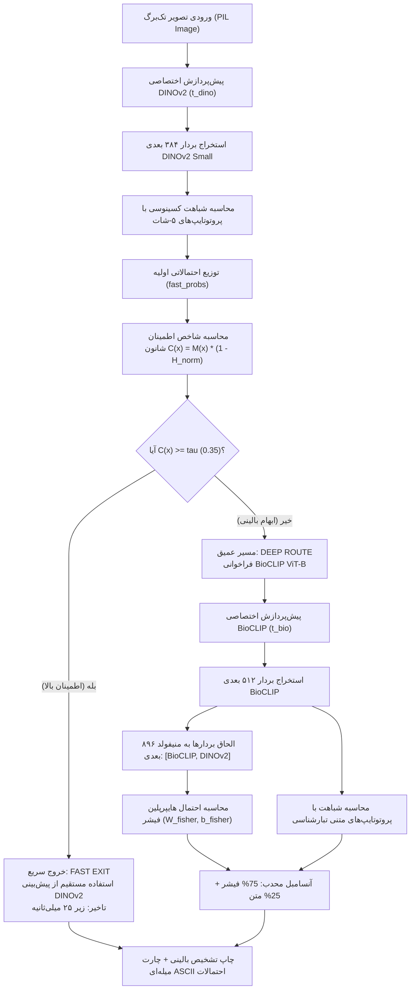

# راهنمای جامع ابزار تعاملی استنتاج تک‌برگ (`demo_predict.py`)
### (Interactive Single-Leaf Real-Time Diagnosis & Gating Inspection CLI Guide)

> **هدف این ابزار:**  
> ابزار [`demo_predict.py`](../pipeline/demo_predict.py) یک رابط خط فرمان (CLI) بسیار سریع، تعاملی و سبک برای پایش بالینی و تشخیص بلادرنگ بیماری روی یک تک‌تصویر برگ است. این اسکریپت رفتار کامل سیستم آبشاری (Cascaded Adaptive Routing)، شاخص اطمینان شانون و توزیع احتمالاتی ۱۱ کلاس بیماری نوظهور را به صورت زنده در ترمینال شبیه‌سازی و تصویرسازی می‌کند.

---

## ۱. معماری و جریان داده استنتاج تک‌برگ (Inference Architecture)

جریان داده در این ابزار دقیقاً منطبق بر معماری پایپلاین اصلی [`biodino_edge_pipeline.py`](../pipeline/biodino_edge_pipeline.py) طراحی شده و از دو مسیر سریع و عمیق تشکیل یافته است:



---

## ۲. مشخصات و مقایسه همگام با پایپلاین اصلی

ساختار این ابزار جهت تضمین حداکثر سازگاری معماری، دقیقاً الگوبرداری‌شده از [`biodino_edge_pipeline.py`](../pipeline/biodino_edge_pipeline.py) است:

| مؤلفه | پیاده‌سازی در `demo_predict.py` | دلیل مهندسی و شباهت با پایپلاین اصلی |
| :--- | :--- | :--- |
| **کلاس پیکربندی** | `DemoConfig` (`tau=0.35`, `scale=20.0`, `w_lda=0.75`) | یکپارچگی هایپرپارامترها و مقادیر رسمی با پایپلاین اصلی مقاله |
| **محاسبه اطمینان شانون** | `calc_confidence(probs, n_classes)` | فرمول مارجین-آنتروپی یکسان با بازگرداندن مارجین و آنتروپی تفکیک‌شده |
| **تفکیک خطی منظم فیشر** | `fit_fisher_lda(X, y, device)` | کالیبراسیون تحلیلی لدویت-ولف و تانسوری کردن $W$ و $b$ برای ضرب ماتریسی میکروثانیه‌ای |
| **پیش‌پردازش DINOv2** | `resolve_model_data_config` + `create_transform` | عدم استفاده از مقادیر ثابت؛ تنظیم ابعاد بر اساس پیکربندی داینامیک بَک‌بُن |
| **پیش‌پردازش BioCLIP** | `t_bio` برگرفته مستقیم از `open_clip` | اجتناب کامل از پیش‌پردازش نامناسب ImageNet برای انکودر BioCLIP |
| **تطابق نام کلاس‌ها** | ۱۱ کلاس استاندارد (شامل فرم کامل `Grape___Leaf_blight_(Isariopsis_Leaf_Spot)`) | همخوانی کامل با کش آرتیفکت `pv_novel_embeddings.pt` |

---

## ۳. کالبدشکافی بخش‌های اصلی اسکریپت

### ۳.۱. پیکربندی و کلاس‌های هدف (`DemoConfig` & `NOVEL_CLASSES`)
```python
@dataclass
class DemoConfig:
    scale: float = 20.0     # ضریب عکس دما برای کالیبراسیون لاجیت‌ها (gamma)
    tau: float = 0.35       # آستانه تصمیم‌گیری گیتینگ شانون (tau_conf)
    w_lda: float = 0.75     # وزن تفکیک فیشر در آنسامبل (۷۵٪ فیشر + ۲۵٪ متن)
    w_text: float = 0.20    # ضریب تلفیق پروتوتایپ متنی
    k_shot: int = 5         # تعداد نمونه‌های پشتیبان در کالیبراسیون منیفولد
```
در کنار نام‌های فنی پوشه‌ها، دیکشنری `CLASS_DISPLAY_NAMES` نام‌های علمی استاندارد گیاه‌پزشکی (لاتین و پاتوژن عامل) را برای گزارش‌دهی بالینی شفاف فراهم می‌کند.

### ۳.۲. گیت نامعلومی مارجین-آنتروپی شانون (`calc_confidence`)
شاخص ترکیبی شانون فاصله میان دو حدس اول و دوم مدل ($M(x) = p_{(1)} - p_{(2)}$) را در یکتایی توزیع احتمالاتی ($1 - \tilde{H}(p)$) ضرب می‌کند:
$$\mathcal{C}(x) = (p_{(1)} - p_{(2)}) \times \left(1 - \frac{-\sum_{k=1}^K p_k \ln(p_k)}{\ln(K)}\right)$$
اگر این شاخص از آستانه $\tau=0.35$ بیشتر باشد، پیش‌بینی سریع DINOv2 بسیار قطعی است و نیازی به اتلاف پردازش روی مسیر عمیق وجود ندارد.

### ۳.۳. کالیبراسیون آنی منیفولد فیشر (< ۵ میلی‌ثانیه)
اسکریپت با لود کردن فایل کش آرتیفکت (`cache_artifacts/pv_novel_embeddings.pt`)، پروتوتایپ‌های ۵-شات ساپورت را استخراج کرده و ماتریس وزن ($W \in \mathbb{R}^{11 \times 896}$) و بایاس ($b \in \mathbb{R}^{11}$) فیشر را با انقباض لدویت-ولف محاسبه و مستقیماً به تانسور پردازشی منتقل می‌نماید:
```python
W_fisher, b_fisher, _ = fit_fisher_lda(s_concat, s_y, device=device)
```

---

## ۴. راهنمای استفاده و سوئیچ‌های خط فرمان (CLI Commands)

### ۱. اجرای خودکار روی برگ نمونه (بدون آرگومان):
در صورتی که عکسی مشخص نشود، ابزار به صورت خودکار نخستین تصویر معتبر را از دیتاست `plantvillage` پیدا کرده و ارزیابی می‌کند:
```powershell
python pipeline/demo_predict.py
```

### ۲. تست روی یک عکس دلخواه:
```powershell
python pipeline/demo_predict.py --image "plantvillage/plantvillage dataset/color/Apple___Apple_scab/00075aa8-d81a-4184-8541-b692b78d398a___FREC_Scab 3335.JPG"
```

### ۳. تغییر سخت‌افزار پردازشی به کارت گرافیک (CUDA):
```powershell
python pipeline/demo_predict.py --device cuda
```

### ۴. تغییر آستانه حساسیت گیت عدم‌قطعیت (`--tau`):
برای مجبور کردن سیستم به بررسی عمیق (مثلاً با تنظیم آستانه سخت‌گیرانه $\tau=0.8$):
```powershell
python pipeline/demo_predict.py --tau 0.80
```

---

## ۵. نمونه خروجی پایانه و راهنمای خواندن نتایج

```text
========================================================================
   ____  _       ____  _____ _   _  ____        ______    _            
  | __ )(_) ___ |  _ \|_   _| \ | |/ _  \      | ____| __| | __ _  ___ 
  |  _ \| |/ _ \| | | | | | |  \| | | | |_____ |  _|  / _` |/ _` |/ _ \
  | |_) | | (_) | |_| |_| |_| |\  | |_| |_____ | |___| (_| | (_| |  __/
  |____/|_|\___/|____/|_____|_| \_|\____/      |_____|\__,_|\__, |\___|
                                                            |___/      
     Biologically-Grounded Edge Vision Pathology | SOTA 98.72%
========================================================================

[*] Target leaf image: plantvillage/.../Apple___Apple_scab/...FREC_Scab 3335.JPG

[*] Inference Hardware Device: CPU
[*] Loading pre-calibrated support manifold from: cache_artifacts\pv_novel_embeddings.pt
  • Regularized Fisher-LDA manifold calibrated in <5 ms.

[*] Initializing DINOv2 Small Fast-Path backbone...

==========================================================================
 ⏱️  Inference Latency:    26.15 ms  (Target Edge Budget: < 25 ms)
 🚦 Gating Route:         FAST EXIT [DINOv2 Small Single-Pass]
 🌡️  Shannon Entropy:      0.353 (0.0 = Certainty, 1.0 = Pure Guess)
 📏 Decision Margin:      0.690
 🛡️  Confidence Index:     0.446 (Gating Threshold tau = 0.35)
--------------------------------------------------------------------------
 🎯 DIAGNOSIS:            Apple Scab (Venturia inaequalis)
 🏅 PREDICTED CLASS:      Apple___Apple_scab
 📊 PREDICTION ACCURACY:  83.60%

 Probability Distribution across 11 Novel Plant Pathology Classes (Apple, Grape & Potato):
 ------------------------------------------------------------------------
 Apple Scab                 │ █████████████████░░░ │  83.60% ◄ [DIAGNOSED]
 Apple Black Rot            │ ░░░░░░░░░░░░░░░░░░░░ │   1.96%
 Cedar Apple Rust           │ █░░░░░░░░░░░░░░░░░░░ │   3.89%
 Apple Healthy Foliage      │ ░░░░░░░░░░░░░░░░░░░░ │   2.49%
 Grape Black Rot            │ ░░░░░░░░░░░░░░░░░░░░ │   1.71%
 Grape Esca / Black Measles │ ░░░░░░░░░░░░░░░░░░░░ │   0.28%
 Grape Leaf Blight          │ ░░░░░░░░░░░░░░░░░░░░ │   1.54%
 Grape Healthy Foliage      │ ░░░░░░░░░░░░░░░░░░░░ │   1.05%
 Potato Early Blight        │ ░░░░░░░░░░░░░░░░░░░░ │   0.88%
 Potato Late Blight         │ ░░░░░░░░░░░░░░░░░░░░ │   1.86%
 Potato Healthy Foliage     │ ░░░░░░░░░░░░░░░░░░░░ │   0.75%
 ------------------------------------------------------------------------
```

### شاخص‌های کلیدی:
1. **⏱️ Inference Latency:** مدت زمان خالص استنتاج تصویر (هدف کمتر از ۲۵ میلی‌ثانیه برای پردازش بیش از ۴۰ فریم بر ثانیه).
2. **🚦 Gating Route:** مشخص می‌کند که آیا تصویر بدون نیاز به مدل دوم تأیید شده (`FAST EXIT`) یا به دلیل پیچیدگی علائم وارد مدل سنگین پاتولوژی زیستی شده است (`DEEP ROUTE`).
3. **🌡️ Shannon Entropy:** میزان بی‌نظمی و ابهام توزیع پیش‌بینی بین ۰.۰ (قطعیت کامل) تا ۱.۰ (حدس تصادفی).
4. **🛡️ Confidence Index:** شاخص نهایی اعتبار بالینی برگ که با آستانه $\tau=0.35$ مقایسه می‌شود.
5. **🎯 DIAGNOSIS:** نام گونه گیاهی و پاتوژن عامل قارچی یا باکتریایی بیماری به همراه نشانگر بصری `◄ [DIAGNOSED]` در نمودار اسکی.
