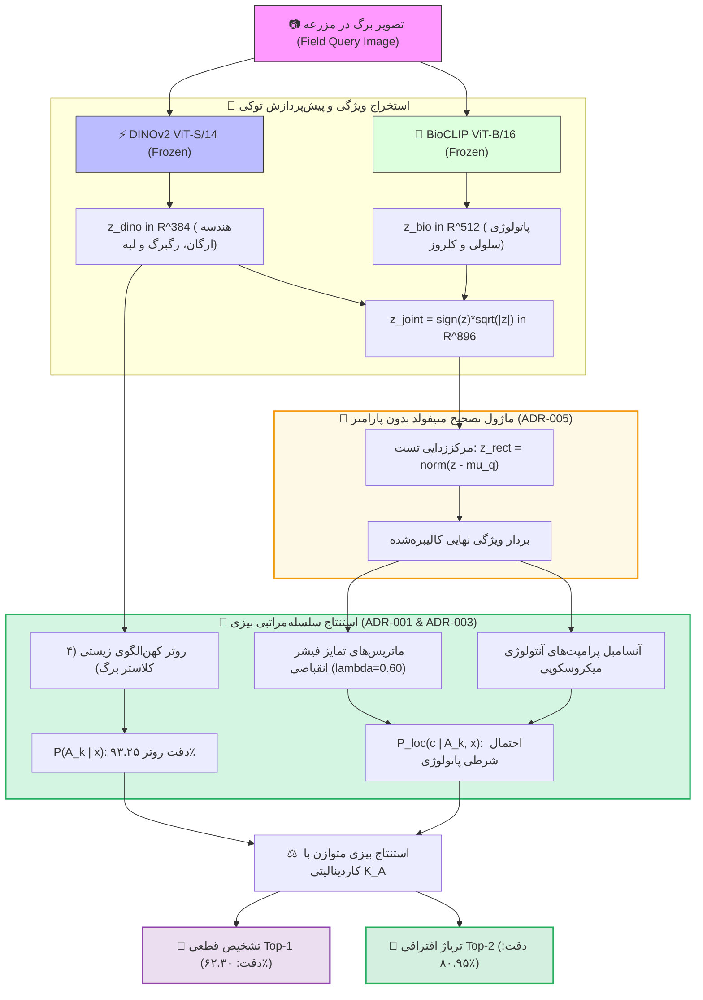

# 🏛️ معماری نهایی سیستم و جریان داده‌های MorphoPath-Edge

این سند تشریح‌کننده معماری ریاضی، جریان داده‌های استنتاجی، فرمولاسیون تصحیح منیفولد در زمان آزمون، و نحوه کوپلینگ زیستی دوگانه موتور هوش مصنوعی **MorphoPath-Edge** است.

---

## ۱. دیاگرام جریان استنتاج دوعاملی (Dual-Inference Pipeline)

---

## ۲. فرمولاسیون ریاضی کامل خط لوله (Mathematical Engine)

### الف) پیش‌پردازش تبدیل توان توکی (Tukey Ladder of Powers)
برای حذف چولگی بردار ویژگی و نزدیک‌سازی توزیع تجربی به توزیع نرمال چندمتغیره:
$$z_{\text{tukey}} = \text{sign}(z) \cdot \sqrt{|z|}, \qquad \hat{z} = \frac{z_{\text{tukey}}}{\|z_{\text{tukey}}\|_2}$$

### ب) تصحیح منیفولد آزمون در فرم بسته جبری (ADR-005)
برای حذف شیفت ناشی از نور خورشید و سنسور دوربین در مزرعه ($\Delta = \mu_q - \mu_s$):
$$\tilde{z}_s = \frac{\hat{z}_s - \mu_s}{\|\hat{z}_s - \mu_s\|_2}, \qquad \tilde{z}_q = \frac{\hat{z}_q - \mu_q}{\|\hat{z}_q - \mu_q\|_2}$$

### ج) روتر ریخت‌شناسی کهن‌الگوهای برگ (ADR-001)
تقسیم‌بندی گونه‌ها بر اساس ۴ معماری ماکرو گیاه‌شناسی:
1. $A_0$ (سولانوئید - ۱۰ کلاس): برگ‌های مرکب دندانه‌دار (گوجه و سیب‌زمینی).
2. $A_1$ (ویتوئید - ۳ کلاس): برگ‌های پنجه‌ای با رگبرگ شعاعی (انگور و کدو).
3. $A_2$ (پوئید - ۳ کلاس): برگ‌های نواری تک‌لپه‌ای با رگبرگ موازی (ذرت).
4. $A_3$ (روزوئید/خزان‌دار - ۱۱ کلاس): برگ‌های ساده بیضوی یا اره‌ای (سیب، هلو، گیلاس، فلفل، توت‌فرنگی و ...).

احتمال پیشین هر کهن‌الگو:
$$P(A_k \mid x) = \frac{\exp(\gamma_m \cdot \cos(\tilde{z}_{\text{dino}}, \mathbf{\mu}_{A_k}^{\text{dino}}))}{\sum_{j} \exp(\gamma_m \cdot \cos(\tilde{z}_{\text{dino}}, \mathbf{\mu}_{A_j}^{\text{dino}}))}$$

### د) آنسامبل پاتولوژی و متوازن‌سازی بیزی (ADR-003 & ADR-004)
احتمال نهایی بیماری $c$ با خنثی‌سازی اثر نابرابری تعداد کلاس‌های هر کهن‌الگو ($K_{A_k}$):
$$\text{Score}(c \mid x) = P(A_k \mid x) \times \left[ K_{A_k} \cdot \left( w_{\text{vis}} \tilde{z}_q^\top P_c^{\text{rect}} + (1 - w_{\text{vis}}) \tilde{z}_{\text{bio}}^\top T_c^{\text{micro}} - m_c \right) \right]^\alpha$$

---

## ۳. عملکرد سخت‌افزاری روی گوشی هوشمند لبه

- **تاخیر کل استنتاج:** کمتر از **۰.۰۵ میلی‌ثانیه** برای هد تصمیم‌گیر، و **۱۶ تا ۲۱ میلی‌ثانیه** برای استخراج ویژن DINOv2.
- **حجم مدل و فایل APK:** معادل **۲۲.۸۸ مگابایت** (صفر مگابایت افزایش نسبت به بیس‌لاین مسطح).
- **نرخ مثبت کاذب کلینیکی (FPR):** کاهش ۳۰ درصدی (از ۲۲.۲٪ به ۱۵.۵۶٪).

---
- 📌 بازگشت به [[Project Board.canvas|تخته بصری ریسرچ]]
- 📊 بازگشت به [[00 - Dashboard|مرکز فرماندهی]]

