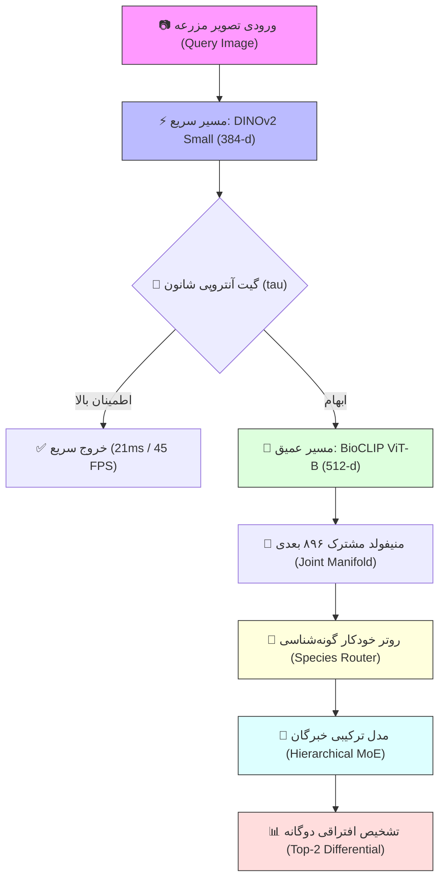

# 🏛️ معماری کلان سیستم (System Architecture Overview)

این سند معماری پایه و جریان داده‌های چندمدلی را برای سیستم تشخیص خودکار گونه و آسیب‌شناسی گیاهی تشریح می‌کند.

---

## 🧩 اجزای اصلی معماری (Key Architectural Components)

---

## 📚 سوابق تصمیمات فنی و معماری (ADRs)
تصمیمات معماری کلیدی مصوب و ردشده در فاز ۲ را در دایرکتوری [[Architecture/ADR/Index|سوابق تصمیم معماری (ADR)]] دنبال کنید.

- 📌 بازگشت به [[Project Board.canvas|تخته بصری ۶ مرحله‌ای ریسرچ]]
- 📊 بازگشت به [[00 - Dashboard|مرکز فرماندهی]]

