# 📜 منشور جامع پژوهش: تشخیص خودکار گونه برگ و ارتقای دقت بیماری‌ها در لبه (Edge)

> **مسئله محوری پژوهش جدید:**
> چگونه می‌توان قابلیت «تشخیص کاملاً خودکار گونه گیاهی» (Automated Host Crop Recognition) را به پایپ‌لاین تشخیص بیماری‌های گیاهی اضافه کرد به نحوی که:
> 1. **دقت طبقه‌بندی بیماری‌ها در مزرعه پر از نویز (PlantDoc) به شکل معنادار جهش کند.**
> 2. **حجم مدل به هیچ عنوان افزایش پیدا نکند (Zero Memory Footprint Growth).**
> 3. **سرعت استنتاج روی پردازنده‌های کم‌مصرف موبایل/پهپاد افت نکند (Zero Latency Degradation / >45 FPS).**

---

## 🎯 اهداف کمی و محدودیت‌های عملیاتی (Key Constraints)

| شاخص ارزیابی (Metric) | مقدار پایه فعلی (Baseline) | هدف پژوهش جدید (Target) | راهبرد کنترل سربار (Zero-Overhead Policy) |
| :--- | :---: | :---: | :---: |
| **دقت استرس‌تست ۲۷ کلاسه PlantDoc** | ۵۳.۱۷٪ (فلت) / ۶۴.۶۸٪ (با ورودی دستی) | **>۶۵٪ خودکار (Top-1) و >۸۵٪ (Top-2)** | استفاده از روتر نرم تطبیقی و بیزی بدون افزودن بک‌بون جدید |
| **حجم بسته نصبی لبه (APK Footprint)** | ۲۲.۷۳ مگابایت (INT8 Standalone) | **کمتر از ۲۳.۰ مگابایت (ثابت)** | بهره‌گیری اشتراکی از فضاهای نهفته موجود بدون مدل جدید |
| **تاخیر زمانی پردازش (Edge CPU Latency)** | ۲۱.۱ میلی‌ثانیه (>۴۵ FPS) | **کمتر از ۲۲.۰ میلی‌ثانیه (تغییر نامحسوس)** | روتینگ خطی ماتریسی فیشر با هزینه محاسباتی در حد چند میکروثانیه |
| **نرخ فرار بیماری از چشم سیستم (FNR)** | ۰.۶۰٪ تا ۱.۲۳٪ | **کمتر از ۱.۰۰٪** | تنظیم بایاس ایمنی بالینی برای بیماری‌های با شدت بالا |

---

## 🔄 ساختار چرخه ۶ مرحله‌ای پژوهش (The 6-Stage Research Lifecycle)

```mermaid
flowchart LR
    P1["💡 فاز ۱: فرضیات و ایده‌ها"] --> P2["🧪 فاز ۲: ترکیب و تصمیمات ADR"]
    P2 --> P3["⚡ فاز ۳: پیاده‌سازی و بنچمارک"]
    P3 --> P4["📝 فاز ۴: نگارش علمی مقاله"]
    P4 --> P5["✍️ فاز ۵: پیرایش انسانی و تصاویر"]
    P5 --> P6["🔍 فاز ۶: ممیزی داوری و آینده"]
    
    style P1 fill:#f9f,stroke:#333,stroke-width:1px
    style P2 fill:#bbf,stroke:#333,stroke-width:1px
    style P3 fill:#dfd,stroke:#333,stroke-width:1px
    style P4 fill:#fdd,stroke:#333,stroke-width:1px
    style P5 fill:#ffd,stroke:#333,stroke-width:1px
    style P6 fill:#dff,stroke:#333,stroke-width:1px
```

### ۱. فاز ۱: فرضیات و ایده‌های اولیه (Exploratory Ideation)
- تولید و ثبت فرضیه‌های نوآورانه پیرامون روترهای گیاه‌شناسی بدون پارامتر، تنظیم پرامپت‌های تبارشناسی در فضای BioCLIP، و استخراج توامان ویژگی‌های کلان/خرد برگ.
- دایرکتوری: [[Ideation/Index|مخزن ایده‌ها (Ideation)]]

### ۲. فاز ۲: ترکیب ایده‌ها، ارزیابی سریع و ثبت ADR (Synthesis & Architecture Decisions)
- غربالگری ایده‌ها با آزمون‌های سبک تجربی، تحلیل چرایی شکست ساختارهای صلب در برابر نرم، و انتشار شناسنامه تصمیم معماری (ADR) به عنوان سند مرجع.
- دایرکتوری: [[Architecture/ADR/Index|سوابق تصمیم معماری (ADR)]]

### ۳. فاز ۳: کدنویسی ماژولار و ارزیابی تجربی دقیق (AI Implementation & Verification)
- پیاده‌سازی الگوریتم نهایی، سنجش آماری در ۳۰ اپیزود مونت‌کارلو، ارزیابی ماتریس درهم‌ریختگی، و مانیتورینگ منابع سخت‌افزاری (RAM و زمان CPU).
- دایرکتوری: [[Tasks/Index|تسک‌های اجرایی]] و [[Logs/Index|لاگ نتایج بنچمارک]]

### ۴. فاز ۴: نگارش علمی پیش‌نویس مقاله (Scientific Drafting)
- مستندسازی فرمولاسیون ریاضیاتی، اثبات‌های همگرایی، نتایج تجربی، و نگارش ساختاریافته بخش‌های مقاله مطابق استانداردهای ژورنال‌های معتبر (مانند Elsevier Computers and Electronics in Agriculture).
- دایرکتوری: [[Drafts/Index|پیش‌نویس بخش‌های مقاله]]

### ۵. فاز ۵: انسانی‌نویسی، ویرایش ضد-AI و غنی‌سازی بصری (Humanizing & Visual Polish)
- پیرایش زبان آکادمیک، پرهیز از تکرارهای ماشینی، موجزسازی جملات برای حداکثر تراکم اطلاعاتی، و تصویرسازی جداول و دیاگرام‌های برداری باکیفیت.
- دایرکتوری: [[Reviews/Index|چک‌لیست‌ها و ویراستاری]]

### ۶. فاز ۶: ممیزی منتقدانه و افق‌های آینده (Peer-Review Audit & Future Horizons)
- شبیه‌سازی سخت‌گیرانه‌ترین انتقادات داوران ارشد، تبیین محدودیت‌های صادقانه، و استخراج ایده‌های کاربردی و نقشه راه برای ادامه مسیر توسط کاربر.
- دایرکتوری: [[Reviews/Index|اسناد ممیزی داوری]]

---

- 📌 ورود به تخته بصری: [[Project Board.canvas]]
- 📊 بازگشت به مرکز فرماندهی: [[00 - Dashboard]]

